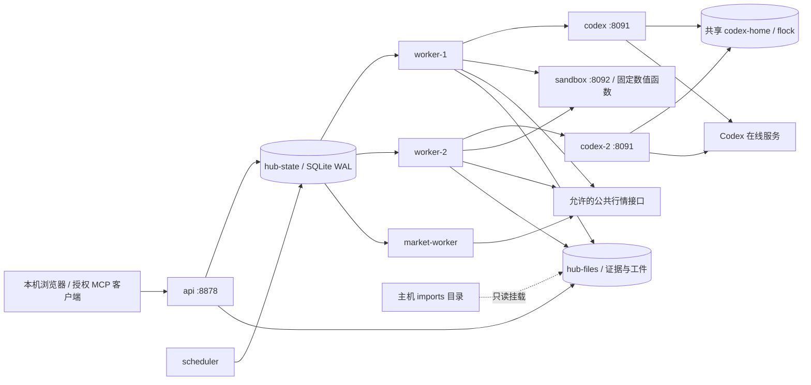

# QT ResearchOps Agent：架构、调研证据与运行边界

本文保留初版实现与调研记录；当前部署和新增能力以 [Agent Hub v2](agent-hub-v2.md) 为准。

调研核验截至 **2026-10-21**。实现依据为本仓库 `src/qt/agent_hub/`、`config/agent-hub.yaml`、`docker-compose.agent-hub.yml` 及部署脚本。本文把已实现能力、厂商披露和后续设计分开；未标发布日期的滚动文档只记录核验日期，不当作 2026 年 9 月新发布的功能。

实现入口：[运行时](../src/qt/agent_hub/runtime.py)、[任务账本](../src/qt/agent_hub/store.py)、[Codex 边界](../src/qt/agent_hub/codex.py)、[公共来源采集](../src/qt/agent_hub/sources.py)、[上下文与记忆](../src/qt/agent_hub/context.py)、[执行与对账](../src/qt/agent_hub/trading.py)、[角色配置](../config/agent-hub.yaml)、[Compose](../docker-compose.agent-hub.yml)。

## 1. 产品选择：把已有量化研究做成可审计的工作系统

项目定位是个人金融研究与执行工作台：围绕 BTC 与明确的二元预测合约，形成“证据导入 → 研究 → 反证分析 → 确定性实验 → 有时限的预测 → 风险复核 → 有界执行 → 日志复盘”的闭环。它延续 QT 已有 BTC 信号、回测、交易账本和行情能力，比另起一个通用聊天助手更容易形成可解释的技术深度。

面试展示重点是系统如何处理证据不足、模型失败、过期任务、重复请求、执行结果不确定和恢复。模型写出的分析、历史收益与自报 confidence 都不能证明策略具有收益优势。个人版默认 `paper`，真实交易适配器的代码存在、账户配置就绪、真实成交对账成功，是三个不同状态。

当前 `research` 角色分析运行时提供的行情、导入资料、历史步骤，以及固定 Fed/CoinDesk RSS 采集器提供的标题、链接、发布日期和来源。采集器在模型进程外运行；Codex 自身没有浏览工具，也没有读取文章正文。初始化生成的 `research-policy.md` 是研究规则；不能把规则文件或 RSS 标题当成完整新闻核验。采集边界和后续路线见第 12 节。

## 2. 截止日期内可借鉴的企业实践

下列为真实企业或其供应商的一手披露，均不是独立复现的性能基准。

| 企业、发布日期 | 实际输入与闭环 | 对 QT 的启示与证据边界 |
| --- | --- | --- |
| Abnormal AI，2026-09-14 | 邮件先经规则与 ML；困难样本交 Agent，在无出网计算环境运行脚本分析；误分类进入独立反馈流程 | Agent 层约数万次/日，不能把第一层数十亿邮件/日写成全量 Agent 调用。采用分层路由、程序验收、长任务文件检查点。[AWS 与客户共著](https://aws.amazon.com/blogs/machine-learning/abnormal-ai-amazon-bedrock-agentcore-for-agentic-email-security-at-scale/) |
| MRH Trowe，2026-09-17 | 员工查询 Teams 会议，服务端传递员工身份，读取本人日历与转录，生成结构化会议纪要 | 首月生产约 400 员工；关键是身份不由提示词设定、数据地域与按用户成本可见。没有披露摘要准确率，不能由用户量推导质量保证。[AWS 客户案例](https://aws.amazon.com/blogs/machine-learning/how-mrh-trowe-enabled-secure-self-service-ai-agents-in-financial-services/) |
| Heurist Finance，2026-09-09 | 结合用户持仓、外部金融数据、跨会话偏好，在隔离计算环境进行分析和作图；身份与 trace 贯穿请求 | 与本产品最接近。应学习数据、计算、身份与审计的组合；其平台工程量节省属于客户估计，不能证明投资有效性。[AWS 客户案例](https://aws.amazon.com/blogs/machine-learning/how-heurist-finance-built-an-ai-native-investment-workbench-on-amazon-bedrock-agentcore/) |
| Anthropic，2026-10-13，更新 10-15 | 工程 Agent 增长推动版本管理、CI、代码审查与基础设施重构，文章介绍 Scion | 经验是提升 Agent 产出后，验证与基础设施可能成为瓶颈；其内部规模与自报改善不能外推为个人项目选型理由。[官方工程文章](https://www.anthropic.com/engineering/redesigning-source-control) |
| AvioBook，2026-09-10 | 按管理者、调度员角色查询航空运行数据，经 MCP 工具获取事件，与延误代码对照并交人员判断 | 该多 Agent 架构明确是 POC。既有 Connect 的业务改善与新 Agent 的假设收益应分开，不能写成新 Agent 生产 ROI。[AWS 与客户共著](https://aws.amazon.com/blogs/machine-learning/how-aviobook-uses-generative-ai-to-drive-airline-turnaround-insights/) |

2026 年 9 月的新工程材料还给出三个可操作方向：记忆按生命周期管理；评测进入 CI；生产轨迹推动下一轮改进。AWS 的 [2026-09-04 记忆生命周期示例](https://aws.amazon.com/blogs/machine-learning/designing-lifecycle-policies-for-agentcore-memory/) 展示过期、评分和合并；[2026-09-08 CI 示例](https://aws.amazon.com/blogs/machine-learning/automated-agent-evaluation-with-amazon-bedrock-agentcore-and-github-actions/) 展示回归门禁；[2026-09-16 优化工程文章](https://aws.amazon.com/blogs/machine-learning/optimizing-agent-system-prompts-with-amazon-bedrock-agentcore/) 展示 trace → 修改建议 → 离线评测 → A/B。它们支持后续路线，不代表 QT 已实现这些托管平台功能。

Microsoft [2026-10-15 发布的 9 月更新](https://devblogs.microsoft.com/foundry/whats-new-in-microsoft-foundry-september-2026/) 将 Tool Search、A2A、Routines 标为 GA，将 Insights、长任务恢复标为预览；同时强调恢复连接仍需要应用自己处理幂等。QT 选择先把任务账本、执行对账和失败可见性落地，再考虑更复杂的自治协作。

## 3. 实际服务拓扑



| Compose 服务 | 职责、存储与网络 |
| --- | --- |
| `api` | 本机 UI、owner token 鉴权 API、查询、任务入队与有限 MCP 面；只把 8878 绑定到 `127.0.0.1`；挂载只读交易 secret |
| `scheduler` | 从 YAML 安装计划，每 2 秒检查到期桶并持久入队；只接内部 `control` 网络 |
| `worker-1`、`worker-2` | 只认领 `pipeline,research,analysis,backtest,forecast,risk_review,log_review`，续租、调用各自 Codex HTTP 入口与 sandbox，产出工件；可访问公共行情，不挂交易 secret |
| `market-worker` | 只认领 `monitor,execute,import_context`，挂载只读交易 secret；与研究任务按 kind 分工，共享同一账本 |
| `codex`、`codex-2` | 两个 CLI HTTP 执行进程，分别接收 worker 请求；共享一个 OAuth home，通过跨进程锁串行化同一账户的调用与刷新 |
| `sandbox` | 独立数值回测服务，只接内部网络，不挂状态、证据、OAuth 或交易凭据卷 |
| `initialize`（一次性） | 在业务进程启动前，仅准备 state/files 的指定目录并设置 UID 10001；不挂主机 imports、OAuth 或交易 secret，无网络 |

当前 Compose 已按 kind 分开研究与市场 worker；这不是独立消息队列，也没有实现严格优先级、资源公平性或租户配额。两个 Codex 容器共享一个账户时不是并行模型吞吐的承诺；忙碌返回 HTTP 429，任务延迟再领取，不消耗业务失败次数。未来使用独立授权账户和独立 home 后，才可分别验证并行吞吐与账户隔离。运行栈为八个常驻服务加一个一次性初始化服务；`test` 是额外的离线测试 profile。

常驻容器为非 root UID 10001、根文件系统只读、丢弃 Linux capabilities、禁止提权，具备有界 `/tmp`、CPU、内存、PID、日志和停止宽限。一次性 `initialize` 例外使用 root 与有限 chown 所需能力，只操作挂载的项目 named volumes。测试 profile 的 `/tmp` 允许执行子进程 fixture，生产 `/tmp` 不因测试放宽。sandbox 的限制为 256 MiB、0.5 CPU、32 PID；这是 Docker 进程隔离与固定函数的组合，**没有实现任意代码执行、microVM、动态依赖安装或每任务容器**。

Dockerfile 固定 Codex CLI `0.162.1`，Python 镜像使用 digest，并从带 hash 的专用依赖锁安装。不同运行栈的依赖独立，不应为了 Polymarket SDK 的 WebSocket 约束修改现有 BTC 服务运行环境。

## 4. 六个模型角色与确定性执行器

主链为：

```text
pipeline → research → analysis → backtest → forecast → risk_review → execute → log_review
```

`execute` 是程序执行器，其余六个节点是 Codex 角色。`pipeline` 本身只创建首个持久步骤。角色是独立提示与调用，不是六套独立模型训练结果；相同模型可能有相关错误。

| 角色 | 提供给模型的主要材料 | 运行权限 |
| --- | --- | --- |
| `research` | 检索证据、当前行情、固定 RSS 标题与出处、研究问题 | 整理观察、假设和缺口，不声称读过新闻正文 |
| `analysis` | 上一步、已完成日线与检索证据 | 反证、数据质量和实验建议 |
| `backtest` | 独立 sandbox 结果、基线、费用和限制 | 复核实验；模型不自行执行 Python |
| `forecast` | 当前市场快照、历史、前序结果、指定合约 | 输出方向、概率、期限及证据引用 |
| `risk_review` | 预测和前序证据、服务端政策、新行情 | `propose/hold/reject`，不能改风险限额 |
| `log_review` | 最近事件、模型上下文与工件引用 | 提出可验证修改建议，不能自动修改代码或配置 |

`config/agent-hub.yaml` 为每个角色提供 `model` 和 `instruction`。`model: null` 使用当前 Codex 账户默认模型；日志中的请求模型名不能当成已核验的服务端 resolved model snapshot。改 YAML 后应重启对应进程；scheduler 启动时安装计划。当前配置计划包括 30 秒行情、每日主链、每小时 forecast、每日日志复盘和每 300 秒挂载导入；实际启用值以 YAML 为准。

统一输出字段为：

```json
{
  "summary": "基于已提供证据的结论",
  "confidence": 0.6,
  "decision": "hold",
  "evidence": ["已提供的引用 ID"],
  "actions": [],
  "probability": null,
  "side": "HOLD",
  "horizon_seconds": null
}
```

`actions` 是字符串建议，不作为命令解释执行。API 的普通任务提交与 MCP `submit_research` 默认不自动执行；主链同时满足服务器 `auto_execute` 与任务开关才进入执行步骤。当前默认 YAML 开启的是 **paper 自动执行**，不能把它解读为实盘已启用。

## 5. Codex CLI、OAuth 与凭据边界

官方滚动文档于 **2026-10-21** 实际核验：[非交互模式](https://learn.chatgpt.com/docs/non-interactive-mode)、[认证](https://learn.chatgpt.com/docs/auth)、[可信自动化中维护账户认证](https://learn.chatgpt.com/docs/auth/ci-cd-auth)。官方将 API key 作为大多数自动化的默认建议，同时描述可信私有 runner 使用 Codex 账户缓存的高级流程。本项目按当前选择使用本地登录的 OAuth 缓存，不接入模型 API key。

鉴权 token 按用途分离：`QT_AGENT_HUB_SERVICE_TOKEN` 是本地 owner 的 UI/API/MCP 权限，只传给 `api`；`QT_AGENT_HUB_EXECUTOR_TOKEN` 保护内部 Codex/sandbox HTTP 调用，供调度与执行栈使用。内部 executor token 不能替代 owner token 调用管理 API。两者不是用户身份系统或每租户令牌，不应互相复用。

交易凭据采用服务器指定的 **0600 JSON 文件**，默认初始化为空对象；仅 `api` 与 `market-worker` 只读挂载，并由 `QT_AGENT_HUB_TRADING_SECRETS_FILE` 指向该文件。研究 worker、Codex 和 sandbox 不挂载它。实际读取还要求容器 UID 有权限；路径存在不能代替权限或账户就绪。默认 `paper` 不因文件存在而激活实盘，当前未配置真实交易凭据，也未进行真实下单。

只把单个 `auth.json` 来源文件通过 Compose secret 提供给 Codex 服务。启动调用 `seed_oauth(home, source)`：缺失时在锁内原子复制到私有持久 home；已有缓存不覆盖，让 CLI 自身刷新后保留新值。**不挂载整个主机 `~/.codex`，不复制个人会话、插件、配置或浏览器资料，不自行调用 OAuth 刷新端点。**

`home/.qt-invoke.lock` 使用非阻塞 `fcntl.flock`，覆盖 seed 和完整 CLI 调用，防止两个容器同时刷新同一份凭据。home 为 0700，认证文件与锁为 0600。此锁只协调本机共享卷；若主机上另一个 Codex 客户端或另一台机器同时使用同一登录产生的刷新凭据，仍可能发生轮换冲突。失效后应在可信环境重新登录并有序重新播种，不能反复用旧 secret 覆盖新缓存。

每次调用使用空临时工作目录、stdin 文件流与参数数组，不经 shell；忽略用户配置及 execpolicy 规则，关闭 shell、web、apps、plugins、hooks、多 Agent、浏览器等工具入口。OAuth home 只供认证与 CLI 自身状态使用，交易凭据不进入模型容器。输入和最终输出分别有 64 KiB 上限；超时或超量终止进程组；无输出、非零退出、非 JSON 或不符合 schema 均不能伪装成功。健康检查只证实 CLI 版本与本地 OAuth 配置存在，不证明在线认证或模型调用成功。

CLI JSONL 只进入本次调用的私有临时文件，受 1 MiB 监督上限保护；provider 仅提取 `turn.completed` 中允许的 token 计数及本次耗时，调用后删除临时目录。原始 reasoning、工具事件和模型进度文本不进入业务事件日志。计数缺失保持缺失，不伪造为零；token 计数也不等于实际账户账单。

“本地 Codex provider”指 CLI 在本地/容器执行；**模型推理仍依赖 Codex 在线服务，不是本地离线模型**。账户配额、网络、服务地区、模型可用性与 OAuth 失效仍是依赖。

## 6. 持久队列、一致性和恢复

`hub.sqlite3` 使用 SQLite WAL 和写事务。任务状态为 `queued/running/succeeded/deadletter`；认领增加 `attempts` 和单调 `lease_token`，持久化 worker、租约和截止时间。worker 每约三分之一租期续租，完成或失败更新同时检查 tenant、job、worker、token 与租约有效性，旧 worker 的迟到结果不能提交为当前成功。

执行路径还把 lease guard 传到交易服务与受保护的适配器，在发送前检查有效租约；这减少旧 worker 在接管后发送的窗口。它不消除远端已接收、进程却未收到确认的情况，仍必须走意图幂等与 UNKNOWN 对账。

完成结果与创建后续步骤通过 `complete_and_enqueue` 同一事务完成。业务幂等键在 tenant 内唯一：相同键与相同提交复用任务，冲突参数不能悄悄复用。定时任务按计划、周期和当前时间桶生成键，停机后合并为当前桶的一次任务，不补发无限历史积压。失败按有界次数重试，耗尽进入 deadletter；人工 retry 保留既有事件与 fencing 历史。

执行器忙属于容量背压：HTTP 429 经 `defer` 延迟重新排队，只有仍持有有效 fencing token 的 worker 能撤回本次 claim 的 attempt 增量。模型调用的真正失败与租约过期仍按失败策略处理，不能把无限重试隐藏成服务健康。

工件文件名包含 job ID 和 lease token，避免旧尝试覆盖接管尝试。事件表追加记录状态、耗时与错误类型；数据库管理员仍可更改文件，因此它不是密码学不可篡改审计。持久任务可能执行不止一次，fencing 保护的是账本状态，**不能自动保证外部副作用 exactly-once**。交易模块另行使用持久意图、幂等标识与对账。

## 7. 知识、记忆、上下文与 MCP

| 能力 | 已实现方式 | 真实限制 |
| --- | --- | --- |
| 知识检索 | `context.sqlite3` 保存原文、source、有效期、SHA-256；FTS5/BM25 与中文词组/双字子串候选，按命中位置返回有界片段 | 属于词法检索；没有 embedding、向量检索、reranker、GraphRAG 或独立搜索集群 |
| 时间过滤 | `valid_from <= as_of < valid_until`；服务端默认当前时间；引用完整原文路径 | 导入者填写的有效时间未做外部来源认证；主链不是按历史时点重跑全部数据的研究平台 |
| 挂载导入 | `<files_root>/<tenant>/imports`；扫描首层 `.md/.txt/.csv`，大小/数量限制，按文件内容 hash 跳过未变文件 | 不能导入任意绝对路径、`..` 或 symlink；无 PDF/OCR、递归抓取和网页采集；变更导入不会自动给旧版本补结束时间 |
| 记忆 | tenant/key 隔离、scope、JSON 值、可选 TTL、查询与 forget；成功角色结果可形成短期派生记忆 | 无自动事实核验、冲突合并、分层遗忘优化；覆盖同 key 后不能恢复完整历史版本；过期过滤不等于物理清除所有备份 |
| 上下文 | `assemble` 有字符预算，保留引用和截断标记；运行时对前序结果等整体上下文做限额、压缩与工件外置 | 模型工具关闭，外置路径本身不代表模型可以自动打开全文；尚无按 token 的模型专属预算器 |
| 技能 | 六个角色的 YAML 指令与固定 domain tools；均为服务器代码/配置拥有 | 没有实现通用 `SKILL.md` 执行器、技能注册中心、技能自动安装或自动发布 |
| MCP | `/mcp` 提供最小无状态 HTTP JSON-RPC 面：initialize、ping、tools/list、tools/call；三工具为证据搜索、状态、研究入队 | Bearer 保护、固定服务器 tenant；不是完整企业 MCP gateway，也没有 OAuth discovery、SSE、资源订阅、第三方工具动态执行和 A2A |

模型输出的 `evidence` 非空，只是当前门禁的一部分；它没有替代逐引用的来源蕴含验证。`confidence` 是模型自报值，尚未用 Brier score、可靠性曲线或独立标签校准。两个角色都同意，也不消除共同幻觉。

## 8. 实验与执行：BTC 与预测市场不能混为一谈

### 固定数值实验

`SandboxRunner` 通过受 Bearer 保护的 `POST /run` 调用独立 sandbox，不在 API 主机解释任意代码。请求只允许预定义 backtest 参数；数值、条数、warmup、请求与响应体积均有边界。返回输入 hash、指标、equity curve 与 fills；客户端核对规范化输入 hash，异常不能被标成实验完成。

目前主链默认运行 `moving_average`：前一价格形成决策，下一价格成交，包含显式手续费、滑点、持有基线与回撤。主链在调用前保存独立的 attempt 输入工件，包含完整 backtest 请求、历史 bars、来源、抓取时间与已收盘标记，并在实验结果中引用工件路径及 SHA-256。服务另有复用 QT 现有日线引擎的 `btc_capitulation` 固定分支，但默认链没有自动选择它。实验不模拟完整订单簿、排队、链上结算或真实账户，不证明预测校准与实盘盈利；重放还需保留对应引擎、依赖、配置及数据版本。

### BTC 现货执行

服务端持有类型化 intent、限价、数量、行情时间与幂等键。模型不能设置账户、端点、杠杆或限额。执行检查当前报价、价差、价格偏离、费用储备、单笔/日累计/持仓预算、现金和持有数量；SELL 不能凭空做空。监控分支具有基于持仓成本的保护性卖出尝试，但它仍依赖进程、行情、流动性、风险门禁和账户状态，不能当作交易所托管止损。

默认周期监控为 BTCUSDT，并不自动遍历全部 Polymarket 合约。组合账本按 venue 保留不同计价货币与历史成本，不能把它当作完整实时净值、风险因子或跨币种估值系统。paper 的 BTC 费用为 10 bps，Polymarket 采用显式近似公式；不是对具体市场实时费率、成交质量和结算结果的承诺。

代码分别保留 Binance Spot Testnet 和独立的生产 Spot adapter。生产适配器限定 BTCUSDT、固定域名、LIMIT IOC 和允许的 REST 路径，读取交易规则并量化数量/价格，使用服务器时间、HMAC、订单查询与成交费用核对。是否真正绑定由服务器启动配置决定，默认 Compose 不提供交易密钥。

Binance 官方说明 `-1007` 和 HTTP 5xx 可能是 **结果未知**；应查询 User Data Stream/订单状态，而不是当作确定失败重发。订单查询可使用 `origClientOrderId`，成交与佣金需要另行确认。[REST 语义，核验 2026-10-21](https://developers.binance.com/en/docs/products/spot/rest-api)、[订单及成交接口，同日核验](https://developers.binance.com/en/docs/catalog/core-trading-spot-trading/api/rest-api/trade)。

本地先提交意图和预算，再进行唯一发送；超时保存 `UNKNOWN`。重启与 reconcile 查询同一标识，不能自动再创建订单。只有终态数量、成交金额与费用可核对时才一次性计入账本；第三资产佣金、成交分页不完整、账户人工活动或其他漂移可能继续冻结等待人工调查。Kill 开关阻止新的提交，包括保护性卖出，不代表自动平仓。

当前适配器走 REST 查询，未实现 Binance User Data Stream 订阅。BNB 等第三资产佣金暂不记账，检测后保持 UNKNOWN；专属账户的第三资产手续费折扣应在真实验收前处理。生产签名协议和 fixture 测试不等于已完成 authenticated 查询或小额真实成交验收。

### Polymarket 合约语义与 SDK 核验

截至 **2026-10-21** 核验，官方 Python 指南推荐 unified `polymarket-client`；PyPI 的 **0.13.0 发布于 2026-10-09**，要求 Python ≥3.11，项目状态标为 Beta。代码/专用镜像固定该版本，不把它称为永久最新版本。[官方 Python 指南](https://docs.polymarket.com/getting-started/python)、[PyPI 发布信息](https://pypi.org/project/polymarket-client/)、[官方仓库](https://github.com/Polymarket/py-sdk)。

官方迁移文档说明 CLOB V2 已于 **2026-04-28** 上线，涉及 V2 签名域和 pUSD；这一日期早于本次新资料窗口，不能包装成 9 月新发布。[V2 迁移文档，核验 2026-10-21](https://docs.polymarket.com/v2-migration)。

公开发现使用 Gamma/CLOB，执行必须使用明确 outcome token，并核对父市场、condition、结果映射、是否开放和订单簿。二元合约概率是指定结果的概率，不能用“BTC 看涨”直接代替合约结算条件。自动链需要明确结果 token、概率、优势阈值、预测期限、风险复核和新报价；没有足够定义时应 HOLD。

适配器把签名与 POST 分开，使用 FAK，返回接收结果后先保持结算待确认；通过订单 ID、关联成交及账户余额变化进行核对。POST 响应丢失且没有订单 ID 时维持 UNKNOWN，不伪称能够从本地幂等键恢复所有链上结果。[下单](https://docs.polymarket.com/trading/place-orders)、[订单管理](https://docs.polymarket.com/trading/manage-orders)，均核验于 2026-10-21。

**SG 在当前官方列表是前端与 API close-only 地区。** 服务器出口地域不能代替用户资格，也不应通过换云区、代理或 VPN 绕过。当前适配器对受限及 close-only 用户保守阻断交易；它尚未实现已有真实持仓的 close-only 专用退出迁移。[官方地域限制，核验 2026-10-21](https://docs.polymarket.com/api-reference/geoblock)。纸面模拟和公共数据读取不等于用户可以真实开仓。

代码还要求 geoblock 返回的服务器 country 与服务器配置的用户 country 一致；配置中的 country 不是已验证的法律身份或实际居住证明。上线前必须重新检查当日规则，不能把这份静态名单当成永久资格判断。

## 9. 完整能力矩阵：当前可展示与尚欠缺

| 面向企业的能力 | 个人版当前状态 | 升级前仍需完成 |
| --- | --- | --- |
| 工作流 | 固定顺序主链、持久步骤、分离角色、程序执行器 | 条件分支版本化、可中断长任务、人工审批状态机、补偿流程 |
| 调度/队列 | 多 worker、租约续期、fencing、幂等入队、死信、定时去重 | 严格优先级、租户公平性、模型速率配额、分布式队列压测 |
| 一致性 | 原子完成与后续入队、交易意图与对账、未知结果不重发 | 跨服务事务设计、事件投递 outbox、灾备恢复后与外部系统重新核对 |
| 研究/知识 | 行情、挂载证据、固定 Fed/CoinDesk RSS 标题采集与缓存去重、元数据有效期、词法检索、导入原文引用 | 正文采集/核验、授权数据接入、来源原始响应与修订链、检索基准 |
| 记忆 | short/long 与 TTL、tenant/key、forget、派生短记忆 | 冲突检测、来源信任、版本历史、物理删除与备份保留策略 |
| 执行环境 | 独立 fixed-function Docker sandbox、输入白名单与资源约束 | 若允许任意代码，需重新设计微虚机/容器生命周期、依赖、网络与文件授权 |
| MCP/技能 | 有限 MCP 入站工具、服务器角色配置 | 标准兼容性测试、OAuth、工具注册/版本/权限、真正的技能包评测 |
| 监控/日志 | 任务事件、耗时、CLI 可用 token 计数、worker 心跳、受保护 `/metrics` 队列 gauge、日志复盘角色 | OpenTelemetry 跨服务 trace、告警接收端、p95/p99、账户费用核对、采样与脱敏策略 |
| 评测/回放 | 单元和协议 fixture、schema/故障/隔离/账本验证、数值回测 | 冻结 golden dataset、按模型/提示/数据版本回归、judge 校准、shadow/A/B、生产轨迹重放 |
| 安全/身份 | owner/executor 双 token、固定服务器 tenant、隔离 OAuth、交易 secret 限定挂载、只读导入、路径防护 | OIDC 用户、RBAC/ABAC、每租户凭据与配额、密钥托管、审计权限分离 |
| 部署 | 个人单宿主机 Compose、独立服务生命周期与持久卷 | 云端 IaC、TLS 入口、备份任务、恢复演练、明确 RTO/RPO；不能称已部署阿里云/腾讯云 |
| 交易 | paper 账本与配置门禁、真实协议适配器代码、对账及 kill | 分 venue 实际账户验收、合规资格、凭据授权、故障恢复与持续运行证明 |

`log_review` 输出修改建议，并不构成自我优化闭环；没有自动评估并推广 prompt/skill/code。`/metrics` 可被抓取，不代表项目已经部署 Prometheus/Grafana 或外部报警。健康绿色也不代表 Agent 正确完成用户目标。

## 10. 个人部署与运维

在仓库根目录使用项目入口；本机脚本强制 `docker --context orbstack`，不改变全局 context，不操作既有 workbench 项目：

```bash
./deploy/orbstack.sh hub-init
./deploy/orbstack.sh hub-up
./deploy/orbstack.sh hub-status
./deploy/orbstack.sh hub-test
./deploy/orbstack.sh hub-check
./deploy/orbstack.sh hub-exec api python --version
./deploy/orbstack.sh hub-logs worker-1
./deploy/orbstack.sh hub-restart worker-1
./deploy/orbstack.sh hub-down
```

`hub-init` 生成本地私有 `.env.agent-hub`，保存端口、独立 owner/executor token、imports、单文件 OAuth 来源及交易 JSON 路径；权限为 0600，已有设置保留，缺失的新设置会补齐。不要提交、打印或把其中值复制到问题单和研究工件。入口会检查私有配置、当前 Docker engine 与 Compose 配置；`hub-test` 使用无网络的一次性测试容器，`hub-check` 执行真实 OAuth/行情/paper 验证，其真实结果应留在验收记录，不以“容器启动”代替完整通过。

verifier 保存 `/state/verification-report.json`。需要读取每项 `checks`：部分 Polymarket 公共接口失败会被记录为 `passed:false`，不能仅凭脚本退出码就说所有能力通过。真实主链还要单独检查父子 job、接受的租约、工件和最终 HOLD/拒绝/成交状态。

`hub-up` 会启用 YAML 中已启用的调度；如果要先检查静态配置，应先关闭对应计划或 `auto_execute`，而不是启动后假设它没有运行。`hub-down` 默认保留 named volumes，不使用删除卷参数。模型服务健康检查不发付费模型请求；实际 OAuth/模型 smoke 需另行核验。

imports 主机目录挂到 `/files/personal/imports:ro`。若更改 `tenant_id`，必须同时修改 Compose 的挂载路径，不能只改 YAML。机密交易设置不应放进 imports，因为那里是模型可被提供的研究资料。

一次性 `initialize` 负责让命名卷中的 `/files/<tenant>`、documents 与 artifacts 等指定目录归 UID 10001；它不挂载、不 chown 主机只读 imports 或凭据。卷恢复或换 tenant 后仍应检查写权限，避免健康检查可通过、实际步骤却因工件落盘失败而重试。

持久数据分为：

| 位置 | 内容 | 备份要求 |
| --- | --- | --- |
| `hub-state:/state` | `hub.sqlite3`、`context.sqlite3`、`trading.sqlite3`、心跳和导入 hash 标记 | 作为同一停止写入时点的一组数据备份，不能单独丢弃未决订单或任务意图 |
| `hub-files:/files` | tenant 下原始证据、步骤工件、外置上下文；imports 是独立只读 bind mount | 保留目录结构、引用与 hash；主机 imports 需另行备份 |
| `codex-home:/codex-home` | 私有 OAuth 刷新缓存、调用锁、CLI 自有状态 | 独立加密保管与访问控制；不进入公开备份、Git 或研究日志 |
| 私有主机配置 | `.env.agent-hub`、OAuth 来源文件及可能的交易 secret | 单独纳入 secret 管理，不把值写进架构文档 |

**备份/恢复方案尚不是已演练结果。** 建议先 `hub-down` 停止所有写者，再通过选定 Docker context 的卷工具导出 state/files，并安全处理认证卷。SQLite WAL 模式下不能只复制一个正在写的主数据库文件；应使用 SQLite backup API，或在停止写入后备份完整一致的数据与相关文件。恢复到新的、停止状态的卷，保留 UID 10001、私有权限和证据路径，检查数据库完整性、引用 hash、任务状态与未决订单，再开启服务。恢复后先禁止自动执行并完成对账；外部成交不会因为恢复本地旧备份而撤销。

迁移阿里云或腾讯云时可复用容器契约与任务语义，但不能直接把 Mac 的 OrbStack 脚本当作云端入口。下一阶段应提交单云单主节点部署、TLS/身份入口、云 secret、数据盘与加密备份、出口资格、可用性探针及恢复验收；目前未实现跨云双活、Kubernetes、共享 SQLite 网络盘或托管数据库迁移。不要把同一 SQLite/OAuth 卷复制到两台在线主机后同时运行。

## 11. 从 tenant_id 到多租户 SaaS 的真实距离

当前 API 的 tenant 来源是只读服务器配置。请求不能选择 tenant；数据库、幂等键、交易账户、记忆和文件路径都有 tenant 范围，跨 tenant 的单元测试用于防止遗漏过滤。这是**应用层隔离基础**，不是已完成的租户身份系统。

当前持有 owner token 的本地调用者拥有同一管理权限；executor token 仅是内部服务边界。API 与 worker 仍共享状态/证据卷，SQLite 没有数据库级 RLS；本地进程若拿到数据库文件即可绕过应用查询。个人 token 也不是用户注册、组织成员、角色、撤销或租户计费。

升级到多租户前至少需要：OIDC principal 映射可信 tenant、服务端 RBAC/ABAC、每租户执行凭据与账户归属、数据库迁移和 RLS/独立库策略、对象存储授权 URL、模型与任务配额、独立费用归因、审计保留及删除规则。共享 OAuth 个人账户不应成为多个不受信任客户的通用模型账户。

## 12. 公共采集器与评测升级路线

**已实现：** `sources.py` 只请求固定的 Fed 公告与 CoinDesk RSS 地址，禁用重定向、限制响应体积，每个 feed 最多取八条；保存标题、URL、发布日期、抓取时间和来源 ID，并按链接 hash 缓存去重。失败返回来源不可用，不伪造正文。采集结果显式标记 `headline_only`；相同链接的缓存目前不建立正文或标题修订链，也没有保存完整原始 RSS 响应。

**后续设计：** 增加授权正文与规则采集时，保留发布/观察/抓取时间、原始响应、内容 hash、解析器版本、许可与有效时间；建立更细的域名、频率和私网访问控制。文本只当证据，不能变成工具指令；不把 RSS 标题或搜索摘要当作已经读过的原文，也不把新闻来源数量当作结论可信度。

将“回测”拆为三个独立验收：策略历史实验看费用、滑点、基线与样本外结果；Agent 回归看引用、工具选择、目标完成和拒绝行为；故障回放看租约、UNKNOWN、超时、重复提交和恢复。优先建立冻结输入与预期结果，再比较不同角色模型/提示版本，保留失败样例；不要使用选型时同一批数据同时优化与宣称最终收益。

## 13. 面试可讨论的十项架构决策

| ADR | 本次决策与理由 | 代价、改变决策的条件 |
| --- | --- | --- |
| 01：CLI 还是模型 API | 按个人授权选择在线 Codex CLI + 本地 OAuth + strict schema，保留现有使用方式 | 账户配额、授权刷新与 CLI 版本约束；企业多租户或独立计费时重新选择认证与推理入口 |
| 02：多 Agent 组织 | 六角色固定主链，副作用由确定性执行器拥有 | 吞吐受顺序依赖限制，同模型错误相关；只有真实任务分支和评测证明收益后才增加动态协作 |
| 03：队列存储 | 单机 SQLite WAL 统一任务、事件、租约与调度 | 文件级写竞争与单机故障域；多主节点、跨区域或明确负载瓶颈时迁移 Postgres/队列服务 |
| 04：一致性语义 | 承认任务重试，使用 fencing 与幂等；外部未知结果对账后推进 | 可牺牲可用性而冻结；不能把本地去重宣传成外部 exactly-once |
| 05：检索方案 | 先采用 FTS/BM25 + 中文 fallback，建立低成本可解释基线 | 同义词、跨语言语义召回有限；在冻结检索集上证明增益后引入 embedding/reranker |
| 06：记忆策略 | 显式来源、scope、TTL、forget，派生结果短期保存 | 尚无自动冲突合并与完整历史；需要测试陈旧偏好、删除传播和未来信息泄漏 |
| 07：执行环境 | 数值任务固定函数，独立无外部网络容器 | 不能运行任意研究代码；若需求改变，需单独设计每任务隔离、网络授权和依赖供应链 |
| 08：交易权限 | 模型只提案；服务器验证账户、时间、数量、预算、地区与对账 | 会 HOLD 或冻结，不追求每次都交易；实盘激活需独立账户与逐 venue 验收 |
| 09：租户隔离 | tenant 从服务器身份上下文取得，所有查询和路径限定范围 | 目前只有个人 token，没有 SaaS 身份与数据库 RLS；不能直接开放不受信任用户 |
| 10：两执行器与认证 | 两 worker/两 Codex 进程共享 home，并以跨进程锁串行 OAuth 使用 | 同账户没有双倍并发；独立授权身份、独立 home 与独立配额验证后才并行扩展 |

## 14. 验收记录与未完成项

本机八个常驻服务和完整六角色主链已经实际验收，工件与回测输入 hash 已核对。容器测试 169 项通过，既有相关功能回归 159 项通过；具体命令、真实 Codex/公开盘口/模拟成交及边界见 [本机验收记录](agent-hub-acceptance.md)。主链选择 HOLD，执行器据此保持不交易；测试结果不证明投资收益。

| 验收项 | 可用验证入口与应记录的证据 | 结论边界 |
| --- | --- | --- |
| 构建与依赖 | `hub-up` 的镜像构建、hash 锁安装和包一致性检查 | 启动成功不证明业务正确 |
| 离线合同与故障测试 | `hub-test`；store/capabilities/trading/runtime 四类测试的实际结果 | fixture 不等于远端协议或账户已验收 |
| 服务与权限 | `hub-status`、API 未认证拒绝、owner/executor token 区分、secret 挂载、UID 10001 工件写入 | 健康状态不能替代一次完整任务 |
| Codex 真实调用 | `hub-check` 的 OAuth 调用、schema、耗时和可用 token 计数 | 缓存存在或 CLI 版本可读不证明在线认证 |
| 知识与记忆 | 时间过滤、跨 tenant 查询、TTL、forget、只读导入与引用文件 | 不是语义检索质量或历史记忆全量回放 |
| 公共 RSS 采集 | 两个固定 feed、标题/日期/出处、缓存去重、失败标记 | 不是文章正文读取或新闻事实核验 |
| 独立实验 | sandbox 完成、输入 hash/完整输入工件、指标与 fills | 固定函数实验不等于任意代码沙箱或盈利证明 |
| 完整主链 | 逐步检查 research 至 log_review 的 job、事件、attempt 工件和最终状态 | HOLD/拒绝也可能是正确结果；不能伪造成交来通过 |
| paper 执行与恢复 | 独立 paper 账本的买卖、幂等、余额与费用；重试/重启后状态核对 | paper 不等于 testnet 或真实资金成交 |
| 公开预测市场 | discovery、明确 outcome token、订单簿、就绪/过期原因 | 公共可读不代表用户有实盘资格 |
| 外部未知结果 | UNKNOWN 不重发、同一订单标识查询、一次性入账、旧租约拒绝 | 远端证据缺失时允许继续冻结并人工调查 |

monitor 在采样前自动查询未决订单，确认后只记账一次；不能确认时继续冻结，并保留 owner 手动对账入口。备份恢复、长时间运行、云端部署、真实资金交易、生产级检索/预测校准和完整 MCP 兼容性尚未完成独立验收。
