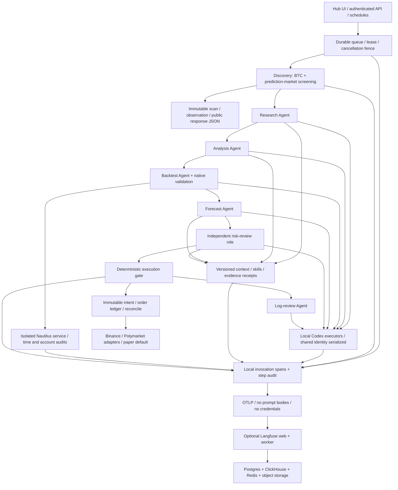

# Agent Hub 2.1：企业架构、投资研究与全链路复核

核验日期：2026-10-21。审查基于实际源码、独立审查、公开一手资料、故障测试和本机运行；区分企业案例、平台文档、研究论文和本项目实测。

## 结论与定位

项目采用企业中常见的“持久业务工作流 + 专职模型角色 + 独立工具执行 + 确定性风控”结构，但规模和能力仍是个人研究／模拟交易系统。六个角色各自收到独立上下文和指令，服务端决定流程；这不是动态规划、可递归委派、跨组织协商的自治 Agent 网络。两个 Codex 执行器共享同一 OAuth 身份并串行推理，也不能当成六个独立模型的统计集成。

原版的工程可靠性超过简单聊天 Demo，但可观测性、机会发现和投资效果评估明显不足。本轮针对实际缺口补齐调用链、候选快照、原生时间因果检查、统计与执行压力门禁。**测试通过证明实现满足当前合同，不证明策略盈利，也不等于机构级实盘验收。**

| 层面 | 升级前实际状态 | 本轮变化 | 仍然存在的边界 |
|---|---|---|---|
| 编排 | SQLite WAL、租约、重试、fencing、原子后继入队 | 加入只读 discovery 节点与运行级查询，旧流程不会被监控任务挤出列表 | 固定流程，单机；没有动态 fan-out/join 或跨主机恢复 |
| 角色 | 6 个配置化模型角色，工具由服务端固定调用 | 按角色记录调用；研究绑定候选原始观测与当前扫描 | 没有模型自主多轮工具选择、预算内重规划或独立模型辩论 |
| 调用追踪 | 只有步骤结束记录和可选 OTLP | 本地持久父子 Span、模型／工具／检索分类、尝试、token、错误类别、输入输出结构指纹；Langfuse Docker 集成 | 不存模型内部思维；不默认导出原始提示词／文档／答案；哈希不等于可重放的完整输入 |
| 回测 | 真实 Nautilus、时间顺序折、费用和基准，但多项仅展示 | 收益／决策时间轴审计、截断未来重放、状态一致性、分折 bootstrap、延迟压力实际参与门禁 | 日线是合成撮合路径；全局试验登记与未触碰 holdout 不完整；压力会计问题仍阻断 |
| 机会发现 | RSS 标题、报价和市场列表 | BTC 特征／深度，预测市场 token／费用／期限／规则检查，响应 JSON 快照、TTL、候选去重与关注状态 | 有界样本筛选，无已验证 alpha、独立校准概率或全市场覆盖 |
| 知识和记忆 | 时间版本、FTS5/BM25、CJK、受限段落读取 | 保持可核验来源与候选快照分离 | 没有语义 embedding/reranker；引用合法不等于事实蕴含成立 |
| 执行 | 不可变意图、幂等、UNKNOWN 对账、发送前风控 | 保留独立门禁，候选扫描无交易授权 | funded 账户生命周期、云容灾和多租户隔离未完成验收 |

## 与 2026 年企业实践的关系

- **Orange Business，2026-10-13**：官方案例描述 Agent/MCP 注册、版本治理，以及 RAG、Agent 行为、生产 trace 三层评估。对应本项目最需要补强的方向是版本、真实调用链和持续评估；引入一个框架并不能替代这些合同。[案例原文](https://www.langchain.com/blog/how-orange-business-built-live-intelligence-on-langchain-and-langsmith)
- **Heurist Finance，2026-09-09**：AWS 客户案例把研究、组合分析、数据工具、记忆和运行环境整合到投资工作台。它说明投资 Agent 不应仅输出买卖文本，但案例也没有为本项目提供可继承的盈利证明。[AWS 原文](https://aws.amazon.com/blogs/machine-learning/how-heurist-finance-built-an-ai-native-investment-workbench-on-amazon-bedrock-agentcore/)
- **LangChain Context Engineering，2026-10-14**：外置大上下文、可恢复压缩、按需技能和子 Agent 上下文隔离。本项目已具备受限段落读取与本地工件，尚未具备通用文件工具和模型自主恢复压缩内容的完整循环。[原文](https://www.langchain.com/blog/context-engineering-deep-agents-remember)
- **Temporal × AWS，2026-10-13**：持久工作流与可替换计算分离。对本项目，多主机运行、长时间暂停恢复和团队协作出现后，Temporal 才有明确收益；相关 Serverless 集成的 Preview/Pre-release 状态不能忽略。[原文](https://temporal.io/blog/temporal-and-aws-a-partnership-built-for-production-grade-ai)
- **Anthropic Managed Agents，2026-04-08**：session、harness、sandbox 分离是本项目独立账本／编排／执行器设计的依据之一。这是较早但仍适用的架构资料，不标成 9 月新技术。[原文](https://www.anthropic.com/engineering/managed-agents)

这些资料支持职责分离和可评估性，不支持“Agent 越多越先进”。个人版保留一种任务状态真相来源；将来可让 Temporal 管跨服务生命周期、LangGraph/Deep Agents 管单个研究 Activity 内的模型工具循环，但不能让两个框架同时拥有同一订单副作用及重试策略。

## 当前技术栈与完整链路

Python 3.12 / FastAPI / Pydantic / httpx；SQLite WAL 任务与域账本；Codex CLI 0.162.1；Nautilus Trader 2.0.0rc4 + Parquet + NumPy/Pandas；FTS5/BM25；OTel SDK 1.45.1；可选自托管 Langfuse 4.66.0；Docker Compose / OrbStack。Hub 是轻量 HTML/JS，原 Workbench 保留 React 19 / TypeScript / Vite。版本沿用锁文件与已验证镜像，不为展示“最新”随意替换研究引擎。



完整 pipeline 含 1 个入口任务、discovery、6 个模型角色及可选执行：允许 paper 执行时共 9 个步骤。六角色及 discovery 都有独立运行记录。扫描阶段不会自行下单；模型产生的是受校验提案；订单价格、数量、账户、权限、幂等与发送由确定性代码控制。

## 本轮独立 review 与修复

| 问题 | 影响 | 处理 |
|---|---|---|
| OTLP 只有步骤 Span，旧导出还挂在不存在的父 Span 上 | 看不出是检索、模型还是研究工具耗时；图不完整 | 新持久调用树使用同一 trace/span ID，父节点为实际调用，已有新 Span 时停止重复 legacy 导出 |
| 只在调用结束后记日志 | 进程中断时无法知道卡在哪 | 调用前写 running，结束更新；未完成记录在诊断中显式显示 |
| 最大 lease token 被当作总重试次数 | 忽略多个步骤重试，并把 Codex 入场等待算成失败 | 分开统计领取／延后／失败尝试，按步骤汇总 |
| `/api/jobs` 仅最新 100 条 | 长流程被监控流量挤出，验收可能误判 | 新增 tenant-scoped `/api/runs/{id}` 直接查完整运行 |
| 候选只拼到问题文字 | 新扫描不含原候选时，无法证明研究针对哪个观测 | API 校验 candidate_id/source_scan_id/标的，固定原观测和 hash，当前扫描单独展示 |
| 扫描任务成功但所有数据源失败 | 全链路验收可能假绿 | 单独检查 discovery 状态和候选数量，报告 partial/errors；unavailable 不通过机会发现验收 |
| 风控快速切换时刷新被丢弃 | UI 短暂显示旧风险模式 | 合并刷新请求后执行尾随刷新，补交互测试 |
| 回测 signal 从全历史初始化而每折重置 | 实时目标可能与最后 OOS 折不同 | 执行信号绑定最后 OOS 折的策略初始化和决策起点 |
| 仅验证返回的窗口元数据 | 缺行、重复、越界或未来观察可能漏检 | 独立核验每日收益、权益重构、观察前缀与决策时间 |
| CAGR 计入 warmup 天数 | 年化与 Calmar 失真 | 按真实决策窗口重算 |
| bootstrap 仅展示，DSR 名称过强 | 小样本或多轮试错可能被误认为有统计保证 | 分折／多 block 长度统计入门禁；明确单候选 PSR 和未做全局搜索校正 |

另有**尚未修复的执行引擎缺口**：全仓 SMA 提交时按信号价格把 quote 金额换成 base 数量，一日延迟成交遇到价格跳变时可能超出现金；原生账本检查正确拒绝。位置为 `src/qt/nautilus/adapter.py::_intent_quantity` 与 `src/qt/nautilus/runner.py` 的 `NativeLedgerError`。尝试简单改为 quote-quantity 会破坏已有 partial-fill 资金对账，已撤销。当前保留失败证据并阻断准入，不能宣称引擎已通过该压力条件。

## 如何定位问题：Trace、调用记录与 Langfuse

每次运行有稳定 32 位 trace_id，每次实际调用有独立 span_id 与 parent_span_id；同 run 的六角色共享 trace，重试保留新的 span 和 attempt。记录包括模型／provider、角色、worker、技能 hash、耗时、输入输出结构指纹、数字 token 用量、错误类型／固定错误码、业务门禁原因。hash 采用有界结构规范化，用于关联和比较，不能还原完整提示词。

本地 SQLite 调用记录是必备诊断来源，Langfuse 是可选查询分析界面，遥测导出失败不改变订单结果。通过 W3C traceparent 传递受信内部 RPC 关联，未传 baggage；本轮模型与工具耗时以客户端调用 Span 为边界，不宣称已经采集执行器内每个函数的分布式服务端 Span。

OTLP 目前是有界队列的 best-effort 导出，配合已验证的手动 `replay`；尚未实现自动持久化 outbox 和后台补发，因此不能承诺外部遥测零丢失。后续应补导出积压指标、自动重送和保留策略。

当前模型配置使用 `codex-account-default` 别名，未钉住上游具体模型版本；保存技能和代码 hash 也不能保证同一模型权重与输出可复现。个人版 Langfuse 的单项目展示不是多租户隔离，团队版需要独立项目与权限设计。OTel GenAI 语义约定仍标为 Development，应固定版本并保留适配层。[官方状态](https://github.com/open-telemetry/semantic-conventions-genai/blob/main/docs/gen-ai/gen-ai-agent-spans.md)

1. 在 Hub 的任务详情查看证据、原生验证、提案和业务执行原因。
2. 在“跨角色 Trace”输入 Run ID 或 Trace ID，查看调用表、失败类别、最慢工具、模型 token 和仍在运行的调用。
3. 区分任务状态和交易结果：`succeeded + held` 表示成功执行了拒绝／等待逻辑，不是成交；`partial` 扫描显示数据覆盖不足。
4. 用 `GET /api/runs/{run_id}/diagnostics`、`GET /api/spans?trace_id=...` 查结构化记录；所有接口需要本地访问令牌，并固定服务端租户身份。
5. 对照原始业务工件：模型答案、证据收据、策略／数据 hash、不可变扫描、订单意图。OTLP 不默认输出原始提示词、文档、答案、凭据或内部思维。
6. 把具体失效输入转成回归场景，再跑质量评估；仅看仪表盘成功率不能发现策略或事实错误。

Langfuse 使用官方 OTLP 接口，沿用已有 OTel，避免重复叠加 tracing SDK。版本 [4.66.0](https://github.com/langfuse/langfuse/releases/tag/v4.66.0) 与 [OTLP 文档](https://langfuse.com/integrations/native/opentelemetry) 已核实。现部署启用 v4 events ingestion；迁移预览开关的用途显式写在 Compose 中，不等于全套云功能验收。模型成本没有可核对账单时不伪造美元金额；cached/reasoning tokens 不再重复累加到 Langfuse 输入／输出总量。

```bash
./deploy/orbstack.sh hub-observability init
./deploy/orbstack.sh hub-observability up
./deploy/orbstack.sh hub-observability connect
./deploy/orbstack.sh hub-up
PYTHON=.venv/bin/python ./deploy/orbstack.sh hub-observability check
./deploy/orbstack.sh hub-observability status
# 遥测服务恢复后，仅重送已完成运行的 Span，不重跑模型或交易：
./deploy/orbstack.sh hub-observability replay RUN_ID
# 浏览器验证本机登录、真实调用树和 token 展示：
./deploy/orbstack.sh hub-observability ui-check TRACE_ID
```

Hub：`http://127.0.0.1:8878`；Langfuse：`http://127.0.0.1:3080`。Langfuse 用户 `owner@qt.local`，密码在本机受限 `.env.agent-hub-observability` 的 `QT_LANGFUSE_USER_PASSWORD`；项目密钥自动生成并写入私有配置，报告不包含值。Langfuse 注册关闭，存储服务不开放宿主端口，与业务卷隔离。`check` 的验收依据是查询读回 observation 并核对 span ID 和父子关系，不是只收到一次 HTTP 202。

## 投资回测：应如何做，这里做到了哪里

投资 Agent 至少要分别评估软件正确性、推理／证据质量、投资效果、执行可靠性四个层次。

| 专项 | 可辩护的方法 | 本项目现状 |
|---|---|---|
| 信息边界 | 按事件时间、首次可得时间、实际观察时间分别存储；冻结历史数据版本 | 文档三时点、策略／数据快照、闭合且连续日线；新闻全文与供应商历史修订覆盖仍不足 |
| 因果性 | 任意决策只能看到当时前缀；删掉未来数据应不改过去结果 | 原生观察前缀检查 + 第一折移除未来后的真实重放；不是穷尽所有时点的数学证明 |
| 数据切分 | 顺序 train/validation/OOS；按标签区间 purge/embargo；最终 holdout 不参与选择 | 3 折、显式隔离间隔；当前固定 SMA，无通用事件标签 CPCV，不宣称随机划分有效 |
| 策略一致性 | 版本、参数、状态初始化、交易信号与执行一致 | hash 绑定、最后 OOS 折初始化一致；仅验证该固定策略 |
| 搜索偏差 | 登记所有提案／参数尝试／失败，基于真实搜索范围做 PSR/DSR/PBO 等 | 单候选统计和局限明确；缺完整跨运行研究账本，`global_selection_bias_corrected=false` |
| 统计稳健 | 保留序列相关、分折统计、多种 block 长度敏感性 | 每折内 circular-block bootstrap，7/14/28 天各 1000 次；最差下界与分折回撤实际参与准入 |
| 基准 | 同样数据、费用、资金、窗口的现金、买入持有等 | 同窗口买入持有和费用压力；需进一步比较 volatility-targeted 等可交易基准 |
| 成交成本 | spread、fees、latency、impact、partial fill、queue position、限价成交率 | 实际双费用／延迟／1 tick 压力及会计断言；无真实 L2/L3 排队回放和容量证明 |
| 风险 | 尾部路径、资金占用、断连、UNKNOWN、撤单／减仓、滑点跃迁 | 日线折内回撤、交易账本和故障测试；缺覆盖更多状态和场景的长期 shadow |
| 前向验证 | 发布前冻结版本、滚动 paper/shadow、按交易数和市场状态评估 | 已有模拟盘和定时任务，尚无足够长的前向样本 |
| 预测市场 | 先记录预测再结算，按命名 outcome、决策时盘口和费用评估 | 有 Brier/log loss/校准基础函数，但没有真实已结算金标流和盈利证明；BTC 回测不能授权它 |

日线回测不是撮合回放。Nautilus 官方明确 bar 只能生成合成路径；本项目延迟一天对应后续 bar 的收盘环境，不称为“次日开盘成交”。[Nautilus 文档](https://nautilustrader.io/docs/latest/concepts/backtesting/bar-execution/)

默认三折本轮有 19 次 native attempts；`native_runs` 只计实际通过的执行。基础回测完成、执行压力会计失败、统计不显著三种状态独立展示。关键字段：`integrity.temporal_audit`、`integrity.prefix_invariance`、`costs.execution_stress_oos`、`statistics.fold_bootstrap`、`statistics.search_accounting`、`eligible_for_paper`。缺统计稳健性或执行压力验证就拒绝新增策略风险。

经典 DSR 不是 2026 新算法，且必须有真实试验范围，不能把每轮 Agent 修改当成“独立单策略”规避选择偏差。[2014 原论文](https://www.davidhbailey.com/dhbpapers/deflated-sharpe.pdf) 2026-08-27 的研究再次强调：统计修正也不能修复已经泄漏的输入。[泄漏与搜索偏差研究](https://arxiv.org/abs/2608.27734)

## 机会发现是否符合最新实操

原版不能称作完整机会发现引擎。本轮建立的是可审计的研究候选筛选入口：

- BTC：已收盘日线的趋势／突破／波动特征，spread／深度筛选，买入 VWAP 与冲击估计；账户实际手续费等级未知会明确保留。
- Polymarket：有界活跃市场样本，condition/token 对应、盘口时间、双边深度、到期窗口、限制、结算来源与规则 hash；读市场 `fd.r/e` 费用参数。未知模型、过时盘口或规则不明均标明阻断原因。不能把旧 fee-rate 的一个数直接当真实百分比。[当前费用说明](https://docs.polymarket.com/trading/fees)、[参数接口](https://docs.polymarket.com/api-reference/markets/get-clob-market-info)
- 每次公开响应的解析 JSON、规范化 hash、来源、接收时间落库，另记响应体字节 hash；没有保留原始 HTTP 字节，不能声称字节级重放。同一候选身份稳定，不同观察不可覆盖。界面支持关注与再次研究；原观测固定，新的市场快照另存。
- `market_probability` 只表示市场价格；没有独立校准预测时 `estimated_probability` 和 `net_edge` 都为空。对预测市场买入，未来应使用“预测概率下置信界 − 可执行 ask − 每份费用 − 预期滑点／结算成本”，卖出另按 bid、库存和退出成本计算，不能直接用 midpoint 差价。

2026 年新研究提供设计参考，但不是可以直接复制的 BTC 收益策略：

| 资料 | 核实日期 | 适用结论与限制 |
|---|---|---|
| [Making Alternative Data Work](https://arxiv.org/abs/2609.11607) | 2026-09-10 | 先筛数据对目标的相关性，再预测；研究的是企业收入和商业数据，不证明 BTC 收益 |
| [SOTA](https://arxiv.org/abs/2610.10407) | 2026-10-07 | 让 Agent 做策略层选择、确定性 resolver 处理实现；新闻在部分消融中损害效果，不能简单堆更多新闻。对象为美股期权研究 |
| [FORESIGHT-9](https://arxiv.org/abs/2608.29372) | v1 2026-08-29；v2 2026-09-04 | 前瞻信息边界、反事实路径和过程 telemetry，揭示终值收益可能掩盖策略退化；不是本项目已复现的成绩 |
| [LLM 交易 fleet 生产观察](https://arxiv.org/abs/2609.05663) | 2026-09-04 | 作者在两组系统中未发现方向性优势，强调运行层与风控影响；预印本样本结论，不扩大为全行业定论 |
| [QuantConnect 官方变更](https://www.quantconnect.com/docs/v2/meta/change-log) | 2026-10-13 / 10-15 | Agent memory/skills、订单与交易导出，以及数据时点工程持续演进；提醒研究要能对照实际成交证据 |

下一步机会发现重点应是可验证的数据覆盖和效果，而非扩大 Agent 数量：BTC 衍生品资金费率／基差／OI、期权隐含分布、官方宏观事件时点、链上资金流和 ETF 数据；预测市场事件关系和互斥约束、独立概率预测、校准及盘口回放。每接一类数据需先做来源适用性和消融验证。

## 测试、发布与后续路线

```bash
./deploy/orbstack.sh hub-test
./deploy/orbstack.sh hub-native-test
./deploy/orbstack.sh hub-ui-test
./deploy/orbstack.sh hub-exec api python -m qt.agent_hub.evaluation
./deploy/orbstack.sh hub-exec api python -m qt.agent_hub.prelaunch
./deploy/orbstack.sh hub-status
```

测试分层：单元和故障合同 → 原生引擎实际重放 → 冻结安全场景走生产运行时 → 真实 Codex 完整流程 → Chromium 前端到后台 → OTLP 写入后读回。fixture 模型通过不等于真实模型质量；一次真实运行通过也不代表稳定性达到统计显著。下一轮应冻结 20—50 个真实失效／正常任务，分开衡量检索 recall、证据蕴含、正确 HOLD、工具选择、首次通过率和重复执行一致性；模型评分须用专家标签校准。[Anthropic Agent eval 方法，2026-01](https://www.anthropic.com/research/demystifying-evals-for-ai-agents)

**优先级 P0：**修复并独立验证延迟订单的资金预留／实际成交会计；补全研究试验登记、未触碰 holdout、真实结算预测数据和长期 shadow。**P1：**在明确任务上增加受工具权限和预算约束的多轮研究循环、并行子课题／反证汇合；做与单 Agent、确定性基线的成本／效果消融。**P2：**真实多主机需求出现后迁移 Temporal/Postgres；团队版补 OIDC/RBAC、数据库 RLS、独立账户／Secret broker、配额、审计保留、SLO 告警和异地恢复。

云上线推荐沿用同一镜像，在阿里云 ECS/ACK 或腾讯云 CVM/TKE 部署；个人单机先不叠加 K8s。Langfuse 的 PostgreSQL 仅存其自身数据，不会自动把 Hub 的 SQLite 变成多租户业务数据库。增加 Redis/ClickHouse 也不会自动获得企业级身份隔离或高可用。

较早的 `agent-hub-v2.md` 是上一版历史结果，不能替代当前版本验证。


## 本机实际验收：2026-10-21

| 验证层 | 本次结果 | 证明范围 |
|---|---|---|
| Docker Hub 测试 | **362 passed / 4 skipped** | 固定生产依赖；4 个需原生引擎的用例在独立镜像执行 |
| Docker 原生研究专项 | **33 passed / 0 skipped** | Nautilus 实际执行、时间轴、因果前缀、分折统计等 |
| 前端与类型检查 | **70 tests passed；TypeScript 通过** | Workbench/Hub UI 合同和状态处理 |
| Chromium 验收 | **10 条流程通过，0 JS errors** | 认证、任务、机会扫描、风险模式、Run/Trace 查询、桌面与移动布局 |
| 冻结安全评估 | **5/5 通过** | 合法模拟成交、伪造证据拒绝、风险否决、回测失败拒绝、取消无订单；使用 fixture 模型，生产队列／门禁／账本 |
| 真实 Codex 全流程 | **通过；162.5 秒，9 步均成功** | 6 次真实模型调用、22 次工具／检索调用、37 个完整 Span，无失败／重试 |
| 真实机会发现 | **complete，11 个候选，0 来源错误** | 本轮有界公开样本成功；不代表候选可交易或全市场覆盖 |
| Langfuse OTLP 验收 | **3 个合成 Span 与最终真实运行 37 个 Span 写入、读回通过** | 逐个核对同一 trace/span ID、父子关系、Generation 类型和真实 token 数；没有重跑模型／交易 |
| Langfuse 浏览器 | **5 项通过，0 JS errors** | 真实账号登录、指定 Trace ID、Agent/模型/工具调用树、token 展示；已检查实际截图 |
| 静态验证 | Ruff、9 个源文件严格 mypy、Compose、shell、diff check 通过 | 代码和部署配置检查 |
| Docker 服务 | Hub 9 个服务与 Langfuse 6 个服务 healthy | 本机存活与健康检查，不代表云高可用 |
| 备份恢复 | **104 个文件，5 个 SQLite 库完整性与 hash 通过** | 停 scheduler/全部 worker，验后恢复；包括新机会库，不覆盖 Langfuse 自有存储 |

最终真实运行 Run ID：`8ae057d31aa64226bdd9e7263e3ae507`；Trace ID：`ce10679e74414b5cfd80a7b4a7821060`。本地调用累计输入 120,606 tokens、输出 2,525 tokens，模型调用 p95 为 28.34 秒（仅此轮 6 次调用的小样本）。所有角色引用均属于注册证据；这只证明来源成员校验通过，不证明每句结论正确。

登录后可打开[最终真实调用树](http://127.0.0.1:3080/project/qt-agent-hub/traces/ce10679e74414b5cfd80a7b4a7821060)。本轮还实际验证了遥测中断恢复：调用先落本地记录，Langfuse 启动后只重送已完成 Span，再从服务端查询核对；没有把“成功排入 exporter”当成已持久化证明。

本次固定 SMA20/60 的三折 OOS 在各折资金重置协议下合并 360 个日收益：累计收益约 **1.44%**，最大回撤约 **27.63%**，Sharpe **0.186**。判定 `fragile`、`eligible_for_paper=false`；原生延迟压力仍报会计断言失败。执行模块正确返回 **held**，没有发送实盘资金订单。`paper_ready` 是模拟研究系统的工程状态，不是该策略的交易批准。

验收还捕获并修复了两项集成错误：扫描成功状态 `complete` 被验收脚本误写成 `completed`；Langfuse v2 observation 默认投影不含 token 用量，校验查询必须显式选择 `usage` 字段。后端流程没有为让报告变绿而绕过门禁。

最终部署代码指纹：`83d69e123696ae7ac14f8a4fa67723af4d93ddd50c005c1e6ad6176e01495432`；代码／配置／技能组合指纹：`44300f5eb217378a60e870769e62ac6c821c0e9bef7ae99223422464aec5221a`。运行报告在 Docker 状态卷 `/state/prelaunch-report.json`，冻结安全评估在 `/state/evaluations/latest.json`，浏览器报告在 `/state/ui-acceptance/report.json`；这些运行数据不提交到 Git。

发布就绪接口 `/api/release/readiness` 的 7 项当前工程检查全部通过，`paper_ready=true`、`live_ready=false`。升级后的备份路径为 `/state/backups/hub-1792550599412057314`；原 Workbench API/worker 探针与未认证访问拒绝检查仍通过。

Langfuse 浏览器截图和报告位于 `/state/langfuse-ui-acceptance/`。`ui-check` 复用项目已有 Chromium 测试镜像；仅测试容器使用 host 网络访问配置的 loopback 登录来源，常驻服务继续使用原隔离网络与 loopback 端口。
