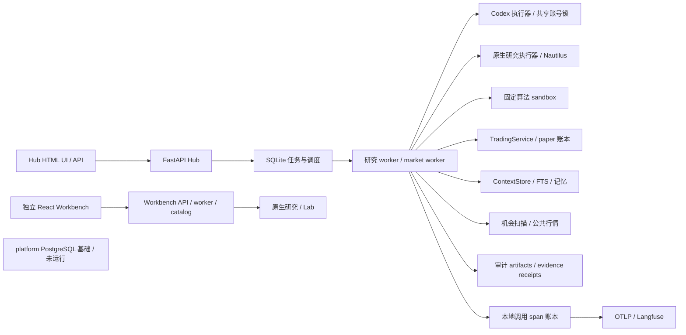
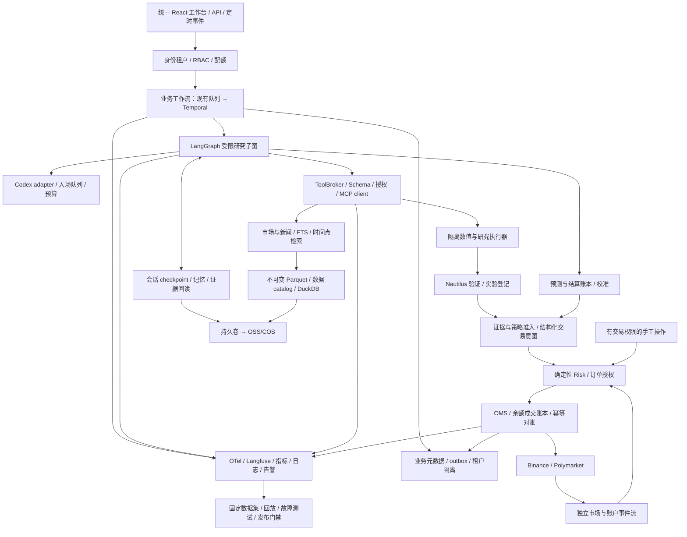

# QT 全栈 Agent 架构复核与选型建议

审查日期：**2026-10-21**。源码基线：**`7da4b1b`**。本报告针对个人 BTC / Polymarket 研究与交易系统，以及未来多租户演进；综合逐模块源码复核、部署清单、受控复现和一手资料。**本次只更新评审文档，没有部署以下目标架构。**

## 1. 结论与约束

当前项目已经具备持久任务、租约与 fencing、证据收据、确定性风控、独立数值执行器、订单幂等和 Langfuse 调用追踪，超过一般多角色聊天 Demo。准确定位是：**可审计、可恢复的多角色研究评审流水线**。它尚未形成完整的自主研究 Agent 平台、多模型平台或多租户交易平台。

主要差距集中在四方面：研究 Agent 无自主补证据循环；数据、记忆与实验语义没有贯通；Hub / Workbench / platform 能力没有融合；持续评估、自动遥测恢复、告警和全系统灾备还不完整。单纯增加框架或 Agent 数量不能解决这些问题。

本项目的推荐目标是：**确定性业务工作流 + 受预算约束的研究 Agent 子图 + 独立交易与风控服务 + 统一证据数据层 + 持续评估运维**。研究和交易必须有不同的时延与正确性合同。

选型继续遵守现有要求：AI 调用使用本地 Codex 集成；个人版 Docker 管理；后续可部署阿里云或腾讯云。这里的“本地 Codex”是本地 CLI/执行器调用在线模型，不是离线模型。向量模型、外部 reranker 或其他模型供应商只作为未来改变约束后的选项。

## 2. 2026 年最新实践：哪些值得采用

以下区分发布日期、当前文档与产品成熟度，避免把旧实践或预览功能包装成全部正式可用。

| 一手来源 | 日期 / 状态 | 对本项目的实际意义 |
|---|---|---|
| [OpenAI Agents API](https://openai.com/index/introducing-the-agents-api/) | 2026-09-10，Public Beta | 托管 Codex harness 与运行环境分离，包含长会话、工具和子 Agent 能力。说明 harness 已成为独立层；它不等于本项目的 CLI 适配器，也不要求本项目切换托管 API。 |
| [Temporal Standalone Activities](https://temporal.io/changelog/standalone-activities-durable-job-processing-ga) | 2026-09-15，核心能力 GA；部分操作命令和批处理仍 Preview | 持久后台作业可逐步演进为 Workflow，支持超时、重试、心跳与调度。适合未来替换跨机器任务底座；不自动保证外部订单只执行一次。 |
| [LangChain Context Engineering](https://www.langchain.com/blog/context-engineering-deep-agents-remember) | 2026-10-14 | 大结果外置后可回读、摘要可恢复、按需技能、子 Agent 上下文隔离、长期记忆。当前“保存全文然后截断”只覆盖其中一部分。 |
| [Orange Business 企业案例](https://www.langchain.com/blog/how-orange-business-built-live-intelligence-on-langchain-and-langsmith) | 2026-10-13，厂商发布案例 | Agent/MCP 目录、按环境管理提示词版本、检索与行为评测、生产 trace 反馈到数据集，值得用于平台治理。 |
| [Heurist Finance 投资工作台](https://aws.amazon.com/blogs/machine-learning/how-heurist-finance-built-an-ai-native-investment-workbench-on-amazon-bedrock-agentcore/) | 2026-09-09，厂商发布案例 | 将研究编排、身份、组合数据、记忆、隔离计算、产物存储与 tracing 连接起来；这是产品架构参考，不是盈利有效性证据。 |
| [Temporal 与 AWS](https://temporal.io/blog/temporal-and-aws-a-partnership-built-for-production-grade-ai) | 2026-10-13 | 可借鉴持久执行分层；其中 Lambda Serverless Workers 为 Public Preview，AgentCore 形态为 Pre-release，不能作为阿里云/腾讯云必选组件。 |
| [MCP 正式规范更新](https://blog.modelcontextprotocol.io/posts/2026-07-28/) | 2026-07-28，正式协议 | 当前项目已经实现该版部分 stateless 核心与旧版兼容。差距主要在工具接入与授权治理，不能误报为仍只支持旧协议。 |
| [A2A 规范](https://a2a-protocol.org/latest/specification/) | 2026-10-21 查阅，当前 1.0.0 | 用于独立 Agent 系统互操作。内部六个角色不需要为了“多 Agent”而全部改成 A2A 服务。 |

综合这些资料，本报告推荐的是分层能力及适用技术，不存在适用于所有企业的唯一“最佳框架”。[LangGraph 官方](https://docs.langchain.com/oss/python/langgraph/workflows-agents)也明确区分固定路径的 workflow 和动态选择过程、工具的 agent；固定工作流本身是合理设计。

## 3. 当前真实拓扑与版本

仓库中存在的组件，不代表已经进入 Hub 的生产调用路径。本次只读容器检查：Hub 9 个运行服务、Langfuse 6 个、Workbench 6 个均 healthy；platform 的 PostgreSQL 部署没有运行。健康快照不代表容量或业务结果通过。

| 子系统 | 当前主要选型 | 真实边界 |
|---|---|---|
| Agent Hub | Python 容器 3.12.11；FastAPI 0.139.0、Pydantic 2.13.4、httpx 0.28.1；简单 HTML/JS UI | 8878；任务、上下文、交易、治理、机会共五个 SQLite；任务库等单独启用 WAL，不能笼统声称全部数据库均采用 WAL。 |
| 模型执行 | Codex CLI 0.162.1；RemoteCodex HTTP；六角色 model 均为 null | 两个执行容器共享 OAuth home 和文件锁，推理串行；默认模型未固定。不是已完成多模型路由。 |
| 原生研究 | NautilusTrader 2.0.0rc4；独立 research executor；Parquet | 已接入 Hub；锁定的是 RC 版本，需要保留版本兼容与账本合同测试。 |
| Workbench | React 19.1.1、TypeScript 5.9.2、Vite 7.3.6、Ant Design 5.24.7、TanStack Query 5.66.8、ECharts / Lightweight Charts | 8877；已有研究任务、数据目录与图表；与 Hub 的 UI、认证和部分存储分离。 |
| 较早 platform | SQLAlchemy 2.0.51、Alembic 1.18.5、psycopg 3.3.4 / PostgreSQL | 可以复用迁移与数据库基础；不能当作 Hub 已经迁移 PostgreSQL 或具备多租户。 |
| 数据分析 | ParquetStore、DatasetCatalog；声明 DuckDB 1.5.4 依赖 | 源码未找到实际 DuckDB 查询入口。原有 Parquet upsert 会覆盖文件，不是不可变历史快照。 |
| 交易 SDK | `polymarket-client==0.13.0`；支持不同版本 token 字段 | 已使用统一 SDK；问题在领域与结算闭环，不应建议“升级掉旧 py-clob”来解决不存在的问题。 |
| 调用可观测 | OTel SDK / OTLP 1.45.1；Langfuse 4.66.0（10 月 20 日发布） | Langfuse 使用自己的 PostgreSQL 17.11、Redis 7.4.5、ClickHouse 25.12 和 MinIO；这些不是 Hub 的业务数据库或队列。 |

版本依据为本仓 Dockerfile、服务锁文件和 `web/package.json`，不是统一声称“最新版本”。Workbench/platform 的 FastAPI 锁为 0.139.2，与 Hub 略有差异；更新应按服务兼容验证进行。

此图中的审计 artifacts 没有自动成为模型可回读的知识库；Workbench 普通 native experiment 与 Lab 验证也不是同一条必经路径。

## 4. 逐模块对照：应用、编排和模型

优先级采用交付顺序：**A = 下一轮个人版应补；B = 公网、多用户或实盘前的门禁；C = 出现规模需求再引入**。这些不是对当前本地 paper 环境统一判定为生产事故。

| 模块 | 当前实现 | 推荐个人版选型 / 改进 | 企业目标 / 迁移触发 |
|---|---|---|---|
| 前端 | Hub 原生 HTML/JS；Workbench React/Vite | **A：复用 React + TS + Vite + TanStack Query**，统一机会、研究、实验、订单和 trace 页面；OpenAPI 生成类型；SSE 展示研究进度 | 保留同一前端；没有 SSR/SEO 需求就无需迁 Next.js。统一会话与对象授权。 |
| API / 领域服务 | FastAPI + Pydantic；Hub 与 Workbench API 分开 | **A：保留 FastAPI/Pydantic**，明确 Research、Data、Execution、Governance 服务接口；先模块化，再按故障/资源隔离拆进程 | B：OIDC、RBAC、服务身份、流式请求大小限制、速率与租户配额。 |
| 业务工作流 | 固定 FLOW；SQLite 事务队列、租约、fence、deadletter | **A：保留确定性投资链**；补任务 deadline、取消传播、重试分类、预算和执行版本 | C：多机、跨小时恢复、升级中长任务共存时用 **Temporal Workflow / Activities**。订单仍由 OMS 保证幂等。 |
| 调度 | interval + 时间桶去重；2 秒 tick | A：显式 skip/coalesce/catch-up、overlap、最晚有效时间；文件导入与监控拆队列 | C：Temporal Schedules；公平性和优先级按租户管理。行情事件单独处理。 |
| 研究 Agent | 六角色各一次模型调用；Python 预先获取证据 | **A：LangGraph 作为受限研究子图**，自定义节点调用扩展后的 CodexProvider；工具请求由 Pydantic schema 表达、服务器执行。固定流水线无需全部迁图 | 专家节点可动态补证据、提出反证、并行独立调查；只有评测证明有效才增加角色。LangGraph 不负责交易账本。 |
| 模型接入 | RemoteCodex → CLI；工具禁用；共享账号串行 | A：继续 **Codex-only adapter**；记录请求及实际可获得的模型身份、CLI/提示词版本、token；集中推理排队、总运行预算、可取消 handle | 以后允许其他供应商才增加 provider gateway / fallback。两个共享锁的容器不能作为双倍吞吐设计。 |
| Prompt 治理 | role prompt 与 query 合并；外层称 JSON 全为非指令数据 | A：可信角色政策、用户请求、外部证据分层；版本化模板和注入测试；避免把角色政策也降为不可信 JSON | 环境 promotion、效果比较、回滚；原始输入独立受控保存，不进普通日志和遥测。 |
| Skills | YAML/Pydantic manifest、hash、schema、role allowlist | A：增加 procedure、资源引用、依赖/兼容版本、评测集；按需加载技能说明 | C：签名 registry、灰度与撤回；技能文字不能自行授予工具权限。 |
| MCP / A2A | 三个对外 MCP 工具；部分新旧协议兼容；无外部 MCP client | A：官方客户端互操作测试；需要接外部服务时增加 **ToolBroker + MCP client**，按 role/tenant 授权 | B：远程 MCP OAuth resource/audience/scope；C：独立团队 Agent 互操作才用 A2A 1.0。 |
| 执行环境 | Docker 非 root、只读根目录、cap_drop、资源上限；固定数值工具 | 保留现有数值 executor；A：清晰标注“固定功能隔离”，不要直接用于任意生成代码 | B：开放代码执行前，新建逐 run 临时 job；gVisor/Kata/Firecracker 按宿主能力选一种；禁止业务凭证与控制网访问。 |

源码入口：[runtime.py](../src/qt/agent_hub/runtime.py)、[store.py](../src/qt/agent_hub/store.py)、[codex.py](../src/qt/agent_hub/codex.py)、[skills.py](../src/qt/agent_hub/skills.py)、[mcp.py](../src/qt/agent_hub/mcp.py)、[Compose](../docker-compose.agent-hub.yml)。

### Codex-only 如何形成真正的研究循环

推荐新增的协议是 `PlannerResponse(decision, tool_requests, evidence_ids, hypotheses)`，工具名为枚举、参数为强类型。当前 Codex 适配器硬编码 review schema 并严格校验字段，不能直接接受该新协议。应先为适配器注册服务器拥有的 planner schema 与对应 validator，保留既有 review schema，禁止客户端任意覆盖输出协议，再由 LangGraph 节点调用。服务器校验工具权限、租约、轮次、token/时间预算、数据时间，执行只读研究工具、保存结果收据，进入下一轮。设置 `max_rounds`、`max_tool_calls`、deadline 和取消路径。

这是一层服务器控制的模型—工具循环，**不是声称现有 CLI 已提供 native tool calling**。复杂内容用 artifact/chunk ID 回读。子 Agent 保持独立上下文，仅交付结构化结论与证据。下单工具不进入研究模型可选工具集合，最终仍进入确定性审批与交易服务。

若未来选择直接使用 Codex 原生 harness / app-server 集成，应单独验证其接口和权限合同，再替换这个适配策略；不要默认叠加两个都控制内部推理循环的 harness。

## 5. 逐模块对照：数据、记忆和投资研究

| 模块 | 当前实现 | 推荐个人版选型 / 改进 | 企业目标 / 迁移触发 |
|---|---|---|---|
| 短期记忆 | SQLite tenant+key；每次 answer TTL 24h；按租户取最近 200 条 | **A：run/session checkpoint**；按研究项目、标的、策略隔离；禁止其他任务答案自动进入当前短记忆 | PostgreSQL checkpoint，授权 namespace；会话状态不能与跨会话知识混用。 |
| 长期记忆 | 版本化 JSON KV、TTL、hash、删除；long 标签 | A：区分事实、经验、操作规则；来源、置信度、有效期、晋升和撤销；未验证模型经验不能变成市场事实 | PostgreSQL 元数据 + 对象存储；租户/用户权限、保留期及删除审计。 |
| 上下文 | 初始字符预算；完整输入字节预算；超限全文落盘后截断 | **A：ContextEnvelope**、token 预算、字段保留优先级、摘要与授权回读；必须保留价格时间、规则、风险和证据 ID | 模型窗口、完整会话日志、证据对象、执行环境分离；checkpoint 可重建输入。 |
| RAG | FTS5/BM25 + CJK fallback；文档排名后取片段 | **A：段落 FTS + 时间过滤 + 预算内 Codex 重排**；测 recall/nDCG、引用支持率、遗漏与延迟 | PostgreSQL FTS；只有另行允许 embedding 服务后才加 pgvector + RRF。更大检索规模再评估 OpenSearch/Qdrant。 |
| 公共数据 | Hub 日线 HTTP；Workbench Parquet/catalog；RSS 标题 | A：统一 DataCatalog、不可变 Parquet 快照、**DuckDB 分析**；记录数据水位、质量和修订；RSS 标题不当全文研报 | OSS/COS + Parquet + PostgreSQL catalog；出现多写入者/复杂快照再评估 Iceberg 等表格式。 |
| 历史时点 | ContextStore 有 as_of/known_at；主流程未贯穿历史截点 | **A：decision_time、available_at、observed_at、版本 ID 贯穿检索、特征和记忆**；改为先采集入库，再检索新证据 | 时间点一致的研究回放；不能把当前新闻或模型记忆用于旧决策后宣称无前视。 |
| 机会发现 | BTC 固定特征；Polymarket 成交量 top5、45 秒有界扫描；价差、深度、规则检查 | A：市场集合→新鲜度/流动性→假设→反证→预测→校准→扣成本 edge；记录未入选样本、覆盖率及失败原因 | 公共行情共享、私有研究隔离；事件关联和组合暴露去重；价值用前向结果验证。 |
| BTC 回测 | Nautilus；固定 SMA20/60；三折时间 OOS、hash、账本断言、prefix 审计与费用/延迟压力 | **A：先修复资金/延迟成交合同**；study/trial registry、最终 holdout、连续资金前向模拟；保持研究与实盘同一策略接口 | 依策略频率补 trade/tick/L2 回放、撮合排队与延迟；完整试验空间统计，不能只报告最佳 trial。 |
| 预测评估 | Brier/log loss/calibration 函数存在，但只有测试调用 | **A：ForecastLedger + ResolutionLedger**，自动入库、结算取证、评分；区分预测概率、模型 confidence、市场价格 | 按事件和期限分组评估；未裁决/争议/取消/0.5 payout/赎回状态独立建模。 |
| 数据血缘 | 来源、候选、实验、proposal、trace 已有 hash 与 ID | A：统一 source→dataset→feature→hypothesis→experiment→forecast→proposal→order→fill/settlement→eval 的关联 | PostgreSQL 元数据、不可变对象、outbox；trace 表达调用关系，不能替代投资数据血缘。 |

源码入口：[ContextStore](../src/qt/agent_hub/context.py)、[机会扫描](../src/qt/agent_hub/opportunities.py)、[原生验证](../src/qt/agent_hub/research_service.py)、[预测评估函数](../src/qt/agent_hub/research.py)、[DatasetCatalog](../src/qt/research/datasets.py)、[ParquetStore](../src/qt/data/store.py)。

当前 scanner 排除**剩余到期时间不足一小时**的 Polymarket 市场，因此不覆盖临近结算的 5/15 分钟 BTC up/down 交易窗口；提前挂牌且距结束超过一小时的短周期市场仍可能进入。它不是全市场实时预测系统。未来短周期产品还需要独立价格基准、规则、行情、延迟与结算协议；[官方 resolution 文档](https://docs.polymarket.com/concepts/resolution)区分一般事件与 BTC up/down 的裁决方式，并有非二元现金结算情形。

### 金融研究验收应分成四类

1. **数值正确性**：现金、仓位、成交、手续费与净值逐项对账；延迟/拒单/部分成交/停牌与未知订单状态通过合同测试。当前的资金/延迟压力失败仍是门禁，不能用“安装了 Nautilus”替代正确性。
2. **研究有效性**：冻结数据与策略、登记全部 trials、时间顺序验证与最终未使用 holdout、真实可得时间、费用/流动性压力。事件标签有重叠时按标签生命周期 purge/embargo；不能把简单留时间间隔称为完整 CPCV。
3. **Agent 质量**：同一生产图的任务完成、证据支持、反证覆盖、时间正确性、工具选择、拒绝不足证据、越权防护及成本/时延。与无 Agent 的确定性基线比较，衡量每个新角色的增益。
4. **前向投资效果**：冻结版本 paper/shadow；BTC 比较基准和风险暴露，预测市场比较市场隐含概率与简单基线；用校准、覆盖率、成交后净收益及不确定区间评价。观察窗口随策略频率和样本相关性确定，不给统一“运行几天就可实盘”的保证。

现有 OOS 是固定候选、各折资金重置，主 bar 成交模型使用已收盘同根 close；prefix 审计覆盖首个 OOS fold。它不等于连续账户实盘模拟、全研究空间 DSR 或全量盘口回放。[Nautilus 官方 bar execution](https://nautilustrader.io/docs/latest/concepts/backtesting/bar-execution/)说明 OHLC 合成路径的边界，实际接入需对照本项目锁定版本。

## 6. 逐模块对照：执行、可观测、发布和云

| 模块 | 当前实现 | 推荐个人版选型 / 改进 | 企业目标 / 迁移触发 |
|---|---|---|---|
| 行情实时性 | Hub 30 秒公共 HTTP 轮询；monitor、execute、import 共用 market-worker | A：先隔离监控与导入；有短周期需求再接 **WebSocket + 序列/缺口/过期检测** | 独立市场数据服务；重连、快照恢复和用户成交流。模型不参与逐 tick 风控。 |
| 风控 / OMS | Decimal、预算预留、幂等指纹、fence、UNKNOWN 对账、kill/reduce-only | **A/B：独立 OrderCommandGateway + Risk + OMS + Ledger**；明确手工/策略授权；补余额和成交不变量、账户级隔离 | PostgreSQL 事务 + outbox；venue 用户流 + 定期全量对账；不靠模型决定重发未知订单。 |
| 费用与合约规格 | Polymarket 扫描核验市场费用曲线，目前仅支持 e=1；paper 固定曲线系数 r=0.07，费用为 q×r×p×(1−p) | **A：统一版本化 InstrumentSpec / FeeSchedule / LiquiditySnapshot**，贯穿发现、回测、风控、paper 与实际成交对账 | 账户费率层级、返佣、最小量、tick、结算和汇率同一领域合同。未知成本不报告可信净 edge。 |
| Trace | 本地持久 span；OTLP → Langfuse；真实父子关系与 token 已验证 | **A：保留 OTel + Langfuse**；补 executor server spans、JSON 日志 trace/span 关联；自动持久 outbox | Collector file_storage WAL、重试与队列监控；Collector 无法救回发送端尚未交付就丢掉的 spans。 |
| 指标 / 告警 | `/metrics`；无完整 Prometheus/Grafana/Alertmanager 部署 | **A：Prometheus + Grafana + Alertmanager**；修 counter、增加 duration histogram；监控队列年龄、行情水位、UNKNOWN、磁盘及推理等待 | 云托管 Prometheus/Grafana；SLS/CLS 或 Loki 选一个日志后端，避免重复部署。 |
| 持续评估 | 单元/合同/故障 fixtures、浏览器脚本和人工可运行验收；Langfuse tracing | **A：Langfuse datasets/experiments/scores + pytest + Vitest + Playwright**；生产失败经脱敏变回归样本 | 固定版本任务集、分类评分、差异分析、预算/性能比较，进入同一 promotion gate。 |
| CI/CD | Hub Docker 离线测试 CI；腾讯 deploy workflow 偏 Workbench/systemd | A：统一 Hub release manifest；代码、镜像 digest、schema、prompt/skill、eval 版本绑定；staging Compose E2E | B：不可变镜像、SBOM/provenance、迁移演练、灰度与回滚；ACK/TKE 上使用相同合同。 |
| 备份 / 恢复 | 五 Hub SQLite + 自有 documents/artifacts；hash/SQLite 完整性验证 | **A：补独立 research-state、原始数据和实验产物的覆盖；全新卷恢复并启动**；外部导入单独快照 | B：PostgreSQL PITR、OSS/COS 版本/保留、实际 RPO/RTO 演练；Langfuse 存储另定策略；凭证走安全恢复通道。 |
| 租户 / 密钥 | 固定 tenant、本地 Bearer、Origin 检查；共享部分状态卷 | 本地单用户保持边界；**B：OIDC + RBAC + PostgreSQL RLS + 命名空间 + 配额**，tenant 由认证身份派生 | 数据库/对象/缓存/模型配额/沙箱/交易账户全路径隔离；工作负载身份、KMS、短期凭证。 |
| 部署 | Docker Compose，OrbStack；镜像/挂载/网络分离 | **保留 Compose**；单云 ECS/CVM + TLS + 私有网络、备份与实际告警即可承载个人版 | C：多节点、团队隔离和弹性需求再上 ACK/TKE；不以容器数作为成熟度指标。 |

源码入口：[TradingService](../src/qt/agent_hub/trading.py)、[API](../src/qt/agent_hub/api.py)、[tracing](../src/qt/agent_hub/tracing.py)、[OTel](../src/qt/agent_hub/observability.py)、[backup](../src/qt/agent_hub/backup.py)、[CI](../.github/workflows)、[本地部署](../deploy/orbstack.sh)。

可观测建议依据 [OTel Collector resilience](https://opentelemetry.io/docs/collector/resiliency/) 与 [Langfuse evaluation](https://langfuse.com/docs/evaluation/overview)。本地 span 账本、Langfuse 调用评估和金融账本各自有用途。当前 Langfuse 单项目里的 tenant 标签不是用户授权隔离，低内存配置 healthy 也不是生产容量证明。

### 云产品映射

| 能力 | 阿里云 | 腾讯云 |
|---|---|---|
| 个人版计算 / 团队容器 | ECS + Compose → ACK | CVM + Compose → TKE |
| 事务数据 / 时间点恢复 | RDS PostgreSQL | TencentDB PostgreSQL |
| 数据集 / artifacts / 备份 | OSS | COS |
| 身份 / 加密与密钥 | RAM / KMS | CAM / KMS |
| 指标 / 日志 / 应用链路 | 托管 Prometheus/Grafana / SLS / ARMS | TMP/Grafana / CLS / APM |

[ACK 托管 Prometheus 文档](https://www.alibabacloud.com/help/en/ack/ack-managed-and-ack-dedicated/user-guide/use-managed-service-for-prometheus-to-monitor-an-ack-cluster)标注更新 2026-09-17；[腾讯 TKE APM 文档](https://cloud.tencent.com/document/product/457/118520)是仍适用的既有实践，不能称为 2026 新发布。以上是映射建议，没有核验账户、区域可用性、购买规格或配额，也没有进行本轮云部署。

## 7. 推荐全栈与职责边界

**个人版下一阶段明确选型**：React/TypeScript/Vite；FastAPI/Pydantic；现有持久队列；LangGraph 研究子图调用 Codex adapter；SQLite 个人状态与 FTS；不可变 Parquet + DuckDB 分析；Nautilus；确定性 Risk/OMS；OTel + Langfuse + Prometheus/Grafana/Alertmanager；pytest/Vitest/Playwright；Docker Compose。LangGraph 是新增建议，需要先验证与现有队列的恢复合同。

**团队版目标选型**：保留上述语言、UI、领域服务和模型适配；业务恢复迁 Temporal；业务状态迁 PostgreSQL + SQLAlchemy/Alembic；对象迁 OSS/COS；补 OIDC/RBAC/RLS/KMS；按规模接 ACK/TKE 与托管监控。数据库版本以云端支持且经过迁移验证的 PostgreSQL 17/18 为候选，不自动沿用 Langfuse 内部数据库。

图为目标设计，不是当前部署。三个状态所有者必须清楚：**业务引擎拥有流程生命周期，研究图拥有单次研究状态，OMS 拥有订单与资金事实**。Temporal Activity 重试时恢复同一 research run；订单提交重试恢复同一不可变 intent。禁止每重试一次就生成新交易意图。

PostgreSQL 可保存流程投影、研究 checkpoint 和领域数据，但数据库共用不意味着它们可以随意互改状态。不要把市场原始数据、完整 prompt 或大文件塞入 Temporal 历史。

**暂不默认新增**：Kafka、Redis 业务队列、Kubernetes、Feast、向量数据库、A2A、第二套 LLM tracing。Redis 只在确有缓存/限流需要时引入；当前 Langfuse 的 Redis 不应顺带成为业务依赖。新增组件必须对应吞吐、隔离、可靠性或质量的可测需求。

## 8. 本轮具体发现与验证证据

| 发现 | 当前证据 / 影响 | 优化与验收 |
|---|---|---|
| 短期记忆跨任务装配 | `context.py:699–730` 按 tenant 读取；`runtime.py:911–919` 写短记忆。临时目录受控复现：BTC answer 被装配进不相关预测市场任务。属于同租户研究污染，未证明跨租户泄露。 | 以 run/session/instrument/strategy 明确作用域；相反策略、不同标的、过期任务测试互不污染；长期经验通过明确检索和晋升进入。 |
| counter 可以下降 | `tracing.py:313–337` 按可变 status 聚合后标 counter。受控复现：同标签 running 数量由 **2 变 1**。 | 完成次数累计 counter、运行中 gauge、耗时 histogram；用 scrape 序列验证单调性与 p95，不能用当前 sum 推导分位数。 |
| 上下文外置不可回读 | `runtime.py:263–300` 截断并保存；`codex.py:333,398` 禁用工具。 | 受限循环里提供分页 chunk/artifact 读取；测试关键证据被移出后能回读并正确引用；预算耗尽明确停止。 |
| 费用模型不一致 | scanner 读取市场 `fd.r/e`，仅接受已核验的 e=1 曲线；paper `_fee` 固定系数 r=0.07，费用为 q×r×p×(1−p)，不是统一 7% 费率。代码诚实标注估算，但跨市场净收益不可直接同口径比较。 | 共享版本化 FeeSchedule；按官方品类及账户规则 fixtures 对账，未知或不支持的费率保持 unknown，阻止声称可执行净 edge。[官方费用](https://docs.polymarket.com/trading/fees) |
| 预测评分未进入生产闭环 | `evaluate_forecasts` 仅测试调用；binary outcome 不能表达结算全过程。 | 预测签发→规则锁定→结算取证→finality/payout→评分→赎回账本；覆盖重复、争议和 0.5 payout。 |
| 灾备覆盖不完整 | `backup.py:21–27,47` 备五 DB 与 Hub 文件；独立 research-state 和 Langfuse 存储不在此备份内。 | 全新卷恢复后可读取旧实验、核对原始输入 hash、重算并查订单；明确外部挂载和凭证各自恢复策略。 |
| 手工与 Agent 交易授权不同 | `/api/orders` 直接调用 TradingService，仍有交易风控，但不走研究/回测准入；自动 Agent 执行当前明确限制 paper。 | 统一 OrderCommandGateway，显式标记 actor、manual/strategy authority、审批与例外原因；不要声称所有订单均经过回测批准。 |
| API 大请求限制在读完后 | `api.py:123` 先 `await request.body()` 再检查字节数；无 Content-Length 时可能先占用内存。 | 公网前增加流式累计上限及网关限制，验证 chunked 超限请求在阈值处中断。当前本地绑定降低暴露范围。 |
| 模型与任务取消不完全同义 | job fence 会阻断结果/副作用提交，但 RemoteCodex 无取消 handle。 | 取消传递到 executor；有界时间内释放预算与资源；区分 requested、acknowledged、stopped。 |
| trace 已有，运维闭环未完成 | 执行器未完整创建 server spans；日志未统一关联；导出有内存队列和手工 replay，未接自动持久 outbox。 | 停止 Langfuse、重启 worker 再恢复，验收同 trace/span ID 完整补发；注入 worker/行情/订单故障触发并关闭告警。 |

Prompt 信任分层也需调整：`runtime.py:590` 合并可信 role 与 query，`codex.py:333` 将整个 JSON 标为数据。这里是待评测的设计歧义，本次未证明存在可利用注入或角色失效。

### 本轮验证与上一轮结果的边界

- **本轮执行**：只读源码、锁文件和项目容器状态核对；两个使用生产类、临时目录和合成数据的受控复现，确认记忆跨任务装配和可变状态 counter 下降；没有模型调用或交易副作用。文档改动检查包括链接目标、代码围栏、空白和实际 Git diff。
- **上一轮已记录、此次未重跑**：Hub 362 passed / 4 native-only skipped；原生 33 passed；前端 70 passed；Hub 浏览器 10 个流程；Langfuse UI 5/5。细节见 [2.1 验收记录](agent-hub-enterprise-review-2026-10.md)。不能把这些结果标为本轮再次全量测试通过。
- 上一轮真实 Codex run `8ae057d31aa64226bdd9e7263e3ae507`：9 步、6 次模型、22 次工具/检索、37 spans；Langfuse readback 验证父子关系和 token。证明链路追踪已经可用，不能证明任务集平均质量或投资收益。
- 上一轮 SMA20/60 OOS 结果约 +1.44%、最大回撤 27.63%、Sharpe 0.186，且资金/延迟压力仍未通过，`eligible_for_paper=false`。工程 paper readiness 与这个策略的可执行资格是不同门禁；未验证实盘或云生产部署。

## 9. 推荐交付顺序与准入标准

1. **先统一研究与金融事实。** 修资金/延迟成交合同；隔离短记忆；贯穿历史 cutoff；统一合约/费用；建立预测结算与完整 trial 登记。验收包括未来数据修订、跨策略污染、账户守恒与争议结算。
2. **再完成 Agent 研究能力。** 引入 LangGraph 受限子图、ToolBroker、证据回读、技能加载、总预算与取消。固定题集比较当前一次调用流水线与新子图，增加角色必须能证明质量或时延增益，且不能降低安全负样本表现。
3. **统一产品与运行保障。** React 工作台贯通一次 run 的机会→证据→回测→预测→风控→订单→trace；补指标语义、JSON 日志、告警、自动遥测补发和完整恢复启动；把这些测试加入 Hub 的发布门禁。
4. **再开放公网与多用户。** OIDC/RBAC、流式请求边界、PostgreSQL/RLS、服务身份、对象前缀、配额及密钥分域。A 用户不能读写 B 的 run、artifact、memory、candidate、订单、trace；应用常规连接不能用绕过 RLS 的 owner/superuser。
5. **最后按实测扩容。** 多主机与长流程需要时接 Temporal；多节点与弹性需要时接 ACK/TKE；根据真实行情/检索吞吐决定事件总线、向量或表格式。先证明单云恢复，再讨论跨云高可用。

项目验收应分别给出 **工程可运行、Agent 研究有效、策略可交易、运维可恢复** 四个结论，避免一个绿色 health/readiness 指示覆盖所有能力。本报告没有把任何未实现建议算入当前能力。
