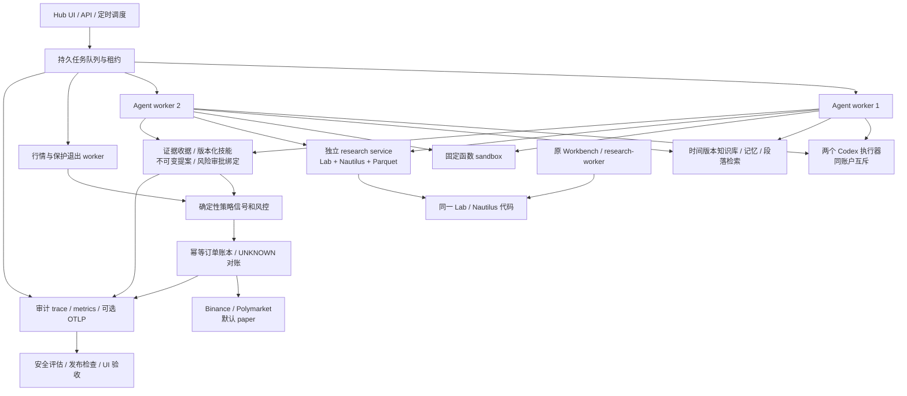

# QT Agent Hub v2：架构、运行与发布验证

核验日期：2026-10-21。本文区分已经实现的个人版、实际测试结果与未来平台能力；部署默认是 paper。

## 本次升级

- 完整工作流：研究 → 分析 → 原生策略验证 → 预测 → 独立提案审查 → 确定性执行 → 日志复盘。SQLite WAL 持久队列负责租约、续租、重试、后继原子入队与取消围栏。取消不能撤销已经提交的订单，也不会强杀正在推理的模型。
- 模型层继续使用本机 Codex 登录及两个容器执行器；六角色分别配置模型和技能，同一个 OAuth 身份串行推理。模型不获得交易凭证、任意 shell 或文件工具。
- 每个决策保存运行级证据收据、上下文 hash、角色技能版本、数据与策略 hash、验证结果、交易提案及风险审查绑定。伪造引用、跨 run 引用、过期数据、改动的提案或配置均不能授权执行。
- 原生研究服务接入现有 Lab/Nautilus，实现同一不可变策略的时间顺序训练/验证/样本外折、purge/embargo、双倍手续费压力、同窗口买入持有基准与统计区间。默认 SMA20/60 是显式基线；模型不能用它的成绩为另一个任意策略背书。
- 只有验证门禁通过、模型与确定性策略信号一致、证据有效、独立风险审查通过，才允许新增 paper 风险；已有目标仓位不会重复买入。Polymarket 的研究预测与适配器保留，但 BTC 回测不能授权预测市场交易。
- 交易恢复优先查原订单；不可变执行意图与 hash 保留原成交结果。UNKNOWN 只对账、不盲目重发。BUY 新增风险日额度与 SELL 减仓分离；active/reduce_only/frozen 三态策略在实际发送前再次检查。
- 知识库增加 available_at/observed_at/published_at 与版本，记忆追加历史版本；历史查询和回填来源明确分开。全文受限段落检索可取回截断尾部；当前是词法检索，不宣称语义向量检索或任意模型文件访问。
- 本地 trace、Prometheus 指标、可选 OpenTelemetry OTLP 导出、冻结安全评估与版本绑定的上线前检查。日志只保存允许的元数据和数字 token 统计。
- MCP 同时提供 2026-07-28 的逐请求协商、discovery、HTTP 头校验与完整结果，以及 2025-11-25 本地旧版兼容；三个工具只能检索、查看状态和提交不自动交易的研究，不宣告未实现的扩展。

## 实际技术栈和边界

| 领域 | 当前实现 | 选择理由与边界 |
|---|---|---|
| 工作台 | 原 Workbench：React 19 / TypeScript / Vite / Ant Design；Hub：FastAPI + HTML/JS | 保留已有研究产品，Hub 独立轻量管理界面；两者共享研究引擎而非合并数据库 |
| 服务 | Python 3.12、FastAPI、Pydantic、httpx | 按已锁定依赖构建，独立职责进程 |
| 编排 | 自有 SQLite WAL 队列、租约与 fencing | 单机个人版适用；不是跨区域高可用工作流引擎 |
| AI | Codex CLI 0.162.1、本地账户 OAuth、角色模型配置 | 本地集成，模型推理仍需要联网；同账户执行互斥 |
| 研究 | Nautilus Trader 2.0.0rc4、Lab、Parquet、现有 NumPy/Pandas/PyArrow | 研究独立重依赖镜像；rc 版本按现有引擎保留并验证 |
| RAG/记忆 | SQLite FTS5/BM25、CJK 回退、时间版本与文件 hash | 无外部 embedding 服务；相关性不等于事实蕴含 |
| 风控/订单 | Decimal、交易意图账本、Binance/Polymarket 适配器 | 确定性限额、持仓、时效、权限、未知状态与对账 |
| 执行环境 | 非 root、只读根目录、cap_drop、内部网络、限额、固定函数 sandbox | Docker 隔离不是恶意任意代码的 microVM 沙箱；禁止模型生成代码直接进生产容器 |
| 可观测性 | 本地 SQLite trace、受保护 metrics、OTel SDK/OTLP HTTP 1.45.1 | 默认无外部导出；可连接自有 Collector，凭证和原始提示词不入 trace |
| 发布 | Docker Compose / OrbStack、专用 Hub/原生引擎 CI、Chromium UI 验收 | 阿里云/腾讯云的真实环境、容灾、身份与网络仍需单独验收 |



## 日常操作

```bash
./deploy/orbstack.sh hub-up
./deploy/orbstack.sh hub-status
./deploy/orbstack.sh hub-test
./deploy/orbstack.sh hub-native-test
./deploy/orbstack.sh hub-ui-test
./deploy/orbstack.sh hub-exec api python -m qt.agent_hub.evaluation
./deploy/orbstack.sh hub-check
./deploy/orbstack.sh hub-exec api python -m qt.agent_hub.prelaunch
```

Hub 地址 `http://127.0.0.1:8878`。用本地 `.env.agent-hub` 中的 `QT_AGENT_HUB_SERVICE_TOKEN` 登录；不要把该文件提交到 Git。令牌只留在浏览器页面内存。先查看上线前验证、工作进程和风险模式，再提交完整流程；详情展示当前步骤的证据、实验与提案，Trace 可按 run 筛选。

角色模型、指令、限额和周期由 `config/agent-hub.yaml` 管理；`config/skills/*.yaml` 管理版本化技能，权限不能超过服务端编译的工具上限。修改后重建/重启并重新验收。只读挂载的 `data/agent-hub-imports` 支持有界 UTF-8 文本，资料进入个人租户的知识库；时间回填必须提供可核对的历史来源。

自动模拟交易仍受策略质量门禁。当前实盘自动执行会返回 `live_strategy_acceptance_not_verified`；填写账户凭据不会自动替代策略验收。不要把 `confidence` 当成校准后的胜率，也不要把“所有任务 succeeded”当成盈利或可实盘的证明。

## 验证方法和结果解释

2026-10-21 本机最终验收结果：

| 验证 | 实际结果 |
|---|---|
| Docker 常驻服务 | 9 个全部 healthy，另有 2 个成功退出的一次性初始化器；原 Workbench 健康检查通过 |
| Hub Docker 合同与故障测试 | 311 passed；2 个依赖 Nautilus 的场景在轻量镜像跳过，由下列原生镜像覆盖 |
| 原生研究 Docker | 17 passed，0 skipped |
| 前端单元/交互 | 68 passed；TypeScript typecheck 通过 |
| Chromium 真实 UI | 登录、风控恢复、证据检索、记忆、任务到 worker、Trace/发布检查、桌面与手机布局、退出，共 8 条链通过；0 JavaScript 错误 |
| 冻结安全评估 | 5/5 场景通过；使用实际队列、上下文、治理与 paper 账本，模型和研究为 fixtures |
| 实际 Codex 完整流程 | 6 角色、8 个步骤全部 succeeded，每步一次；114.6 秒；来源 ID 校验率 100% |
| 实际执行结果 | HOLD：模型未提议执行；原生策略同时为 fragile / eligible_for_paper=false |
| 发布检查 | paper_ready=true，live_ready=false；7 项工程检查通过 |
| 备份与恢复 | 升级前 42 个文件在隔离目录恢复，hash 与 SQLite integrity_check 通过 |
| 静态与独立 review | Ruff、6 个核心模块 strict mypy、Compose/shell/diff 检查通过；已修复独立 review 发现项 |

最终真实流程 ID：`e706ef0f4f8249cfb6822663737bd10a`。后端/界面代码指纹 `dcefcde32c31905d5cceb8bfd25558a0150b50b5db373dc1f16308c980b976e2`；代码、配置和技能组合指纹 `a86a522eb21206365de3b0a2429a7fb5f72f239e9502d4f6c18b0ec3dcd91953`。这些是该版本验收快照，不替代后续修改后的重新验证。

公共 BTC 报价、独立 paper 买卖和幂等恢复通过；Polymarket 公共发现通过。初次仅取 3 个市场未获得双边盘口，扩展至 10 个市场后读取到可用双边报价；没有发送 Polymarket 或 Binance 真实资金订单。来源 ID 校验率只证明引用属于所供材料，不能证明每个判断都被材料支持。

1. **合同/故障测试**：伪造证据、跨租户、历史可得性、重复执行、订单提交崩溃窗口、并发退出、发送前冻结、取消围栏、备份恢复、MCP 参数权限、trace 脱敏。
2. **原生引擎测试**：真实 Nautilus 执行、数据和策略 hash 校验、未来 bar/缺口/NaN 拒绝、账户不变量、费用和基准、预测概率 proper scoring。工程正确性与策略效果是两组指标。
3. **冻结安全评估**：五组 fixture 模型与研究报告走同一生产流程，验证合法 paper 成交、伪证据拒绝、风险否决、质量门禁、取消及成交后恢复。它不测模型本身的推理质量。
4. **真实集成验收**：本地 Codex 实际调用、六角色同 run、真实公开行情、独立 paper 买卖、原生回测、证据引用率与任务状态。
5. **真实浏览器**：Chromium 登录、资料导入/检索、记忆、风控恢复、任务提交到 worker 完成、Trace、发布检查、桌面/移动布局和退出。

报告落在 Docker named volume 的 `/state/verification-report.json`、`/state/prelaunch-report.json`、`/state/evaluations/latest.json`、`/state/ui-acceptance/`。发布检查绑定当前代码、挂载配置和技能；安全评估有效期 24 小时。`paper_ready` 仅表示这些工程门禁满足；`live_ready` 始终单独声明，当前为 false。

上一轮 review 的 R1/R2/R3/R7 已用恢复、减仓、证据注册和时间版本修复并补回归。R4 已把受验证的原生策略接入 Hub，R6 已加入专用 Docker CI；R5 通过服务端受限段落检索取回匹配内容，模型仍没有通用文件读取工具。本轮独立 review 又修复了监控任务挤掉验收证据、旧研究引擎审批继续执行、OTel 上游异常泄漏日志和自定义宿主端口的内部 UI 验收问题。

首次真实模型集成发现 `evidence` 返回了带解释的字符串，门禁按设计拒绝；输出 schema 已按每次上下文的来源 ID 生成枚举，解释保留在 summary。fixture 测试不能替代这类真实模型集成，因此两类结果分别记录。

本轮公开 BTC 999 根已收盘日线的默认 SMA20/60 研究：3 折、360 根 OOS、15 次原生执行；OOS 总回报约 1.44%、最大回撤约 -27.63%、Sharpe 约 0.186，低于 0.5 门槛，结论 `fragile` / `eligible_for_paper=false`。这是本次固定样本结果，不是未来收益预测；引擎 bar 模型暂不支持独立 bps 滑点/市场冲击压力，报告明确这一限制。

## 备份、恢复和升级

本轮迁移前停止 scheduler、两个 worker 和 market-worker，在无 API 写入的维护窗口完成旧 Hub 备份及隔离恢复校验。四个域 SQLite 数据库分别使用 SQLite backup API；文档和审计工件使用文件 hash 校验。备份不含 OAuth、交易凭据和外部 imports。

```bash
./deploy/orbstack.sh hub-stop scheduler worker-1 worker-2 market-worker
./deploy/orbstack.sh hub-exec api python -m qt.agent_hub.backup
./deploy/orbstack.sh hub-start scheduler worker-1 worker-2 market-worker
```

需同时禁止维护窗口内的 API 写操作。逐库 online backup 不能保证跨库一致性，所以必须暂停写者。备份在 `/state/backups`；同盘备份用于升级恢复，不等于异地灾备。研究服务独立 `hub-research-state` volume 需另行停止服务并备份其 Parquet/报告/数据库；Hub 证据工件保留输入与 hash，可用于重新计算。实际还原时先恢复到新卷并校验路径与权限，保留旧卷；不要直接删除或覆盖现有数据。

## 与 2026 年企业实践对照

2026 年 9—10 月的一手资料支持的是“持久工作流 + 独立执行环境 + 有来源的上下文 + 持续评估”，并不要求个人版同时堆叠多个编排框架。

- [AWS / Heurist Finance，2026-09-09](https://aws.amazon.com/blogs/machine-learning/how-heurist-finance-built-an-ai-native-investment-workbench-on-amazon-bedrock-agentcore/)：金融研究工作台把身份、记忆、计算与追踪结合。本项目采用同样的职责划分，但未声称具有其托管平台和团队规模。
- [AWS / Abnormal AI，2026-09-14](https://aws.amazon.com/blogs/machine-learning/abnormal-ai-amazon-bedrock-agentcore-for-agentic-email-security-at-scale/)：规则、ML、Agent 分层处理，复杂计算使用受限环境。本项目把下单与风控保留在确定性代码中。
- [LangChain Context Engineering，2026-10-14](https://www.langchain.com/blog/context-engineering-deep-agents-remember)、[Skills，2026-10-07](https://www.langchain.com/blog/revamping-skills-in-deep-agents)：按需上下文、外置与可恢复读取、版本化技能。本版实现受限段落检索与显式工具授权，暂不声称任意长任务文件系统 Agent。
- [Numan / LangGraph + LangSmith，2026-10-19](https://www.langchain.com/blog/how-numan-built-an-eval-first-ai-health-coach-with-langgraph-and-langsmith)：评估走与生产相同的流程。本版的安全评估复用生产运行时；模型事实蕴含与金融预测校准仍需要更大金标集。
- [Temporal × AWS，2026-10-13](https://temporal.io/blog/temporal-and-aws-a-partnership-built-for-production-grade-ai)：持久任务与计算边界分离。相关 Serverless 集成有 Preview / Pre-release 状态；本版不因此迁移稳定的单机队列。
- [MCP 2026-07-28 规范](https://modelcontextprotocol.io/specification/2026-07-28/changelog)：每请求协议元数据、stateless discovery 与扩展机制。工具协议与订单授权仍是不同边界。
- [OpenTelemetry Python](https://opentelemetry.io/docs/languages/python/instrumentation/)：使用标准 SDK 及 exporter，与本地业务账本并存；遥测故障不能改变订单结果。

## 下一阶段达到团队/多租户平台的条件

当前提供 tenant-scoped 数据访问基础，不是完整多租户 SaaS。下一阶段按真实需求补齐：OIDC/RBAC/服务身份、Postgres RLS 与迁移、按租户账户/对象存储/配额、跨进程或跨主机的持久工作流、outbox 与事件总线、独立凭据代理、受限出网的 microVM 沙箱、混合检索与 reranker、事实蕴含金标集、来源可验证的真实已结算预测数据集、持续 Brier/log loss/校准及分市场报告（基础评分函数已实现）、真实费用/流动性与撮合回放、连续 paper/shadow 观察、SLO/告警/异地恢复演练。

Temporal、LangGraph、A2A 或向量数据库应分别解决明确问题；同一个工作流只保留一个状态真相来源。部署阿里云 ECS/ACK 或腾讯云 CVM/TKE 时，先完成私网、TLS、身份、Secret Manager、托管数据库、备份及故障恢复，再考虑公网入口和多租户商业服务。
