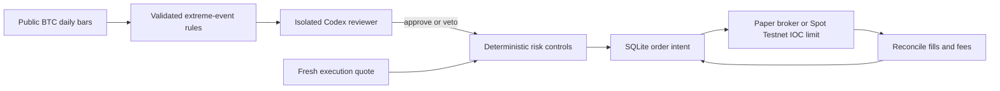

# Codex Bitcoin agent: operation and testnet acceptance

This isolated service monitors BTC/USDT every five minutes, evaluates completed
UTC daily candles, and trades only paper money or Binance Spot Testnet assets.
There is no production trading mode. It runs independently of the existing QT
dashboard, platform workers, and live broker.

Read the [research and exact signal rules](codex-btc-research.md) first. The
thresholds are hypotheses. Neither an AI approval nor a testnet fill establishes
profitability. The first release monitors price and volume; news, on-chain,
derivatives and macro data are not integrated into its decision feed.
Current execution evidence and remaining prerequisites are in the
[acceptance report](verification/codex-btc-agent-acceptance.md).

## Design



The worker has exchange credentials. The reviewer has only `CODEX_API_KEY`,
no worker volume, and no published port. Each Codex call gets a fresh temporary
home, read-only sandbox, disabled tools/search/plugins, a JSON schema, and a
100-second timeout. [Official non-interactive Codex documentation](https://learn.chatgpt.com/docs/non-interactive-mode)
describes the CLI integration. Model errors and malformed replies veto entry.
Protective exits use fresh quotes without depending on Codex or daily candles.

Default limits: 25 USDT per order including a 0.5% fee reserve, 25 USDT daily
buy budget, 100 USDT owned exposure including recorded dust, one active
position, seven days between entries, no leverage or short positions. Exit at
10% loss from fee-adjusted cost, 15% trailing decline after a 20% gain,
90 days held, or daily overheating. Exits are chunked to the order limit.
An IOC limit bounds price but may partially fill or expire. New strategy entries
also require the refreshed ask to remain within
5% of the signal's daily close. Stops are software
checks, not exchange-hosted protection; gaps, outages and illiquidity can
produce larger losses. The exposure cap governs entries, not subsequent gains.

SQLite WAL stores intents before submission, fills, owned positions, per-day
spend, review inputs/output hashes, and heartbeat events. Unknown submissions
are reconciled by client ID and never automatically resubmitted. A file lock
prevents two workers using the same mode/database. Testnet and paper ledgers
are separate; changing the API key requires a separate state directory.

BTC left below venue minimums after an exit is retained as `dust_btc` and
`dust_cost`. It counts toward exposure and inventory checks, but is not treated
as an active position. No automatic dust conversion or balance write-off exists.

## Start in Docker

```bash
mkdir -p data/runtime
cp config/btc-agent.env.example data/runtime/btc-agent.env
chmod 600 data/runtime/btc-agent.env
docker compose --env-file data/runtime/btc-agent.env -f docker-compose.btc-agent.yml up -d --build
docker compose --env-file data/runtime/btc-agent.env -f docker-compose.btc-agent.yml exec worker python -m qt.btc_agent status
docker compose -f docker-compose.btc-agent.yml logs --tail=20 worker
```

The default is paper mode with 1,000 virtual USDT. With no Codex API key, the
worker still monitors public data but cannot approve entries. Configure a
valid API key only in the untracked environment file. The Compose reviewer
gets only that key; exchange keys are passed only to the worker. The reviewer
health check proves HTTP liveness, not successful model authentication.

`BTC_AGENT_CODEX_MODEL` selects a supported Codex model. An empty value uses
the pinned CLI's default; model identity is not resolved into the audit table.
The CLI version is pinned in `Dockerfile.btc-agent`. Top-level Python packages
are pinned; transitive dependencies and base image tags are not a full lockfile.

Both containers restart unless stopped, have bounded logs and memory, run as
non-root, and publish no host ports. Keep Docker and the machine running and
disable sleep for continuous monitoring. Docker health status alone does not
restart an unhealthy worker or send an external alert; monitor it operationally.
No 24-hour soak is implied by a successful startup check.

## Testnet validation

Bitcoin L1 testnet/testnet4/signet tests on-chain transfers. It does not provide
a BTC/USDT order book. This service uses the [official Binance Spot Testnet](https://github.com/binance/binance-spot-api-docs/blob/master/testnet/general-info.md)
to test trading. Its balances and liquidity are virtual and periodically reset.
No Bitcoin wallet or mainnet key is required or accepted.

1. Create dedicated keys at [Binance Spot Testnet](https://testnet.binance.vision/).
   Configure `BINANCE_TESTNET_API_KEY` and `BINANCE_TESTNET_API_SECRET` locally,
   plus `CODEX_API_KEY`. Do not reuse the existing QT production credentials.
   Disable BNB fee discounts: third-asset commission is rejected by this ledger.
2. Set `BTC_AGENT_MODE=testnet` in the same environment file. Keep the testnet
   account dedicated to this service. A balance reset or manually removed BTC
   blocks execution rather than overwriting owned inventory.
3. Stop the worker while running the one-shot test so it can acquire the lock:

```bash
docker compose -f docker-compose.btc-agent.yml stop worker
docker compose --env-file data/runtime/btc-agent.env -f docker-compose.btc-agent.yml up -d reviewer
docker compose --env-file data/runtime/btc-agent.env -f docker-compose.btc-agent.yml run --rm worker probe-testnet
docker compose --env-file data/runtime/btc-agent.env -f docker-compose.btc-agent.yml run --rm worker testnet-round-trip
docker compose --env-file data/runtime/btc-agent.env -f docker-compose.btc-agent.yml up -d worker
```

`probe-testnet` without keys checks only public quotes. With keys it also checks
balances. `testnet-round-trip` is an explicit plumbing test: it requests Codex
approval for a test buy independently of strategy conditions, sends bounded
IOC orders, and requires positive confirmed buy and sell fills, no pending
orders and no active position. It reports any retained dust separately.
A Codex veto, zero fill, or ambiguous submission does not pass the smoke test.
Run it once in a clean testnet ledger; do not delete state to bypass cooldowns.

## Recovery and stopping

```bash
docker compose -f docker-compose.btc-agent.yml exec worker python -m qt.btc_agent halt
docker compose -f docker-compose.btc-agent.yml stop worker
# After inspecting pending orders and balances, with the worker stopped:
docker compose --env-file data/runtime/btc-agent.env -f docker-compose.btc-agent.yml run --rm worker resume
docker compose --env-file data/runtime/btc-agent.env -f docker-compose.btc-agent.yml up -d worker
```

`halt` blocks all new orders, including protective sells; it does not liquidate.
Reconciliation can continue while halted. `resume` refuses unresolved orders.
For uncertain submissions, preserve the database and check the exchange order
and trade history. If lookup cannot establish an outcome, the worker remains
blocked for operator investigation. Do not issue replacement IDs, delete the
database, or clear the original order. Testnet resets can erase evidence;
archive the stopped volume and start a clearly separate experiment only after
reconciling what is recoverable. There is intentionally no forced resolution.

An AI candidate is reviewed at most once per daily bar, including failures;
this prevents retry storms. Next day's qualified candidate can be reviewed
again. The `reviews` table retains successful and failed review attempts;
`events` retains the latest 10,000 operational records and order records remain.
Back up SQLite using its backup API while running, or copy the whole volume
while stopped. `docker compose down` retains state; `down -v` destroys it.

## Validation commands

```bash
.venv/bin/pytest -q tests/test_btc_agent_*.py
.venv/bin/ruff check src/qt/btc_agent tests/test_btc_agent_*.py
.venv/bin/mypy --follow-imports=silent src/qt/btc_agent
python -m qt.btc_agent backtest > data/runtime/btc-agent-backtest.json
```

The backtest downloads up to 1,000 daily production candles and compares the
rules with buy-and-hold and monthly DCA from the same 100-USDT initial capital.
It uses next-open fills, 10 bps fee and 10 bps slippage per side, completed data,
and no Codex look-ahead. This rule-only diagnostic uses daily risk checks and
whole-position synthetic exits, unlike the service's polling and capped IOC
fills. It is not an AI backtest or an out-of-sample profitability validation.
