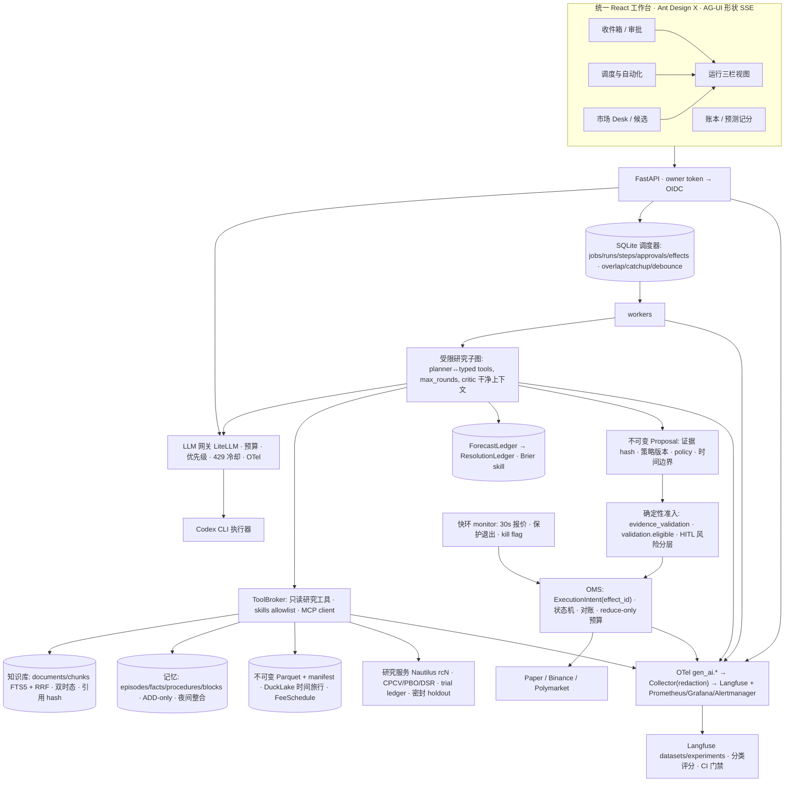

# QT 行业调研与优化方案：个人金融交易 Agent 对标 2026 年企业最佳实践

调研日期：**2026-10-21**。源码基线：`e4a7588`。本文是独立调研报告，不修改业务代码。信息来源分三类：(1) 本仓库源码与运行记录；(2) 2026-09 及以后的一手资料（厂商发布、官方文档、arXiv、监管文件），标注日期；(3) 仍然有效的更早滚动文档，单独标明日期。标注"**未核实**"的条目只有二手来源或厂商自述。

调研由七条并行线索完成，共约 230 次检索与原文抓取：金融量化 Agent 产品、企业 Agent 平台与案例、记忆/RAG/技能/MCP、监控/trace/评测/治理、回测与量化研究循环、编排/定时/UI、以及本仓库产品面盘点。

---

## 0. 需求整理

| 用户目标 | 本文对应章节 | 交付形式 |
|---|---|---|
| Review 项目现状 | §1 | 能力矩阵、真实拓扑、本轮新发现 |
| 调研 Agent 监控 / 多 Agent / 定时任务 / RAG / 记忆 / 回测 / 全链路 trace | §4–§7 | 每个专题：行业现状、工具成熟度、对 QT 的适用性 |
| 调研同类金融量化 Agent 产品（监控、机会发现、回测、交易）的功能与技术实现 | §2 | 产品清单、共性功能模式、技术模式、未被证明的事 |
| 调研 2026-09+ 企业 Agent 实践：场景、架构、部署、记忆、执行环境、知识库、技能、MCP、回测、监控、日志、稳定性一致性、生态与选型、案例 | §3 + §4–§7 | 平台发布时间线、参考架构、12 条企业实践、案例表 |
| 结合项目目标给出达到行业最佳实践的优化建议：架构、功能、UI 细节 | §8–§10 | 差距矩阵、目标架构、分阶段路线、数据模型/API 合约、UI 信息架构 |
| 用于准备 Agent 架构师 / 专家岗面试 | §11 | 三条演示、知识点到仓库证据的映射、高频追问 |

两个目标存在张力：**个人交易系统**要求简单、可靠、少组件；**面试展示**要求覆盖企业级能力。本文的处理方式是：个人版只做"合同正确"的最小实现，每个合同都对应一项可以在面试中展开的企业能力，不为展示而堆框架。

---

## 1. 项目现状 Review

### 1.1 定位

QT 当前是**两套并行的个人系统**：React 研究工作台（8877，Nautilus/Lab 严格验证）和 Agent Hub（8878，六角色固定流水线 + paper 账本）。Hub 已具备持久队列、租约与 fencing、证据收据、确定性风控、不可变意图、UNKNOWN 对账、本地 span 账本 + Langfuse OTLP 导出、冻结安全评测、发布就绪检查。准确定位是**可审计、可恢复的多角色研究评审流水线**，不是自主研究 Agent 平台，也不是多租户交易平台。此前三份审查（[项目审查](project-review-2026-10-21.md)、[全栈复核](agent-hub-full-stack-architecture-review-2026-10.md)、[2.1 验收](agent-hub-enterprise-review-2026-10.md)）已记录 R1–R7 与后续发现，本文不重复，只引用。

### 1.2 能力矩阵（本轮源码盘点）

| 维度 | 当前实现（源码位置） | 状态 |
|---|---|---|
| 编排 | `runtime.py` FLOW：discover→research→analysis→backtest→forecast→risk_review→execute→log_review；SQLite 队列、租约、fence、deadletter、原子后继入队（`store.py`） | 固定流程、单机；无 overlap/catch-up/debounce/priority 策略；取消未传到执行器 |
| 定时 | 6 个 schedule，2 秒 tick，按 interval 桶去重，错过的桶不补（`store.py:596-649`） | 无 catch-up、无 monitor 专属语义（notify-on-change / end condition） |
| 角色 | 六角色各一次模型调用，服务端预取证据，`skills.require_tool` 门禁 | 无多轮补证据循环、无并行子课题、无反证汇合 |
| 模型接入 | RemoteCodex → Codex CLI，两容器共享 OAuth 锁，推理串行 | 单 provider、模型未钉住、无取消 handle |
| RAG | FTS5/BM25 + CJK 子串补偿；`_visible(as_of, known_at)` 双时态过滤；文档级排序后取片段（`context.py`） | 无段落级 chunk、无 RRF 两阶段、无重排、无检索评测 |
| 记忆 | short/long、版本、TTL、sha；短记忆按 tenant 读取 | 已复现跨任务污染；无事实/经验/规则分层；无整合与晋升策略 |
| 技能 | 六个 YAML manifest：version、allowed_tools、schema、evaluation_tags、sha（`skills.py`） | 非 SKILL.md 可移植格式；无评测样本、无扫描 |
| MCP | 3 个工具；支持 2026-07-28 stateless 与 2025-11-25 legacy（`mcp.py`） | 无 MCP client、无 tasks 扩展、无 OAuth |
| 回测 | Nautilus 2.0.0rc4；SMA20/60；3 折时间 OOS、purge/embargo、分折 block bootstrap、8 条 gate、prefix 不变性审计（`research_service.py:315-338`） | 无 trial ledger、无 CPCV/PBO、DSR 只对单候选、holdout 未密封、延迟成交会计失败阻断 |
| 机会发现 | BTC 日线特征 + 盘口深度/冲击；Polymarket 费用曲线、到期窗、规则 hash（`opportunities.py`） | `estimated_probability`/`net_edge` 恒为空；排除 <1h 市场；无预测/结算账本 |
| 交易 | 订单状态机（PREPARING→SUBMITTING→UNKNOWN/NEW/…→终态）、Decimal 账本、风险模式 active/reduce_only/frozen、`_risk` 多项检查（`trading.py`） | R1 重试生成新 intent；R2 退出额度与开仓共用（见项目审查） |
| 可观测 | 本地 `invocation_spans`，OTLP→Langfuse 4.66 已验证 37 span 父子/token；`/metrics` | counter 非单调；无 Collector/redaction；无日志关联；无告警；无自动补发 |
| 评测 | 冻结 `production-workflow-safety-v2` 5 场景；发布就绪 7 项（`evaluation.py`, `release.py`） | 无分类数据集、无检索/引用/时间正确性评测、无 judge 校准 |
| Hub UI | 单文件原生 HTML（127 行），15 秒轮询，仅中文，表格 + `<pre>` JSON；`DELETE /api/memories`、`/api/orders/{id}`、`/api/artifacts`、scan detail 等端点 UI 未使用 | 无 SSE、无图表、无分页/过滤、`risk_review` 不可选 |
| 部署 | Compose/OrbStack；只读根、非 root、cap_drop；Hub 9 服务 + Langfuse 6 服务 | Hub 无云端验收；TC 部署仅工作台 |
| 测试 | 118 个 Python 测试文件，Hub 14 个文件含租约/fence/UNKNOWN/崩溃恢复注入；Playwright 桌面+移动 | R1–R4 的端到端故障场景尚未作为测试加入 |

### 1.3 本轮新增判断

- 固定六角色流水线在 2026 年的行业语境下**不是缺点**：Cognition（2026-04-22）、OpenAI Agents SDK、Microsoft Morgan Stanley FIXR 案例都在收敛到"单写者 + 多个只读智能贡献者"。QT 的 execute 是确定性代码、只有一个写者，已经符合这个原则。缺的是研究阶段的有界循环，不是更多角色。
- QT 的 FTS5 + 双时态过滤方向正确。独立基准显示纯 FTS5 两阶段 + RRF 无 embedding 可达 LongMemEval R@5 97%（Exocortex，2026-04-07）。不需要为"有向量库"而引入向量库；需要的是段落级 chunk、RRF、检索评测。
- 上游 NautilusTrader 已到 2.0.0rc7（2026-10-15），rc5–rc7 含破坏性变更（费用模型迁移到 venue、catalog API、Polymarket TWAP 仅 60s、`batch_deltas` 默认开启会改变成交）。QT 钉在 rc4 是正确的，但升级必须附带 fills diff。
- Hub UI 与行业参考产品（Perplexity Finance、Bloomberg ASKB、QuantConnect Mia、Devin、ChatGPT Scheduled）差距最大的是：没有"需要你处理"的收件箱、没有证据面板、没有计划卡、没有预算仪表、没有可分享的运行链接。

---

## 2. 同类金融量化 Agent 产品调研

### 2.1 产品与项目清单（按类别，优先 2026-09+ 信息）

**零售 / 专业个人**

| 产品 | 最新信息 | 功能（监控/发现/回测/执行/风控） | 技术实现要点 | 对 QT 的启发 |
|---|---|---|---|---|
| QuantConnect Agents / Mia（LEAN） | 文档 2026-10 | 全流程 Agent 团队：Ideas→Research→Validation（critic）→Backtest→Paper→Live Monitoring，Kanban 研究流水线；Mia 空闲时自动拉下一张卡 | 服务端 Agent Harness 紧挨数据与 Object Store；持久状态、回测完成唤醒；结构化回测诊断（分级、封顶、重复 3 次静音、SPY 基准）回喂 Agent；按域读写权限，**实盘需显式 write grant**；外部 MCP 挂到同一权限模型；每次运行 token/retry/escalation 遥测；Paper 测试三门禁：按代码执行、paper 与同区间回测一致、OOS 落在回测统计包络内 | 分阶段流水线 + critic + 结构化回测诊断 + 实盘单独授权，是个人 Agent 的最完整参考设计 |
| Robinhood Agents / Cortex / Trading MCP | 2026-09-29 HOOD Summit | 应用内 Agent（可选第三方模型）、独立**agentic account**（资金隔离）、Loops 定时指令、外部 Agent 通过 `agent.robinhood.com/mcp/trading` 接入 | 内置 Agent 默认开审批，外部 MCP 账户默认关；Agent 只能交易自己的子账户；150k agentic accounts、约 30M tool calls/日 | 把 Agent 资金隔离到子账户，审批默认开，执行以 MCP 工具暴露 |
| Public.com MCP | 2026-09-29 | 第三方 Agent 读账户/行情、下单（股票/期权），OAuth | 披露明确："Agent 可能在没有逐笔确认的情况下交易" | 披露模板 |
| Perplexity Finance / Computer | 2026-10-01（TradingView 集成）、2026-10 changelog | 40+ 金融工具（SEC、FactSet、S&P、Coinbase、CBOE）、Plaid 关联券商、Polymarket 数据工具、可追溯到来源、Automations（定时/事件）、**Decisions API 返回概率** | 不执行；每个数字标来源与 as-of | "来源可追溯 + 概率输出端点"是预测市场研究层的好模式 |
| OpenBB Workspace / Copilot / Agent Rita | 文档 2026 | 双向 MCP：外部 Agent（Claude Code/Codex/Cursor）控制 Workspace；Copilot 调第三方 MCP；自定义 Agent 实现 `/agents.json` + `/v1/query` SSE | FastAPI + `openbb-ai`；Copilot 可把自己的表/图提升为仪表盘 widget | 标准"Agent 合约"（元数据端点 + SSE 查询端点）让研究 UI 可替换 |
| Composer MCP / Alpaca MCP | 2026 | Composer：Agent 创建指标策略、**回测作为工具迭代**、搜索 1000+ 策略；Alpaca：FastMCP + OpenAPI，paper 交易 | 托管 MCP | "回测作为 LLM 可反复调用的工具"是最便宜的想法验证方式 |
| TradingView AI Copilot | 2026-10-20 | 图表内助手：换标的、加指标、画位、建告警、写 Pine、回测优化已有策略 | 付费附加；明示"分析非建议" | 图表即工作面 |
| Trade Ideas Holly / Tickeron / Danelfin / Kavout | 2026-08/10 | 信号 + 止损/目标、无代码回测、AI 评分；部分可直连券商 | 第三方对比文指出 Kavout 无公开费后超额收益证据 | 评分产品普遍缺少费后证据 |

**开源 LLM 交易 Agent 框架**

| 项目 | 最新信息 | 架构 | 2026 年关键教训 |
|---|---|---|---|
| TradingAgents（Tauric） | v0.7.0 2026-10-16；v0.5.2 2026-09-29 | LangGraph；分析师（市场/新闻/情绪/基本面）→多空研究员→交易员→风险团队→组合经理；结构化输出；checkpoint 恢复；决策日志记忆按后续收盘结算 | 8 个月内反复修 look-ahead：as-filed EDGAR、按分析日过滤数据、**决策从决策日之后第一个收盘计分**（v0.7.0 修复盘后新闻泄漏）；`max_tool_rounds` 默认 20；Polymarket/FRED 数据源 |
| ai-hedge-fund（virattt） | v2.6.0 2026-10-19 | 单一 `advance` 动词（reconcile→执行待定决策→标记→评估），回测与 paper 同一代码路径；T 决策 T+1 执行；**hash 链 append-only 账本**重放重建状态；每 tick 先对账券商；**任何失败停机直到人工清除**；审批步骤展示精确决策；**盲化 prompt**（去掉代码/行业/日期，用市值分位）防模型记忆泄漏；按命中率/IC 给分析师打分 | 计划加入 CPCV/PBO 门禁 |
| Microsoft RD-Agent(Q) | v1.0.0 2026-09-23 | Research（假设）↔ Development（Co-STEER 代码生成）反馈环；多臂老虎机调度方向；因子-模型协同优化于 Qlib 回测；因子去重（IC ≥0.99 丢弃） | 论文声称 2× ARR、因子少 70%、<$10（A 股，厂商自述） |
| FinRobot V2 / FinGPT | Desktop v0.1.0 2026-07 | PydanticAI + FastAPI + React/Tauri；**32 个确定性计算算子产生每个数字，LLM 只叙述；6 个审计算子核对叙述与数字**；7 数据源故障切换；多空辩论 + 裁判 | "模型推理、软件计算、系统核验"的分工 |
| Hummingbot MCP + Condor | 2026 | OODA：Observe/Act 确定性，Orient/Decide LLM；**按席位的工具 profile**（无人值守 tick 循环 37 个工具，无流动性/管理工具）；`agent.md` 限额；技能/记忆/例程/日志 | 建议 API 放在 Tailscale 后 |
| Freqtrade | 2026.8 | 无内置 LLM（维护者持怀疑）；FreqAI 常规 ML；hyperopt 触碰指标参数时告警 | 可借鉴的 Agent 循环护栏 |
| 其余 | Polymarket/agents（已归档 2026-05）→ `Polymarket/agent-skills`（SKILL.md 渐进披露）；FinMem、StockAgent、QuantAgent 2026 低活跃；`LLMQuant/awesome-trading-agents`（2026-04） | — | — |

**加密 / DeFi / 预测市场 Agent**

| 项目 | 最新信息 | 要点 |
|---|---|---|
| Polymarket 生态 | Galaxy Research 2026-10-01：>50 单/日的账户占 4.1% 账户、**80.8% 订单、41% 名义、$246.8M 利润**；2026-10 月成交 Polymarket $3.02B、Kalshi $4.39B | 对手是作为流动性的机器人；边际必须来自预测流程与执行纪律 |
| Olas Polystrat | CoinDesk 2026-03-15 | 用户自有自治 Agent；声称 37% Agent 正收益 vs 人类 7–13%（**未核实**）；CEO 称朴素 LLM prompt ≈ 抛硬币 |
| Senpi（Hyperliquid 运行时） | 2026-04-01；`senpi-skills` | $230M+ Agent 成交；关键结论：**"入场需要智能，出场需要可靠性"** → 动态止损移入确定性运行时（10–30s 轮询，两阶段 trailing，交易所止损兜底）；技能含 `risk.guard_rails`（日亏损、回撤停机）和实盘"bugs & gotchas"文件 |
| Open Broker | 2026 | 非托管 CLI/SDK；**本地 SQLite 审计日志**；每条命令 dry-run |
| Nansen AI | 2026-01-29 | fast/expert 模式；SSE `tool_call` 事件；准备 swap 需用户确认；**x402 微支付按端点计费（$0.01–0.05）** |
| Glassnode MCP（beta，7 工具）、CryptoQuant 远程 MCP（9 工具、OAuth PKCE）、Messari AI、Coinbase AgentKit x402 hooks（2026-10-09/19） | 2026 | 数据厂商统一以受治理 MCP 分发；x402 前置支付钩子 + 支出上限 |

**机构 / 企业**

| 机构 | 最新信息 | 实现 |
|---|---|---|
| BlackRock Aladdin Copilot / RockAI | 2026 WSJ；LangChain Interrupt | LangGraph supervised multi-agent；插件注册表让 50–60 个领域团队注册工具；输入/输出 guardrails；不给投资建议 |
| Bloomberg ASKB | 2026-02-23 发布，2026-04-16 路线图 | 并行 Agent 网络；多商业 + 开放权重模型（非 BloombergGPT）；每个答案引用来源；**输出 BQL 代码**；Workflows 自动化 |
| Man Group AlphaGPT | 2026 | Idea/Implementer/Evaluator 三角色写 Python；信号必须通过与人类研究相同的统计/经济门槛；"数十个"获批实盘；遇到幻觉、look-ahead、多重检验问题；与 Anthropic 合作（2026-02） |
| JPMorgan | Dimon Q3 2026-10-14 | LLM Suite 150k 周活；模型无关路由到最便宜模型；regime-agent 论文（8 个配置，最佳 Sharpe 0.95 vs 60/40 0.61）作者自己警告 look-ahead 回忆 |
| Morgan Stanley FIXR | 2026-06-30 | 三个协作 Agent 做 P&L 对账，**刻意降低自主性**；6h→2–3h/本，省 ~1,500 controller 小时/周 |
| Two Sigma | 2026 | "AI 作为研究操作系统"；Agent 注册表记录 owner/purpose/tools/endpoints；控制按 Agent 行为分级；"明年不会是 LLM 下单" |
| Numerai Unity | 2026-10-16 | 真实代码 + 1,040 特征，明确号召"构建 agentic 研究流水线"；Numerai MCP、SKILLS.md |
| 数据厂商 | FactSet MCP（23 工具）、S&P/Kensho、Moody's MCP、Daloopa 只读 OAuth MCP | 受治理、带权限的 MCP 成为分发标准 |

**评测与基准**

| 基准 | 日期 | 结论 |
|---|---|---|
| Vals Finance Agent v2.1 | 2026-10-19 | 449 个私有分析师任务；Top：Claude Opus 5.5 67.85%、Gemini 4 Argon 67.66%；每题成本 $0.07–$8.91；**衡量研究不衡量交易** |
| Alpha Arena（nof1.ai） | 2025-10/12 后休眠 | 唯一真金赛季 2/6 模型盈利；无 Season 2 |
| TradeRank | 2026-10-20 | 22 模型模拟 $10k，11 天 17/22 负收益 |
| LiveMACE（arXiv 2610.09872） | 2026-10-07 | 30 天实时 paper，5 个前沿模型：**收益排名与能力排名大量反转**；记忆降低尾部损失但收益异质；集中度违规来自算错持仓后暴露 |
| FARSIGHT SoK（arXiv 2609.19705） | 2026-09-17 | 15 个学术 LLM 交易方案无一在任何稳健性指标拿满分；**没有一篇有绕过 LLM 推理的停机路径**；7 个开源发布**无一在 LLM 之外强制止损或仓位限制** |
| SwingGuard（2610.12988）、AlphaPilot（2610.15488）、AlphaDiverse（2609.29014）、VST（2609.07065） | 2026-09/10 | 双时间尺度（日频辩论 + 5 分钟确定性风控）；RL 工具型 alpha 挖掘（A 股）；VST 诚实报告所有方法超额收益为负 |

### 2.2 行业共性功能模式（15 条）

1. 执行前人工审批，**默认开启**（Robinhood、Nansen、ai-hedge-fund、QuantConnect live grant）。
2. **隔离的 Agent 资金**：子账户 / 小额会话钱包（Robinhood、Senpi、Bankr 建议）。
3. **阶段门禁流水线与晋升**：idea→research→validation/critic→backtest→paper→live，常以 Kanban 呈现（QuantConnect、ai-hedge-fund、Man AlphaGPT Evaluator）。
4. **paper 与回测偏差监控**作为调查触发器（Mia）。
5. **证据引用、来源可追溯**（ASKB、Perplexity、Hebbia 句级、FinRobot provenance）。
6. **时点数据纪律与泄漏防御**：as-filed、按下一收盘计分、日期/代码盲化（TradingAgents、ai-hedge-fund、StockBench）。
7. **确定性数字、LLM 叙述**（FinRobot、Condor OODA、Senpi "出场是基础设施"）。
8. **结构化输出 / schema 校验的决策**（TradingAgents、Nocturne、QC JSON schema、Perplexity Decisions API）。
9. **append-only 可重放审计账本**（ai-hedge-fund hash 链、Open Broker SQLite、LiveMACE 决策轨迹）。
10. **模型外的 kill switch 与异常停机**（ai-hedge-fund、Senpi、FARSIGHT 建议）。
11. **定时/常驻循环**（Robinhood Loops、Perplexity Automations、QC 市场时段调度、cron 安全幂等 tick）。
12. **按 Agent 的记分卡与校准追踪**（命中率/IC、QC 车队遥测、Numerai NCORR/MMC）。
13. **多空辩论 + 裁判**去偏（TradingAgents、FinRobot、Boosted Alfa Prime、SwingGuard）。
14. **按成本/角色的多供应商路由**（JPMorgan、TradingAgents 分层 provider、Robinhood 模型选择）。
15. 显式"非建议 / 风险自负"披露。

### 2.3 共性技术架构模式

- **MCP 作为通用集成层**：券商（Robinhood、Public、Alpaca）、机器人（Hummingbot）、数据厂商（FactSet、Glassnode、CryptoQuant、Nansen、Numerai）、研究 UI（OpenBB）。Agent 运行在 Claude Code/Codex/Cursor/OpenClaw 中调用它们。
- **SKILL.md 渐进披露的领域技能**（Polymarket agent-skills、Senpi、Numerai、Hummingbot、Binance skills hub）。
- **角色专精多 Agent 图**（LangGraph 最常见）+ 有界工具轮次 + 编排者。
- **Harness/运行时与 LLM 分离**：持久状态、恢复、事件唤醒、按工具域权限、按上下文收窄工具集（QC、Condor seats、AlphaCrafter "harness engineering"）。
- **双时间尺度控制**：慢 LLM 策略环（日/小时）+ 快确定性风控/退出环（秒–分钟）。
- **回测引擎作为工具调用**，结构化诊断回喂（LEAN analyzer、Composer、RD-Agent/Qlib）。
- **记忆**：决策日志按实现结果结算；LiveMACE 显示"检索 ≠ 学习"。
- **执行适配器**：重试、精度取整、每 tick 前按交易所状态对账、交易所侧止损兜底。
- **x402 按调用付费数据**，客户端支出上限与前置钩子。
- **可观测**：按运行的 token/时长/重试遥测、交易日记经 HTTP/Telegram 暴露。

### 2.4 尚未被证明的事

- **真金持久 LLM alpha**：Alpha Arena 唯一真金赛季 2/6 盈利且停办；TradeRank 17/22 负；StockBench 多数模型跑不赢买入持有；LiveMACE 收益不随能力。正面声称（Polystrat 37%、Senpi WOLF、SwingGuard Sharpe 2.98、RD-Agent 2× ARR）均为厂商自述或短样本单市场回测。
- **含 LLM 的回测被训练数据回忆污染**：JPMorgan 作者自己标注；多个框架 2026 年内才修 look-ahead。任何 2025 年前数据 + 前沿模型的回测应视为样本内。
- **自主执行的安全性**：FARSIGHT 发现无学术方案在 LLM 外强制仓位限制/止损、无非 LLM 停机路径；零售披露明确 Agent 可能在陈旧数据上行动并亏光。
- **机构"Agent 产生 alpha"是流程声称**：Man Group 说 AI 信号过与人类相同的门槛；未公开 P&L 归因。
- **预测市场 Agent 的边际**：Galaxy 数据证明机器人主导流量且总体盈利，但未证明 LLM 预测者是盈利子集；大部分利润可能来自做市/套利。
- **基准 ≠ 交易**：Vals 67% 衡量分析师任务；StockBench 显示 QA 强不等于交易行为好。

---

## 3. 企业 Agent 实践（2026-09 及以后）

### 3.1 平台发布时间线

| 厂商 | 发布 / 日期 | 可核验内容 | 成熟度 | 对 QT 的意义 |
|---|---|---|---|---|
| OpenAI | Agents API 公测 2026-09-10；沙箱更新 2026-10-09/16；Agent Builder & Evals 2026-11-30 关停 | 把开源 Codex harness 作为托管服务，环境可选 `openai_hosted` / `self_hosted` / 伙伴沙箱（E2B、Modal、Daytona、Cloudflare、Vercel…）；架构 = harness + environment + application server；沙箱预热、只在活动轮次计费；**12 小时 prompt 缓存**；ChatKit 保留 | Beta | 不要建在可视化 builder 上；Agent 循环放在代码里；harness/environment 分离是要复制的形态 |
| Anthropic | Managed Agents beta（`managed-agents-2026-04-01`）；9–10 月新增 `auto` 权限策略、`ant apply` 资源即代码、web_fetch 限制为会话内已出现 URL、**动态工作流**（2026-10-09）、**OTel 导出 beta**（2026-10-14）；Agent Skills 2026-08 GA；Claude Code 2.1.292（2026-10-06） | 有状态托管 harness，非 ZDR；Skills 每会话 ≤500 | Beta/GA 混合 | SKILL.md 可移植；web_fetch "只允许已在上下文中的 URL"是防外泄的好规则 |
| Google | Gemini Enterprise Agent Platform（2026-04-22）；9 月：Computer-Use & Shell 沙箱 GA 带 VPC-SC/CMEK/**pause-resume 保留文件系统**（09-09）、SDK 2.0.1 拆分（09-18）、**deferred tier 后台 Agent token 五折**（09-02 预览）；ADK 五语言（2026-10-13）；A2A v1.0（2026-03-12，2026-08-17 入 Linux Foundation AAIF） | Identity（SPIFFE）→ Registry → Gateway + Model Armor → Observability 链 | GA 为主 | 治理链"谁/什么/在哪"最清晰的公开参考；deferred tier 适合夜间复盘 |
| Microsoft | Agent Framework 1.0（AutoGen + SK 合并，GA 2026-04）；Foundry Agent Service GA（2026-03-16）；**Routines GA 2026-09-24**；Agent 365 GA 2026-05-01；Foundry 9 月更新：Tool Search、A2A GA、长任务恢复预览 | 带 checkpoint 的图工作流；Routines 一触发一动作（cron ≥5 分钟），明确"不做分支/多 Agent/审批" | GA 核心 | Routines 的"接受 ≠ 完成 ≠ 送达"三态与"模型不选收件人"规则 |
| AWS | **AgentCore Runtime V2 GA 2026-09-18**（microVM 快照冷启动 P75 1.9–2.0s、scale-to-zero）；Memory `IngestData`（09-08）、**STM 按量计费**（10-12，$1/GB 写入）；Harness lifecycle hooks `before_tool_call`；Identity Consent Portal（09-14）；Payments x402 预览 | Runtime / Memory / Gateway / Identity / Harness / Observability 拆分 | GA（Payments 预览） | 最完整的"按需拼装"参考；STM 计费说明为什么会话记忆要 TTL |
| Salesforce | Dreamforce 2026-09-28：长时程 Agent 新持久运行时（试点，GA 11 月）、Agent Optimizer 从生产会话挖失败模式（GA 10 月）、AI Skills；**Agent Context Engine**（2026-10-20，经 MCP 向 ADK/Bedrock/LangGraph/OpenAI SDK 提供受治理共享上下文） | — | 混合 | 共享上下文经 MCP 分发 |
| Databricks / Snowflake | Agent Bricks（docs 2026-10-13）：AgentKit 持久执行、`DurableAgentServer`、沙箱持久 home、Lakebase 记忆、Unity Gateway、MLflow tracing + CLEARS；Snowflake Cortex Agents：**按租户行级访问策略隔离**、预算、评测 | GA | 数据平台把行级安全作为 Agent 多租户默认隔离模型 |
| ServiceNow Zurich | 2026-10-08 | 失控触发检测、**deny-by-default agentic ACL**、MCP guardian、AI Control Tower | GA | — |
| NVIDIA | Agent Toolkit + OpenShell（2026-03-16）策略执行运行时 | — | — |

### 3.2 开源编排框架现状（2026-10）

| 框架 | 最新 | 持久性 / HITL | 企业选用证据 |
|---|---|---|---|
| LangChain 1.4.6 / LangGraph 1.2.13 | 10-14 / 10-05 | Postgres checkpointer、`interrupt()`、`HumanInTheLoopMiddleware(interrupt_mode="per_call")` | Orange Business（2026-10-13，20 家评估后选）、Numan（2026-10-19）；Thoughtworks Radar Vol.34 Trial；PyPI 37.6M/周 |
| Deep Agents 0.7.29 / Managed Deep Agents v0.9 公测 | 10-20 / 10-07 | 每次运行在模型运行前确定 model/skills/MCP/sandbox（= 访问控制）、schedules、按用户记忆 | — |
| OpenAI Agents SDK 0.23.1 | 10-02 | `needs_approval` + 可序列化 `RunState`；崩溃持久只能靠 Temporal（GA 2026-03-23）/Restate/DBOS/Dapr | 3.3M/周 |
| Pydantic AI 2.54 | 10-03 | 八种持久引擎（Temporal、DBOS、Prefect、Restate、Lambda、Airflow…）；OTel 原生 | 1.6M/周 |
| Google ADK 2.11 | 10-02 | Sessions/state/memory、工具确认、A2A | 2.3M/周 |
| Microsoft Agent Framework 1.20 | 10-02 | checkpoint 工作流、time travel | — |
| CrewAI 1.15.23 | 09-28 | 任务级人工审核、checkpoint | 676k/周 |
| Dapr Agents 1.0 GA | 03-23 | 持久工作流、SPIFFE 身份 | CNCF |
| AutoGen | — | 维护模式 | 迁 Agent Framework |

**持久执行的 2026 共识**："框架管循环，引擎管崩溃"。LangGraph 从节点顶部重跑中断的节点（副作用节点需幂等键）；Temporal/DBOS/Restate 把每次模型/工具调用记日志并重放。DBOS 是纯库（Postgres/SQLite，无服务器）；Temporal 需服务器；Restate 等待时挂起 serverless。选用理由反复出现的是**可观测/评测集成与持久性，不是开发体验**。

### 3.3 执行环境 / 沙箱

| 提供方 | 隔离 | 持久模型 | 来源 |
|---|---|---|---|
| E2B | Firecracker | 暂停保存 FS **与内存**，暂停免费；`fork()` 20 份 | 2026 对比 |
| Daytona | 容器（<90ms）/VM/GPU | 容器保留磁盘丢内存，7 天归档；VM 带内存暂停 | SOC2 2026-07-28 |
| Modal Sandboxes | gVisor 默认；**VM 运行时 GA 2026-10-01** | ≤24h；FS 快照 30 天 | — |
| Vercel Sandbox | Firecracker，GA 2026-01-30 | 停止自动快照、恢复、Drives、静态出口 | — |
| Cloudflare Sandbox SDK 1.0 | 容器由**你自己的 Durable Object** 控制 | DO 决定寿命；默认无 Internet；**按主机名的出站处理器注入凭据，容器永远看不到** | 2026-09-30 |
| Google Agent Sandbox | 托管 | pause/resume 保留 FS；VPC-SC、CMEK | GA 2026-09-09 |
| AgentCore Runtime V2 | Firecracker/会话 | 快照恢复冷启动；Code Interpreter 无任意出口 | GA 2026-09-18 |
| **Docker Sandboxes v0.49.1（`sbx`）** | 本地/云 microVM | Kits YAML 定义镜像/工具/网络；"凭据永不进入 VM"；宿主侧 MCP gateway；默认拒绝网络 | 2026-10-20 |
| **阿里云 FC Agent Sandbox** | Function Compute microVM | **E2B SDK/CLI 兼容**；轻睡眠毫秒唤醒；OSS/NAS 挂载 | 北京 2026-06 GA，HK/SG/US 2026-07 |
| Kubernetes agent-sandbox v1.0.7 | `Sandbox` CRD，gVisor/Kata via RuntimeClass，`kata-fc` ~125ms | warm pool、scale-to-zero | 2026-10-15 |

**收敛的模式**：会话状态在持久存储（Postgres checkpointer、DO storage、服务端 session）；计算是可认领、可暂停的单元（warm pool、快照恢复、暂停/恢复）。**出口默认拒绝 + 允许列表**成标准；**秘密在边界注入**而非进 VM（Cloudflare 出站处理器、Docker kit secret、阿里云百炼凭据保险箱按主机替换 `${VAR}`、K8s 投射 SA token 换短期密钥）。

### 3.4 部署与网关

- **Agent/AI 网关**：agentgateway（Apache-2.0，AAIF，MCP+A2A+LLM，工具级策略）、Agent Router（原 Envoy AI Gateway，2026-09-09 入 AAIF，`MCPRoute` OAuth/JWT/CEL 工具过滤）、**LiteLLM**（MIT，OpenAI 兼容代理，预算/虚拟 key/MCP gateway，Radar Trial）、Kong AI Gateway（企业版才有 token 限流/语义缓存）、Portkey→Palo Alto Prisma AIRS。中国：Higress（阿里源，CNCF sandbox）。
- **模型路由/成本**：网关级 fallback + 预算；服务层级（OpenAI ultrafast、Google deferred −50%、Anthropic effort）；prompt cache 经济学（OpenAI 12h 缓存写 2.5×，Anthropic 新模型读 0.025–0.05×）。Gartner（2026-10-01）建议智能分层、**动态会话预算 + 熔断**。
- **中国云**：阿里云百炼 Agent Studio Managed Agents（2026-08-17 计费、09-17 memory store、09-18 web_search/fetch、凭据保险箱）、Connector 单一工作区 MCP 端点、AgentRun（会话亲和、scale-to-zero、轻睡眠计费）、FC Agent Sandbox；腾讯云 ADP 4.0（WAIC 2026-07-20：AgentOps 定位、**Claw 模式**云沙箱长任务、40 连接器、150+ 技能）、4.0.9（2026-08-19）；Coze MCP 插件/Responses API；火山 HiAgent、百度千帆 AppBuilder 2026-09+ 细节**未核实**。

### 3.5 案例（优先 2026-09+）

| 案例 | 场景 | 架构 / 框架 | 记忆 · 可观测 · 评测 · 治理 | 结果与限制 |
|---|---|---|---|---|
| Heurist Finance（AWS，2026-09-09） | 零售投资研究/组合工作台 | Strands 编排 + Claude；Aurora Postgres 组合；AgentCore Identity、Memory、**Code Interpreter（短暂、无出口）**、Observability；**x402/USDC 付费数据，按运行 `maxSpendAmount`** | Secrets Manager 运行时取；工件 S3 | 自估少 80% Agent 系统工程；Payments 预览 |
| Abnormal AI（AWS，2026-09-14） | 每日数十亿邮件威胁检测 | 规则→ML→Agent 分层，只有困难样本进 Agent；Code Interpreter 作为"计算草稿纸" | 短暂沙箱 | 生产规模；厂商撰写 |
| MRH Trowe（保险经纪，2026-09-17） | ~400 员工自助内部 Agent | Strands + AgentCore + LibreChat | 法兰克福驻留、身份派生访问、成本透明 | 首月 ~$14/席 |
| Orange Business（2026-10-13） | 企业 Agent 平台，120k 员工 | LangChain（模型中立）+ LangSmith Fleet + MCP | **三层评测：RAG 金标集、Agent 行为（工具选择、注入鲁棒）、生产 trace 监控** | 20 家评估后选；定性 |
| Numan "Nu"（2026-10-19） | 受监管健康辅导 | LangGraph supervisor → 专科子 Agent | 分类 LLM-judge 数据集 + 模拟对抗对话；**边界回归阻断发布**；一天内切供应商 | 方法可迁移到金融"不得给投资建议"边界 |
| Morgan Stanley FIXR（2026-06-30） | 日终 P&L 对账 | 三个协作 Agent，**刻意降低自主性** | 人工 controller 在环 | 6h→2–3h/本 |
| BNY Eliza（2026-05/PYMNTS 2026） | 跨境支付校验 | 微软栈；单一职责 Agent 交人 | 对 Agent 做"绩效评估" | 5–6 分钟→<30 秒 |
| 银行汇总（TD 2026-09-09、HSBC 2026-09-22、Fulton 2026-09-24、PNC 2026-09-14） | 催收、SDLC、销售、开发 | 混合 | **任何出行前人工审批** | 银行自报 |
| Cursor Projects（2026-09-10）、Replit（2026-09-29） | 工程 Agent | 协调者→数千子 Agent，共享同步上下文文件；核心模型自选子 Agent 层级 | — | 厂商自报 |

### 3.6 分析师视角

- Gartner Hype Cycle AI 2026（2026-10-01）：仅 **17%** 组织已部署 Agent；**>40% agentic 项目将在 2027 底前取消**；治理与身份是前提；AI 可观测"最有后果但碎片化"；FinOps 不成熟。
- Forrester（2026-06-03）：长时程 Agent "行为像分布式系统"，需要编排、身份、上下文纪律。
- McKinsey（2026-08-25）：>$1B 公司 40% 在规模化 Agent；~20% 称 token/运营成本限制使用。
- Thoughtworks Radar Vol.34（2026-04）：Adopt *context engineering、structured output*；Trial *Agent Skills、沙箱执行、渐进上下文披露、LangGraph、ADK、LiteLLM、AgentCore、Langfuse*；**Caution** *"MCP by default"、"忽视工作流持久性"、编码 Agent 蜂群、指令膨胀*。

### 3.7 2026 参考企业 Agent 架构（综合）

| 层 | 典型选择 | 备选 | QT 个人版映射 |
|---|---|---|---|
| 渠道/UI | Web + Slack/Teams；ChatKit / AG-UI | LibreChat、Agent Portal | FastAPI SSE + React |
| 身份（人 + Agent） | OIDC；每 Agent 工作负载身份（SPIFFE / Entra Agent ID / AgentCore Identity）+ OBO | Okta、K8s 投射 SA | 每个角色一个服务身份；每次工具调用携带 tenant |
| 网关（模型 + 工具） | LiteLLM 或 agentgateway 自托管；托管网关 | Agent Router、Kong、Prisma AIRS | LiteLLM 容器：预算、fallback、OTel |
| Harness/编排 | LangGraph / Agent Framework / 托管 harness | Pydantic AI、ADK、Strands、Deep Agents | 现有队列 + LangGraph 受限子图或 Pydantic AI |
| 持久性 | Postgres checkpointer；Temporal 做跨系统 saga | DBOS、Restate、Dapr | DBOS 或 SQLite step journal + outbox |
| 执行环境 | Firecracker/gVisor 每会话、warm pool、默认拒出口 | E2B/Daytona/Modal/Cloudflare；K8s agent-sandbox；FC Agent Sandbox | 独立 Docker 容器 → 阿里云 FC Agent Sandbox（E2B API） |
| 工具/MCP 注册 | 受治理 MCP 服务器置于网关后，按工具 ACL | Toolboxes、百炼 Connector、Docker MCP gateway | 少量第一方工具；优先 CLI/skills |
| 记忆 | 短期 TTL；长期按用户/租户命名空间 | Mem0/pgvector | SQLite → Postgres + pgvector |
| 知识 | 按用户权限过滤的受治理检索（Unity、行级策略） | — | Postgres RLS |
| 评测 | 离线分类数据集 + judge；模拟对话；边界回归阻断发布；生产 A/B | LangSmith、MLflow CLEARS、AgentCore Evaluations | Langfuse datasets/experiments + pytest |
| 可观测 | OTel GenAI spans → Langfuse/LangSmith/Cloud Trace | Datadog、Phoenix | Langfuse（已有） |
| 治理/控制面 | 网关策略 + harness hooks、kill switch、审计、支出熔断、Agent 注册表 | Agent 365、AI Control Tower | `before_tool_call` 钩子 + 会话预算 + 审计表 |

### 3.8 12 条企业实践

1. Agent 循环放在代码里，不放可视化 builder（Agent Builder 2026-11-30 关停）。
2. 分离 harness、environment、application server；计算可认领/可暂停，会话状态持久。
3. 默认沙箱（Radar Trial）：microVM/gVisor、默认拒出口、允许列表。
4. 秘密永不进沙箱：占位符/出口代理注入或短期范围 token。
5. 每个 Agent 有身份并注册；用户委托用 OBO/consent。
6. 模型与工具都放网关后：按工具 ACL、预算、fallback；规划 ≥3 个模型家族（a16z 81%）。
7. 不忽视持久性（Radar Caution）：每步 checkpoint；副作用幂等键；按工具调用 HITL interrupt。
8. 分类评测、边界回归阻断发布（Numan、Orange 三层）；加对抗模拟与生产 trace 挖掘。
9. 全部 OTel 埋点；Gartner：可观测是控制层。
10. 按会话预算 + 熔断；利用 cache/deferred/ultrafast 层；短期记忆 TTL。
11. 自主范围收窄、人在边界（BNY、Morgan Stanley "更少自主"、Citi 逐项审批）。
12. 够用就用 skills/CLI 而非 MCP；策划 MCP 服务器；审查第三方技能供应链。

---

## 4. 专题：记忆、上下文工程、RAG、技能、MCP

### 4.1 记忆

**词汇与政策**
- 工作 / 情景 / 语义 / 程序记忆（arXiv 2603.07670，2026-03）；关键缺口是"情景何时晋升为语义事实"的**转换策略**。
- 写入 / 整合 / 遗忘生命周期（preprint 2026-10-10）：反复出现的失败是"指导丢失了适用条件与证据"。
- **双时态**：Zep 论文四时间戳（`valid_at/invalid_at` 现实轴；`created_at/expired_at` 摄入轴）；Mem0 "Managing Time in AI Memory"（2026-10-20）：写入时解析相对时间、保持精度诚实、存时区。
- **评测**："Beyond Downstream QA"（arXiv 2610.22209，2026-10-15）：QA 准确率与记忆库正确性相差 ~16pp；典型系统 create/update/reinforce/supersede 分类只有 20% 正确；发布 FEB-30。独立基准与厂商数字差距巨大（Bench'd 2026-05：Mem0 OSS 32.4% vs 自报 93.4%）。**纯 FTS5 两阶段 + RRF 无 LLM 无 embedding：LongMemEval R@5 97.0%、LoCoMo 89.9%**（Exocortex 2026-04-07）。

**工具**

| 工具 | 日期 | 要点 | 对 QT |
|---|---|---|---|
| Mem0 | 新算法 2026-04；时间博客 2026-10-20 | 单遍 ADD-only 抽取、实体链接、语义+BM25+实体融合、`timestamp/reference_date/latest_only/expiration_date/history()`；OpenMemory 已停 | 想法可复制进 SQLite，不需依赖 |
| Zep / Graphiti v0.31.2 | 2026-10-20 | 时态知识图；失效而非删除；每个事实默认带有效期窗 | schema 模式价值高，依赖价值低 |
| Letta（MemGPT） | Letta Code v0.33.5 2026-09-28 | 记忆块（常驻上下文、带标签、字符限制）投射为 **MemFS**（git 支持的 Markdown 仓库）；sleep-time 整合 | 记忆块 + 夜间整合 + git 历史，用文件和 Codex CLI 定时任务即可模仿 |
| LangMem / LangGraph Store | 2026 | 元组命名空间 `("memories", "{user_id}")`，PostgresStore | 命名空间设计可复制 |
| Cognee v1.6.1 | 2026-09-24 | 图+向量；`remember/recall/improve/forget`；嵌入式 SQLite+LanceDB | — |
| Hindsight | ACL 2026 demo | MIT；**仅 Postgres+pgvector**；四网络（世界事实、经验、观察、心智模型）；`retain/recall/reflect`；recall = 语义 ∥ BM25 ∥ 图 ∥ 时间 → RRF → cross-encoder | Postgres 阶段的最佳开源参考 |
| AWS AgentCore Memory | IngestData 2026-09 | 短期按 `actorId+sessionId`；长期策略 SEMANTIC/SUMMARIZATION/USER_PREFERENCE/EPISODIC；斜杠命名空间；TTL | 命名空间与策略分类可复制 |
| Anthropic memory tool + context editing | memory_20250818、compaction 2026-01-12 | 客户端 `/memories` 文件记忆（你拥有存储，需防路径穿越）；服务端清工具结果/思维；compaction 为主推荐 | FastAPI 提供 `/memories` 目录给任何模型 |
| Microsoft Foundry memory | 2026-06-03 | 用户画像、会话摘要、**程序记忆**（从审计轨迹抽取，~5% 提升）；scope 隔离 | 从成功运行抽取程序记忆 |

### 4.2 上下文工程

- Anthropic "Effective context engineering"（2025-09-29）：compaction（先调召回再调精度）、结构化笔记、子 Agent 广探窄返（1–2K token 摘要）；cookbook 默认：150K 触发 compaction，100K 清工具结果保留最近 3 个。
- LangChain Deep Agents "How Deep Agents Remember"（2026-10-14）：大结果外置到文件带预览；85% 窗口时摘要并存全文到 `/conversation_history/{session_id}.md`；按需技能；子 Agent 隔离；文件支持的长期记忆。
- **上下文腐烂证据（任务相关）**："How Fast Do Agents Rot?"（arXiv 2609.01660，2026-09）：衰减由**步数而非上下文长度**驱动，收窄窗口反而加速；"Distractor-Aware Truncation"（2608.03297，2026-08-24）：朴素中间截断崩溃，保信号截断不崩。结论：单事实查找能活过长上下文，聚合与长动作链不能；compaction 必须 distractor-aware。
- **Prompt 缓存**：字节级前缀匹配 `tools → system → messages`；按稳定性物理排序；**永远不要把时间戳插进 system prompt**；动态 MCP 工具列表会打破前缀（arXiv 2601.06007 实测省 41–80%）。

### 4.3 RAG 与知识库

- 默认流水线：BM25 ∥ 稠密 → RRF（k=60）→ cross-encoder 重排 top 50–200 → 3–10 块给模型。Agentic 参考架构（arXiv 2604.16394）加迭代预算、每通道 top-K、确定性兜底、逐迭代溯源。
- 重排：Cohere Rerank 4、bge-reranker-v2-m3、ColBERT。Late chunking vs contextual retrieval（arXiv 2504.19754）：contextual 更连贯更贵，late chunking 不稳定优于朴素；**最便宜有效基线：每块前置标题 + 章节路径**。
- GraphRAG："Do We Still Need GraphRAG?"（2604.09666）：agentic 搜索缩小差距，但多跳上 GraphRAG 仍更稳；LightRAG 是便宜增量选项。
- 存储：pgvector（配 `pg_search` BM25）、Qdrant、Milvus、LanceDB（嵌入式、版本化、内建 RRF）、Turbopuffer；嵌入式综述（2026-09-28）：SQLite FTS5 + sqlite-vec（精确 KNN 稳定，ANN alpha）；DuckDB vss HNSW 实验性、内存态。
- 评测：RAGAS（Context Precision/Recall、Faithfulness、Noise Sensitivity）无 nDCG，需自算 Recall@k/MRR/nDCG@k；**Faithfulness ≠ 真实**——忠于过期文件的答案仍然错；单独跟踪引用精确/召回。
- 摄入：Docling（MIT，自托管，版面+表格+阅读顺序+页溯源）、Unstructured、LlamaParse。
- "RAG 已死"辩论：长上下文适合找事实，检索适合组合事实，查询引擎适合计数/过滤。

### 4.4 Agent Skills

- 规范（agentskills.io）：目录 + `SKILL.md`；frontmatter `name`（≤64）、`description`（≤1024）、可选 `license/compatibility/metadata/allowed-tools`；渐进披露：~100 token 元数据启动、<5,000 token 正文激活、`scripts/references/assets/` 按需；SKILL.md <500 行；`skills-ref validate`。
- Claude Code：`allowed-tools` 仅本轮预批准且不能覆盖 deny；`context: fork` 隔离子 Agent 运行；Deep Agents 技能改版（2026-10-07）：工具经 `metadata.include_tools` 在技能被读后才注入，保留缓存前缀；Cursor 与 Codex 共享 `.agents/skills/`；Codex 初始列表限 2% 上下文或 8,000 字符。
- **安全**："Under the Hood of SKILL.md"（arXiv 2605.11418）：仅元数据攻击可 86% 赢得发现、77.6% 偏置选择；CSA（2026-06-24）：ClawHub 1,184 个恶意技能携带 macOS 窃密器；"Context Matters"（2603.16572）：朴素扫描误报 46.8%，仓库感知分析留 0.52%；**NVIDIA SkillSpector**（Apache-2.0，71 模式，SARIF）。

### 4.5 MCP、A2A、AG-UI

- **当前规范 2026-07-28**（截至 2026-10-21 无更新）：**无状态**（无 `initialize`、无 `Mcp-Session-Id`；版本/能力在 `_meta`）；强制 `server/discover`；`Mcp-Method`/`Mcp-Name` HTTP 头便于网关授权；列表结果可缓存；**Multi Round-Trip Requests**（`resultType: "input_required"`）取代服务端发起的 sampling/elicitation/roots；`subscriptions/listen`；SSE 可恢复性移除；Roots/Sampling/Logging 弃用（12 个月）；**Tasks 为官方扩展** `io.modelcontextprotocol/tasks`。
- 授权：OAuth 2.1、RFC 9728、**RFC 8707 资源指示符强制**、禁止 token 透传；elicitation URL 模式让第三方凭据不经客户端/LLM；OTel `traceparent/tracestate/baggage` 在 `params._meta`（SEP-414）。
- MCP Registry 仍 preview（2026-10-20）；MCP Apps 扩展 2026-01-26 稳定（`ui://` 沙箱 iframe）。
- 工具搜索：Anthropic `defer_loading` + `tool_search_tool_regex/BM25`；OpenAI `tool_search`；Foundry `toolbox_search`。
- **2026 安全事件**：STDIO 命令注入族（CVE-2026-30625 Upsonic、CVE-2026-40933 Flowise、`npx -c` 绕过）、IDE 提示注入改 MCP 配置（Windsurf CVE-2026-30615）、`mcp-server-fetch`/`playwright-mcp` SSRF 窃取 IMDS 凭据（54 个服务器 27.8% 高危，2026-05-25）、Context7 CVE-2026-75130（CVSS 9.0）。
- **A2A 1.0**（2026-03-12，Linux Foundation）："MCP 在 Agent 内，A2A 在 Agent 间"；Gemini Enterprise 仍消费 v0.3 流式。**AG-UI 1.0**（2026-09-30）：31 事件 8 族（run/step 生命周期、文本、工具调用、推理、`STATE_SNAPSHOT/DELTA`（RFC 6902）、activity、subagents）；Google/Microsoft/Amazon/Oracle 采用。

### 4.6 金融知识的时点正确性

- **TempFinRAG**（Symmetry，2026-09-07）：以 SEC 可得时间作因果边界，跨文本/表格/XBRL/页图，带时间有效性/声明支持/数值一致/弃答校验器：准确率 66.7→78.9%，时间泄漏 10.8→1.7%，幻觉 17.3→7.9%。
- Arche 示例：Apple FY2023 10-K **受理** 2023-11-02 18:08 ET、**落款** 2023-11-03——收盘时交易的 as-of 必须用受理时间戳。
- **Look-Ahead-Bench**（arXiv 2601.13770）：标准 LLM 背诵记忆结果，偏差随规模**恶化**；时点训练模型随规模改善。
- 新闻四时钟：event time、`published_at`、`available_at/found_at`（你的管道何时能查到）、revision time；回测只按可得时间过滤；修订作为新版本；回填历史模拟真实延迟。
- 双时态数据库：XTDB v2（2025-06 稳定）SQL:2011 `FOR VALID_TIME AS OF / FOR SYSTEM_TIME AS OF`、`SNAPSHOT_TOKEN`；JVM，比 QT 目前需要的重，但语义是模板。

---

## 5. 专题：监控、Trace、日志、评测、稳定性、安全治理、FinOps

### 5.1 Trace 与可观测平台

- **OTel GenAI 语义约定**：截至 2026-10 所有 `gen_ai.*` 页仍 **Development**，2026 年中迁到独立仓库 `semantic-conventions-genai`，无 tagged release。Agent spans：`create_agent`、`invoke_agent`、`invoke_workflow`、`plan`、`execute_tool`；关键属性 `gen_ai.operation.name`（必填）、`gen_ai.provider.name`、`gen_ai.request.model`、`gen_ai.usage.input_tokens/output_tokens`、`gen_ai.tool.name`、`gen_ai.tool.call.id`、`gen_ai.conversation.id`、`error.type`；事件 `gen_ai.client.inference.operation.details`（opt-in 带消息体）与 `gen_ai.evaluation.result`；指标 `gen_ai.client.operation.duration`、`gen_ai.client.token.usage`。Python 内容捕获默认 **NO_CONTENT**（`OTEL_INSTRUMENTATION_GENAI_CAPTURE_MESSAGE_CONTENT`）。
- **Langfuse v4**（4.0.0 2026-07-29；9 月更新 2026-09-30；experiments 重做 2026-10-19；session view 2026-10-13）：单一反范式 append-only observations 表；全文搜索、`has:` 过滤、**Monitors/告警**（Slack/webhook/GitHub Actions）、**代码评估器**（Python/TS 跑在实时 observation 上）、Halo 应用内 Agent（沙箱代码跑数千 observation，写操作需审批）、Metrics API v2、cached-token 与成本列、评估器回填、决策模型 judge（Jev $0.042/M）、experiments 一等公民带阈值与基线比较。OTLP：`POST /api/public/otel/v1/traces` + 头 `x-langfuse-ingestion-version: 4`。PII：`Langfuse(mask_otel_spans=...)` 只影响 Langfuse 客户端导出的 span；其他 exporter 得到未脱敏副本。Cloud 2026-11-16 起 v4-only。
- LangSmith：Insights 聚类 + Engine v2（2026-09-24）**16 类失败分类**（循环、上下文爆炸、错误恢复失败、幻觉、工具参数错误、guardrail 绕过、PII 泄露…）并红队验证修复；自托管需 K8s/Helm。失败分类直接可作 Langfuse score 标签。
- Arize Phoenix 20.17–20.20（2026-09-30→10-08）：span 行 eval 徽章、`DECISION` span kind、Docker 代码评估器（拒绝全部出口）、**Python ≥3.11**。Datadog：Patterns 聚类 + Bits Evals。Honeycomb Agent Timeline GA（2026-06-18）：用 `gen_ai.conversation.id` 绑定多 trace 对话。Grafana Agent Observability（公测）Prometheus 指标名：`gen_ai_client_operation_duration_seconds`、`gen_ai_client_time_to_first_token_seconds`、`gen_ai_client_token_usage`、`gen_ai_client_tool_calls_per_operation_count`。MLflow 3.17（2026-10-06）：OTel GenAI 原生摄入、`@mlflow.test` pytest 门禁、WAL 持久 tracing、跑在 SQLite 上。Pydantic Logfire `pydantic-evals` 在线评估器发 `gen_ai.evaluation.result` 标准事件。

### 5.2 评测

- **Numan 评测优先案例**（2026-10-19）：分类 judge 数据集（不是一个平均分）；rubric 限于单条回复能体现的；模拟多轮对手；安全探针阻断发布；"我们发布的就是我们测的"（评测跑生产图）。
- **Anthropic "Demystifying evals"**（2026-01-09）：task/trial/grader/transcript/**outcome**（查 DB 状态而非消息）；多次 trial；代码 grader 优先；capability vs regression 套件。
- OpenAI Evals 平台 2026-11-30 关停，推荐 Promptfoo。
- **LLM-judge 校准**："Reliability without Validity"（2606.19544，21 个 judge、~541k 判定）：κ 比精确匹配低 33–41pp，位置偏差 >0.10；最小验证协议 = 校正机会的 κ、AB+BA 交换、≥3 次 T=0 重复、交叉验证。
- 基准饱和（2026-10）：SWE-bench Verified 97%、BrowseComp 92.2%、τ²-bench 76.5%；Anthropic 记录 Opus 4.5 在 τ²-bench 因找到更好的策略漏洞而"失败"——基准分数 ≠ 对你任务的适配。
- 金融：Vals Finance Agent v2.1（2026-10-19）9 类分析师任务、dealbreaker 门控部分得分；top ~67% 意味着**核验层是必需的**。

### 5.3 稳定性与可靠性

- **非确定性**：Thinking Machines（2025-09-10）证明主要来源是 batch invariance 缺失而非 GPU 原子操作；托管 API `seed + system_fingerprint` "大体"确定。**设计方式：多次 trial + 通过率阈值，而非期望相同输出。**
- Schema：OpenAI Structured Outputs `strict: true`（refusal 与 `max_tokens` 截断仍可破坏；与并行工具调用不兼容）；无论如何用 Pydantic 校验每个工具参数。
- **持久执行**：Temporal 1.32.0（2026-09-11，Standalone Activities GA）；Restate 1.7.13（2026-10-01）；**DBOS Python 3.0（2026-09-16）** 纯库 checkpoint 到 Postgres；默认差异：Temporal activity 无限重试、Restate 70 次后暂停、DBOS 默认不重试。**全部是副作用至少一次**；"exactly once"指记录的结果只应用一次。
- **金融工具幂等**：幂等键确定性地从 `run_id + step_id + 规范化参数` 派生，调用前附加，要求券商/支付 API 去重；不可逆动作用 reserve-then-confirm（saga/补偿）；永不只靠重放。
- 供应商韧性：LiteLLM router 429→立即冷却（默认 5s）、`allowed_fails_policy`、组内加权故障切换、后台健康检查路由。
- **SLO**：任务成功率、端到端 p95、每**成功**任务成本、工具调用有效性（schema）vs 工具错误率、干净终止率、人工升级/覆盖率；燃烧率告警 7–30 天窗；AWS Agentic AI Lens；用逻辑调用 ID 防重试膨胀，缺失 usage 不填零。

### 5.4 日志分析

- OTel Logs 数据模型稳定，**Python Logs SDK 仍 Development**，钉版本；`LoggingHandler` 自动附 trace/span ID；"JSON ≠ 结构化"，需稳定 schema。
- LLM 驱动分析：Datadog Bits AI SRE、LangSmith Engine v2、Langfuse Halo、Braintrust Loop/Patterns、MLflow Detect Issues、Honeycomb Automated Investigations。
- RCA 工作流：告警 → session 视图 → 失败 span（`error.type`、重试为兄弟 span）→ 加入数据集 → 修复 → experiment vs 基线 → 监控。

### 5.5 安全与治理

- **OWASP Top 10 for Agentic Applications 2026**（2025-12-09）ASI01 目标劫持 … ASI10 流氓 Agent；附录 D 事件追踪。**OWASP LLM Top 10 2026**（2026-08-04 发布）：Prompt Injection #1、敏感信息泄露 #2、**Excessive Agency #3**；Crosswalk 到 25–26 个框架（2026-09-01）。
- 防注入：CaMeL（SaTML 2026-03）特权规划器 + 隔离 LLM + 工具调用时能力策略，AgentDojo 77% 任务可证安全；multi-CaMeL（2026-10）显示单 Agent 保证不跨 Agent 边界组合；MCP 工具响应未经检查进入上下文（tool poisoning）。
- **HITL**：OWASP AISVS C09 四风险层（读=自动；写=阈值；资金转移/外部通信=人工；不可逆/安全=强制）；"checkpoint 不是审批流"（无通知/TTL/升级）；LangGraph `human_approval()`、OpenAI `needs_approval` 按调用 ID 范围。
- **Agent 身份**：Entra Agent ID GA 2026-04；Okta for AI Agents GA 2026-04-29（短期范围 token、MCP 服务器作为受治理资源、kill switch）；NIST AI Agent Standards Initiative（2026-02-17）；IETF `draft-ietf-wimse-aims-00`（2026-09-15）；ISO/IEC 27090:2026（2026-10-14）。
- **EU AI Act**：Omnibus (EU) 2026/1744 自 2026-07-27 生效：Annex III 高风险义务推迟到 **2027-12-02**；Article 50 透明度 2026-08-02 起适用；GPAI 2025-08-02 不变。个人交易 Agent 非 Annex III。
- **金融监管**：FINRA 2026 监管报告（2025-12-09）：Agent 风险 = 无审批自主、范围/权限蔓延、可审计性；**FCA 良好/不良实践（2026-10-19）**：比例化生命周期治理、升级触发器、高管问责，计划"agentic finance"框架（Agent 身份、委托权限、执行）并期望报告 AI 事件/险肇；**MAS AI 风险管理指引（2026-10-07 发布，2027-10-07 生效）**：清单、风险重要性分层、高重要性独立验证、记录人工监督决定与险肇；**HKMA ART 框架通函（2026-10-15）**。
- **模型风险**：SR 11-7 于 2026-04-17 被 **SR 26-2 / OCC 2026-13** 取代，**明确将生成式与 agentic AI 排除在范围外**（仍期望一般风险管理）；实践：自愿借用 MRM 结构（清单、概念健全、结果分析、独立挑战、变更控制）。

### 5.6 成本与 FinOps

- Prompt 缓存（2026-10-21 文档）：Anthropic 5 分钟写 1.25×、1 小时写 2×、读 0.1×（Opus/Sonnet 5.5 0.05×，Fable/Mythos 5.1 0.025×）；OpenAI GPT-5.6+ 30 分钟写 1.25×、12 小时写 2.5×、读 0.1×；缓存写轮次可能是读轮次的 ~5× 成本，按写价预留、事后对账。
- Token 核算：按逻辑尝试记录 input/output/cache-read/cache-write/reasoning、版本化价目表、每**成功**任务成本；Langfuse v4 显示 cached token 与成本来源。
- 预算：LiteLLM 按 key/team；二元检查路由到决策模型（Jev $0.042/M）；非紧急评测走 Batch API（−50%）。

---

## 6. 专题：回测、验证、量化研究循环、预测市场

### 6.1 引擎现状

| 引擎 | 2026-10 状态 | 对 QT |
|---|---|---|
| **NautilusTrader** | v2.0.0rc7（2026-10-15）；v1 已从 develop 移除（2026-08-20）；rc7：Polymarket 仅 60s TWAP、参考价迁 PolyBolt（需 CLOB L2 凭据）、`batch_deltas` 默认（**成交可能不同**）、Parquet 等 `ts_init` 行序修复；rc6：`maker_fee/taker_fee` 从 instrument 移到 venue `fee_model`、`nautilus catalog migrate-parquet`、`InstrumentClose` 二元期权结算；bar execution 仅 `bar_execution=True` + L1 + 外部聚合 bar，每 bar 四个合成 L1（O→H→L→C），`ts_init` 必须是 bar **收盘**，`on_bar` 下单最早下一 bar 成交 | QT 落后 3 个 RC 且路径上有破坏性变更；钉死 RC，每次升级重跑 SMA20/60 并 diff fills；确认日线 `ts_init`=close |
| QuantConnect LEAN / Mia V2 | 远程 MCP `quantconnect.com/api/v2/mcp`；Paper Testing Agent 三门禁 | 三门禁可直接移植到晋升逻辑 |
| vectorbt 1.2.0 / PRO 2026.10.5 | 1.1.1（2026-09-26）**修正 DSR 用非超额峰度与 NaN 处理，结果会变** | 参数网格稳健性热图；用 Nautilus fills 重分析 |
| Hummingbot 2.17.0（2026-09-22）、Freqtrade 2026.8（2026-08-31）、Zipline-reloaded 3.2.0（维护）、backtrader（2024-08 停更）、PyBroker 2.0.2、Qlib 0.9.8（2026-10-08）、RD-Agent 1.0.0 | — | Freqtrade "hyperopt 触碰指标参数时告警"值得复制 |
| 基准（python.financial 2026-09-20） | 100k 事件：vectorbt PRO 15.85ms、LEAN 47.67ms、Nautilus v1 1,554ms、Backtrader 4,486ms（边界不同，非真实感排名） | 事件驱动真实感 → Nautilus；扫参 → vectorbt |

### 6.2 验证方法论（2026 关键证据）

- **arXiv 2608.27734（2026-08-27）"What survives honest evaluation?"**：Agent 只能经**注册表校验的工具**（特征空间构造上排除 look-ahead）行动；**每次评估记入 trial ledger**，所有报告数按 trial 数折减。实证：植入 look-ahead 预言机（设计 Sharpe 34.7）**完全通过 DSR（1.00）与 PBO** → 统计折减无法检测泄漏；诚实评估认证了被动基准并**拒绝了所有 LLM 发现的策略**（2 个前沿模型、100 候选、5 次运行）；最佳 Agent 设计 SR 1.69 → 评估 SR 0.18，102 trial 后 DSR 0.86；预注册 N=1 时 DSR=PSR；**t ≈ SR·√years，SR 0.6 需要 ~11 年 OOS 才有 t≈2**；自由 JSON 提案 0/60 有效 vs 工具型 99/100。
- **FORESIGHT-9（2608.29372，2026-08-29）**：9 条反事实世界线，回溯排名与前瞻排名中位 Spearman **−0.80**；等权与逆波动控制组胜过 **31/36** Agent 运行；一个高收益运行在因子库崩溃后仍在"赚钱"→ 需要过程遥测。
- **LLM 车队（2609.05663，2026-09-04）**：3,505 个真实 ETH 金库 + 500–599 Hyperliquid Agent：无方向性边际；杠杆由 UI 滑块而非推理决定（所有波动分位都 5.0×）；机械 bracket 恢复 +39bps/仓；"机制优于劝诫"；17 条方法论。
- **SOTA 期权 Agent（2610.10407，2026-10-07）**：LLM 在 9 个策略族中选，**确定性 resolver** 映射到合约/规模/对冲；RL 中保留新闻把 OOS 翻成 −2.7%。
- 工具：`purgedcv`（CombinatorialPurgedCV、`probability_of_backtest_overfitting` CSCV、`deflated_sharpe_ratio(n_trials, var_sharpe)`、相关 Optuna trial 的有效 trial 数）；hftbacktest 延迟/队列模型。
- **对 QT**：3 折 OOS + block bootstrap 低于当前标准。加 CPCV（如 6 组 2 测 → 15 路径，purge ≥60 bar warmup + embargo）、按数据快照 hash 的 trial ledger、对**全部** Agent 评估变体的 DSR、PBO、成本网格（Binance 现货 10bps + 滑点 1–5bps、Polymarket 公式）、regime 切片（减半周期、2022 熊市、ETF 时代）。接受"10 年日线 BTC SMA 无法统计认证 SR<~0.7"——报告区间，不下判决。

### 6.3 Agent 研究循环（防 p-hacking）

- RD-Agent(Q)：Research↔Development 反馈环 + 老虎机调度 + 因子去重；QuantConnect Mia 的 paper-vs-backtest 偏差门禁；TradingAgents v0.7.0 刚修的"决策后首个收盘计分"泄漏；Numerai Unity 号召"自治 Agent 车队"。
- **有效护栏（证据支持）**：类型化/注册表工具面；服务端校验；单一评估入口 → 完整账本；DSR 覆盖全部 trial；预注册 N=1 臂；holdout 对提案者不可见；过程遥测；**机制级风险限制而非 prompt 指令**（2609.05663：45% Agent 说出了清算距离却仍然相同地定仓）。

### 6.4 预测市场

- **Polymarket 费用**：`fee = C × rate × p × (1−p)`，加密 `rate=0.07`，taker-only，maker 返 20%，p=0.5 峰值 **1.75%**；2026-03-06 起扩到 1H/4H/日/周加密市场。
- **BTC Up/Down 结算不是 UMA**：2026-08-14 起所有 5 分钟加密市场按 Chainlink **60 秒 TWAP**；平局→Up；`umaResolutionStatuses: []`；轮次起点 Unix 秒整除 300（288/日）；实测结算延迟 60–120s；结束后 ~95s 仍可交易；最小 tick 0.01、最小 5 USDC。
- CLOB 2026：V2 + pUSD 切换 2026-04-28；加密 **taker 延迟 250→50ms（08-17）→150ms（09-04）**；Data API v2（09-04，`/v2/prices-history`、`/v2/resolutions`、`/v2/tokens`）；**PolyBolt** WS 参考价/TWAP（09-15）。Kalshi：maker 费 2026-08-20、`GET /margin/fee_tier_rates`（09-03）。
- 预测基准：Metaculus Spring 2026 FutureEval：Pro 团队胜前十机器人 1.25 分，**不显著（p=0.247）**（2025 Q2 为 −20.03）；ForecastBench（2026-10-14）：DeepMind 69.0 vs 超级预测者中位 68.7（CI 重叠）；Prophet Arena（2026-10-21）：市场基线 Brier 0.1058 vs 最佳 Agent ~0.081。
- 校准证据：113k 已结算市场（2023–2026-04）30 天 Brier 0.045、斜率 0.95–0.98；3,236 个流动市场：24h Brier 0.0259，**<10¢ Yes 合约费前回报 −67%**；OSC 论文：利润集中在流动性提供者。
- 回测工具：**outcometick**（MIT，tick 级 CLOB 帧重放、吃深度、taker 费、按结果证据 $1/$0 结算、挂单队列估计，仅 5/15 分钟加密档案）；Marketlens（L2 快照+增量、Parquet、MCP）。
- **对 QT 扫描器**：按 Unix 起始秒键入轮次；边际 = `p_model − ask − fee(p) − 预期 TWAP 不利漂移`；把 150ms taker 延迟与 60s TWAP 当成真实博弈；每个预测写入**结算账本**用于 Brier/log-loss/ECE 与相对市场中价的 Brier skill。

### 6.5 数据与时点

- Tick/L2：Tardis.dev $350/月起（CSV），replay API $1,000/月；Kaiko（2026-06-02 收购 Amberdata）L2 $2,500/月；CoinAPI 更便宜。Binance 公开数据免费但**非商业许可**；**Binance Spot Testnet 约每月无预告重置**（2026-10-07、09-09、08-05…）。
- 链上：Glassnode Professional（$584/月起）有**时点指标、不回溯更新**；CryptoQuant 每端点带 **revision 标志 + 延迟检查**；Coin Metrics Community 免 key。
- 版本化存储：DuckDB `iceberg` 扩展（快照、`AT (VERSION/TIMESTAMP)`，写入自 2025-11-28）；**DuckLake** 保留全部快照、`ATTACH ... (SNAPSHOT_VERSION n)`——对现有 Parquet 零基础设施加时间旅行。

### 6.6 Paper / 影子 / 晋升

- 实务清单（2026）：独立 kill-switch 进程（独立主机，心跳丢失/硬回撤时平仓撤单）；每单 clientOrderId、重发前对账；预交易限额；部分成交/拒单/停牌路径测试；数据陈旧告警；**每日自动对账**；每个信号/订单/成交/跳过的决策日志；**paper 2–8 周以成交模型准确度为门禁而非 P&L 符号**；最小规模实盘直到每种订单状态都出现过；书面放量表与降级触发；季度 kill-switch 演练。
- **Binance `newClientOrderId` 只在同 ID 订单处于 open 时拒绝；成交后可复用 → 不是持久幂等键**；需查 `GET /api/v3/order?origClientOrderId=` 并经 user-data stream 确认；Binance skills hub 要求 `agent-` 前缀。
- 月度测试网重置会打断多周 paper 运行；优先 Nautilus 沙箱/"主网数据 paper"模式，测试网只做连通性。

---

## 7. 专题：编排、定时任务、多 Agent、UI

### 7.1 多 Agent 模式

- Cognition "Multi-Agents: What's Actually Working"（2026-04-22）：并行**写者**蜂群仍失败；有效的是多 Agent 贡献**智能**而**写保持单线程**——干净上下文的审稿人、更强的"聪明朋友"模型、管理范围的 manager。
- Anthropic 多 Agent 研究系统（2025-06）：Opus 主导 + Sonnet 工人胜单 Opus 90.2%，但 token ~15× 聊天；适合广度优先、可并行、超上下文任务；按复杂度缩放努力（简单事实 1 Agent/3–10 次调用）。Harness 设计（2026-03-24）：外部记忆存计划、阶段摘要、结构化交接。Trustworthy agents：按步审批会被忽略，**Plan Mode 把监督从步移到策略**。
- Deep Agents 子 Agent：`isolated` 默认 vs `fork`；同步阻塞 vs 异步可 launch/check/update/cancel。OpenAI SDK：handoffs（专家拥有下一个用户回复）vs agents-as-tools（manager 保持所有权）——QT 是 manager 型。ADK 2.x 声明式 `Workflow` 图取代 Sequential/Parallel/Loop。Agent Framework：superstep 边界 checkpoint 含待审批请求。A2A 1.0 仅在信任边界使用。

### 7.2 定时 / 后台 / 长运行 Agent

| 产品 | 日期 | 可复制的语义 |
|---|---|---|
| Microsoft Foundry Routines GA | 2026-09-24 | 一触发一动作；cron ≥5 分钟；**接受 ≠ 完成 ≠ 送达**；代码拥有的适配器只发到固定批准目的地；明确"不做分支/多 Agent/审批" |
| Anthropic Claude Code scheduled tasks | 2026（beta 头 `experimental-cc-routine-2026-04-01`） | 三层：云（≥1h、每任务 HTTP 触发端点返回 session URL）、桌面本地（≥1 分钟）、会话内 `/loop` |
| Cursor Automations | 2026-03-05 | 多触发（cron、GitHub、Slack 过滤、Linear、Sentry、webhook）；每运行隔离沙箱；**跨运行记忆用于去重告警** |
| OpenAI ChatGPT Scheduled | 2026-06-17 | 专门 Scheduled 页（下次运行、暂停/编辑/删除）；**监控任务"只在有值得报告时通知"、保留上次状态、有结束条件**；≤1/h、事件任务 ≤30/h；不活跃自动暂停 |
| Temporal Schedules | 2026 | overlap 策略 **Skip/BufferOne/BufferAll/CancelOther/TerminateOther/AllowAll**；catchup window；pause-on-failure；backfill；jitter |
| Inngest / Trigger.dev 4.7.0 | 2026-10-01 | 按 key debounce（period+timeout）vs rate-limit（丢）vs throttle（排队）；**命名共享并发限制**（`concurrencyLimit({name:'openai', total:25})`） |
| Cloudflare Agents SDK | 2026-10-18 | 一个 DO alarm 复用 SQLite `cf_agents_schedules`；至少一次 6 次退避；cron 默认幂等去重（callback+payload），修复过 `onStart` 重复注册 bug |
| Kubernetes CronJob | — | `concurrencyPolicy` Allow/Forbid/Replace、`startingDeadlineSeconds`；规则：整个脚本是恢复单元用 cron，每项是恢复单元用队列，**命名步骤 + 持久业务状态用工作流引擎** |
| 事件驱动（Confluent Streaming Agents GA Q2'26） | 2026 | 事件唤醒而非轮询；不可变日志重放审计；"Agent 反思"模式先自评再发一条可信事件 |

**背压与预算**（HiveMind arXiv 2604.17111）：无协调并行 Agent 在竞争下 72–100% 失败；带准入控制、header 速率追踪（<10% 剩余暂停）、AIMD + 熔断、按 Agent token 上限（85% 警告、100% checkpoint 停止）、优先队列（priority → SJF → FIFO）的代理把失败降到 0–18%。**只在一层重试**（3×3×3=27 次请求）；full-jitter + `Retry-After` 下限；运行预算同时覆盖调用/token/美元/墙钟。

### 7.3 可靠性模式

- **至少一次 + 稳定键 = 实际一次**：行动前记录意图；`effect_id = uuid5(ns, run_id:step_seq)` 对每次重试相同；下游 `Idempotency-Key`；显式键优于参数派生键（重规划会合法地重复相同参数）；永不以时间戳/新 UUID 为键；结果无法序列化时 fail closed；outbox 行带租约 + 心跳。
- **状态所有权三分**：工作流引擎拥有持久推进/定时/取消；Agent harness 拥有一个 episode；领域账本拥有业务真相；工作流"不拥有授权、撤销、凭据权威"。LLM 调用不进确定性重放代码。

### 7.4 参考 UI

| 产品 | 日期 | 对 QT 有用的做法 |
|---|---|---|
| ChatGPT Work / 云浏览器 / Scheduled | 2026-10-20 / 06-17 | 登录/确认暂停；按站点权限（Always ask / Auto approve / Always allow）**与后果性动作审批分离**；Scheduled 页 |
| Claude Code agent view | 2026-10 | 一个屏调度与监控后台会话，"看哪些需要你" → **主页是"需要你处理"的收件箱而非聊天** |
| Perplexity Finance Search | 2026-05-06 | 每个结果内联引用标明哪个来源产生哪个数字；SEC 值链接到文件页并显示计算；可见数据提供商页脚（FMP、Quartr、FactSet、Polymarket）与"仅供参考" |
| Bloomberg ASKB | 2026 | 每个答案引用文档/新闻/聊天段落；**返回分析背后的 BQL 代码**；工作表成为持久可查询上下文 |
| TradingView AI documents/news | 2026-03 | 列表一行"精华"、打开看全文、跳到来源文本 |
| Kalshi Pro / Polymarket | 2026 | ≤12 市场瓦片 + 盘口/图/下单、保存布局、blotter 停靠、拖拽改价、最大滑点护栏、"Clear canvas"需二次点击；Polymarket 卡片优先 |
| OpenBB Workspace / QuantConnect Mia | 2026 | Copilot 把自己的表/图提升为仪表盘 widget；Workspace 同时是 MCP 服务器 |
| Devin | 2026-07-29 | 统一进度时间线（shell+编辑+浏览器）；Session Insights 彩色问题时间线；任一会话完成或需要输入时系统通知 |
| Manus | 2026-04-24 | **可分享只读任务链接**（用于支持，也是审计工件） |
| Gemini Deep Research / Copilot Researcher | 2026 | 执行前可编辑计划；澄清问题可跳过（"直接开始"） |
| Langfuse agent graphs / LangSmith / Temporal UI | 2026-07 | 聚合图（每步名节点带计数，循环为环）vs 展开图；中断条目琥珀色高亮；Timeline/Compact/JSON 视图 → **不要重建 trace viewer，深链到 Langfuse** |

### 7.5 UI 协议与组件

- **AG-UI 1.0**（2026-09-30）：31 事件 8 族；`STATE_DELTA` 为 RFC 6902 patch；activity 族在对话外渲染结构化进度；subagents 族带归属；中断与 cancelled 结束态。即使不用 CopilotKit，也从 FastAPI 发 AG-UI 形状的事件。
- **Ant Design X 2.x**（2.7.0 2026-04-30，需 antd 6）：Bubble、Sender、**ThoughtChain**（长任务重设计）、Think、**Sources**、Conversations、Prompts、`@ant-design/x-sdk` `useXChat/XRequest`（SSE 解析带重连）、`x-card` 数据绑定生成式卡片——QT 的原生套件。
- Vercel AI SDK 7（2026-06-25）/ AI Elements（shadcn）：调用级 `toolApproval`、**HMAC 签名审批防伪造**、重放时重新校验工具输入；AI Elements 模式清单 = 组件词汇：Plan、Queue、Chain of Thought、Confirmation、Context、Checkpoint、Inline Citation、Sources、Subagent。
- CoT 可见性三档（hidden / tools only / full）是跨行业惯例（Chainlit、Gradio、Open WebUI）。
- **SSE vs WebSocket**：SSE 单向，Last-Event-ID 恢复需单调 id + 持久缓冲 + 显式 gap 事件，心跳不带 `id`；用户需要中途引导/取消/审批才需 WS。QT 方案：SSE over SQLite 事件日志 + REST POST 做取消/审批。
- 图表：Lightweight Charts 5.2.1（2026-08-12，附 Agent Skill 文件）做价格 + Agent 标注；ECharts 6.1.0（2026-05-19）做分析图。

### 7.6 UX 证据（CHI 2026 等）

- 确认调度（CHI 2026）：模型放置的中间确认被 81% 参与者偏好、完成时间 −13.54% vs 最后确认。
- 多 Agent 透明度（CHI 2026-04-13）："金发姑娘"透明度 + 渐进披露；用户**误把 Agent 数量和可见共识当可靠性代理**。
- CHBAH 2026-05：**叠加视觉置信度 + 口头对冲产生最高过度依赖、最低来源核验**；准确性主导信任。AMCIS 2026：通过来源核验比通过 Agent 解释核验更建立信任。
- 金融安全 UX：每单预检查写入决策日志并显示在成交旁；kill switch = 每周期顶部读一个标志，fail-closed，暂停的 Agent 只发心跳；券商 MCP 收敛于：paper 默认、独立 live 端点/密钥、绑定请求 hash 的单次确认 token、专用 Agent 子账户。

---

## 8. 差距分析：QT vs 行业最佳实践

优先级：**A = 个人版下一轮必补；B = 公网/多用户/实盘前门禁；C = 规模需求出现再做**。

| 领域 | QT 现状 | 2026 最佳实践 | 差距 | 优先级 |
|---|---|---|---|---|
| 执行幂等 | fingerprint 对完整 intent；重试重新报价生成新 intent（R1） | `effect_id = uuid5(run_id:step)`，首次执行前持久化不可变 intent，重试先对账再决定 | 键的派生方式错误；缺 effects outbox | **A** |
| 退出保护 | 日额度 BUY/SELL 共用（R2） | 新增风险预算与 reduce-only 退出预算分离；Senpi "出场是基础设施" | 保护性卖出可被阻断 | **A** |
| 证据核验 | 自报 confidence + 引用成员校验 | 不可变 proposal 绑定证据 hash/策略版本/policy；蕴含核验；TempFinRAG 式时间有效性校验 | 伪造/过期证据不阻断（R3） | **A** |
| 研究循环 | 六角色各一次调用，Python 预取证据 | 有界 planner 循环（typed tool requests、max_rounds、预算），干净上下文 critic，子课题并行 | 无补证据能力 | **A** |
| 回测统计 | 3 折 OOS、分折 bootstrap、单候选 PSR | CPCV + PBO + 全 trial DSR + 密封 holdout + trial ledger（2608.27734） | 搜索偏差未核算；holdout 未密封 | **A** |
| 回测引擎 | Nautilus rc4；延迟成交会计失败阻断 | rc7；venue fee_model；fills diff 升级流程 | 落后 3 RC；会计缺陷未修 | **A** |
| 预测评估 | `evaluate_forecasts` 仅测试调用；`net_edge` 恒空 | ForecastLedger + ResolutionLedger；Brier skill vs 市场中价；Chainlink TWAP 结算；<10¢ 带警告 | 无生产闭环 | **A** |
| 定时语义 | 桶去重、无 catch-up、无 overlap 策略 | Temporal 六种 overlap、catchup window、debounce、priority、end_condition、notify-on-change | 错过的桶静默丢失；监控与导入共用 worker | **A** |
| 记忆 | short/long + TTL；短记忆跨任务污染 | episodes/facts/procedures/blocks 四表；ADD-only supersede；双时态；run/instrument 作用域；夜间整合 | 无分层、无整合、作用域错 | **A** |
| RAG | 文档级 FTS5 + 双时态；无评测 | 段落 chunk + 两阶段 FTS + RRF + 预算内重排；golden set；**时间泄漏率**指标 | 无 chunk、无评测 | **A** |
| 上下文 | 字符预算、超限落盘截断、模型不能回读 | 外置带预览 + 授权回读、85% 摘要保全文指针、稳定性排序防打破缓存 | 不可回读；无缓存意识 | **A** |
| Trace | 本地 span + OTLP；counter 非单调；无日志关联 | `gen_ai.*` 属性；Collector redaction；Prometheus 指标集；Langfuse Monitors + 代码评估器；日志 trace_id 关联 | 指标语义错；无告警；无自动补发 | **A** |
| 评测 | 5 个冻结安全场景 | 分类数据集（检索、引用蕴含、时间正确、正确 HOLD、工具选择、注入）；judge κ 校准；CI 门禁 | 覆盖面窄 | **A** |
| 技能 | YAML manifest（有 allowed_tools、sha） | SKILL.md 可移植格式 + manifest；SkillSpector 扫描；评测样本 | 格式不可移植；无扫描 | A/B |
| MCP | 3 工具、新旧协议 | 外部工具需 ToolBroker + MCP client；远程服务器 OAuth RFC 8707；`traceparent` 入 `_meta` | 够用；接外部前补治理 | B |
| HITL | 无审批行；auto_execute 开关 | 风险分层（读/写/资金/不可逆）；审批行带 TTL/升级/签名 token；plan-level 审批 | 无审批模型 | **A**（paper 也要） |
| Prompt 信任 | 角色策略与 query 合并 | 可信策略 / 用户请求 / 外部证据三层；注入测试 | 歧义 | A |
| 费用模型 | scanner 读 `fd.r/e`，paper 固定 r=0.07 | 版本化 FeeSchedule / InstrumentSpec / LiquiditySnapshot 贯穿发现→回测→风控→对账 | 口径不一 | A |
| 数据快照 | Parquet upsert 覆盖；无 manifest | 不可变 Parquet + manifest（sha、行数、ts 范围、revision 标志）+ DuckLake 时间旅行 | 不可回放 | A |
| 模型接入 | 单 Codex、共享锁 | LiteLLM 网关（预算、fallback、429 冷却、OTel）；按角色模型/预算/deadline | 无网关 | A（预算）/ B（多供应商） |
| 执行环境 | 固定函数 sandbox | 任意代码需每 run 临时 runner，默认拒出口，秘密不进 VM；云上 FC Agent Sandbox（E2B 兼容） | 当前够用；标注边界 | B |
| 身份/租户 | 固定 tenant、owner token | OIDC、每 Agent 身份、Postgres RLS、配额 | 单用户可接受 | B |
| UI | 原生 HTML、轮询、JSON dump | 收件箱、运行三栏、证据面板、计划卡、预算仪表、调度页、desk 瓦片、AG-UI SSE | 差距最大 | **A** |
| 部署 | Compose 本地；Hub 无云验收 | 单云 Compose + 托管 PG/OSS + TLS + 备份演练；再 ACK/TKE | 无云 | B |
| 治理 | capabilities 清单、readiness 7 项 | OWASP Agentic Top 10 威胁模型；Agent 注册表；审计保留；MAS/FCA 式险肇记录 | 无 | B |

---

## 9. 优化方案：目标架构与分阶段路线

### 9.1 设计原则（与行业证据对应）

1. **单写者**：只有确定性 `execute` 与 alert-dispatch 产生副作用，均经 effects outbox（Cognition 2026-04-22；FARSIGHT）。
2. **三个状态所有者**：调度器拥有 `jobs/runs/steps/approvals/effects`；研究 harness 拥有 `run_checkpoints`；OMS 拥有 `orders/fills/ledger`。禁止每次重试生成新交易意图。
3. **模型推理、软件计算、系统核验**（FinRobot）：所有数字来自确定性算子；模型只产生 proposal；服务端校验证据、时间、策略版本。
4. **双时间尺度**：慢研究环（小时/日，LLM）与快风控环（秒，确定性 monitor + 交易所侧止损）。
5. **时点正确性是一等特性**：`available_at`/`observed_at`/`revision` 贯穿文档、特征、记忆、回测、预测。
6. **评测优先**：分类数据集 + 生产同一路径 + 边界回归阻断发布（Numan、Orange）。
7. **不默认新增**：Kafka、Redis 业务队列、Kubernetes、向量库、A2A、第二套 tracing。新增组件必须对应可测需求。

### 9.2 目标架构



图为目标，不是当前部署。个人版保留 SQLite/Compose；多租户阶段把 `Q`/`KB`/`MEM`/`OMS` 迁 PostgreSQL（RLS），`DATA` 迁 OSS/COS，跨主机长流程再引入 Temporal 作为外层。

### 9.3 阶段 A：正确性与个人版闭环（4–6 周）

**A1 执行与退出合同（R1/R2）**

```sql
-- 新表：所有副作用经此表
CREATE TABLE effects (
  effect_id TEXT PRIMARY KEY,          -- uuid5(ns, run_id || ':' || step_id || ':' || seq)
  run_id TEXT NOT NULL, step_id TEXT NOT NULL, tool TEXT NOT NULL,
  args_hash TEXT NOT NULL, status TEXT NOT NULL,   -- pending|sent|confirmed|failed|compensated
  external_id TEXT, result_json TEXT,
  lease_until INTEGER, created_at INTEGER, updated_at INTEGER
);
-- ExecutionIntent 在首次执行前写入，重试只读不改
CREATE TABLE execution_intents (
  intent_id TEXT PRIMARY KEY, decision_id TEXT NOT NULL, effect_id TEXT NOT NULL,
  venue TEXT, instrument TEXT, side TEXT, quote_amount TEXT, reference_price TEXT,
  quote_ts INTEGER, proposal_hash TEXT, validation_hash TEXT, policy_hash TEXT,
  created_at INTEGER, UNIQUE(decision_id)
);
```

- 恢复路径：按 `decision_id` 读 intent → 查 `effects` → 若 `sent/UNKNOWN` 先 `GET /api/v3/order?origClientOrderId=` 对账 → 再决定；永不重新报价。Binance `clientOrderId` 成交后可复用，因此 `effects.external_id` 才是持久键。
- 风险预算拆分：`daily_new_risk_quote`（BUY）与 `reduce_only_budget`（SELL ≤ 持仓）；三种运行态 `active / reduce_only / frozen` 保留，`frozen` 仍允许保护性 SELL 需显式配置 `frozen_allows_protective_exit`（默认 false，但在 UI 中醒目提示）。
- 测试：在"预留后 / 发送后 / 账本提交后 / job 完成前"四个点注入崩溃；断言单笔副作用、单次记账、正确终态。

**A2 证据与提案合同（R3）**

- `Proposal` 增加 `evidence: [{doc_id, chunk_id, available_at, sha}]`、`time_boundary: {decision_time, knowledge_time}`、`strategy_version_id`、`validation_hash`、`policy_hash`。
- 服务端核验：每条引用属于本次 `ContextEnvelope`；`available_at ≤ decision_time`；sha 一致；缺失/伪造/越界 → `evidence_validation.valid=false` 阻断。
- 蕴含核验：预算内用 Codex 对 top-k 引用做"该句是否被该片段支持"的二元判断，结果写 `evidence_entailment` score；人工标注 100 条校准 κ。

**A3 研究有界循环**

```python
class ToolRequest(BaseModel):
    tool: Literal["search_evidence", "read_chunk", "market_history", "fee_schedule",
                  "validate_strategy", "forecast_ledger_lookup"]
    args: dict  # 由各工具的 Pydantic schema 校验

class PlannerResponse(BaseModel):
    decision: Literal["continue", "propose", "hold", "abstain"]
    tool_requests: list[ToolRequest] = []   # ≤ max_tool_calls_per_round
    evidence_ids: list[str] = []
    hypotheses: list[str] = []
    rationale: str
```

- 服务端循环：`max_rounds=4`、`max_tool_calls=12`、token/时长预算、deadline、`cancel_requested` 每轮检查；下单工具永不在研究工具集中。
- critic 角色使用**干净上下文**（只收 proposal + 证据，不收研究过程），输出反证与"拒绝/保留/通过"。
- 效果验证：固定 30 题对比"一次调用流水线"与"有界循环"的证据支持率、正确 HOLD 率、成本、时延；无增益则不启用。

**A4 回测与研究账本**

```sql
CREATE TABLE trial_ledger (
  trial_id TEXT PRIMARY KEY, snapshot_id TEXT, strategy_spec_hash TEXT, params_hash TEXT,
  cost_model_hash TEXT, split_scheme TEXT, arm TEXT,  -- hypothesis|search
  is_sharpe REAL, oos_sharpe REAL, oos_return REAL, oos_mdd REAL, path_ref TEXT,
  proposer TEXT, created_at INTEGER
);
```

- `ValidationReport` 新增：`cpcv: {groups, test_groups, paths, sharpe_ci}`、`pbo`、`dsr: {n_trials, effective_trials, value}`、`holdout: {sealed_until, unlocked_at, result}`、`regimes: [...]`、`search_accounting.global_selection_bias_corrected=true`。
- 密封 holdout：最近 ≥18 个月对提案者不可见，每个 spec 只允许解锁一次并记录。
- 升级 Nautilus 到 rc7 的流程：钉版本 → 迁 fee_model 到 venue → `catalog migrate-parquet` → 重跑 SMA20/60 → fills diff 为 0 或可解释 → 更新 `native_bridge_sha256`。先修 `_intent_quantity` 延迟成交会计（quote→base 换算在成交时而非信号时）。
- 复制 Freqtrade 规则：Agent 修改指标参数时自动把 trial 归为 `search` 臂。

**A5 预测市场闭环**

```sql
CREATE TABLE forecasts (
  forecast_id TEXT PRIMARY KEY, run_id TEXT, market_id TEXT, token_id TEXT, round_start_unix INTEGER,
  p_model REAL, p_market_mid REAL, best_bid REAL, best_ask REAL, fee_at_p REAL,
  horizon_s INTEGER, decision_time INTEGER, knowledge_time INTEGER, evidence_receipt TEXT
);
CREATE TABLE resolutions (
  forecast_id TEXT PRIMARY KEY, outcome INTEGER, settle_ts INTEGER, settle_source TEXT, -- chainlink_twap_60s|uma|cancelled|half
  payout REAL, redeemed_ts INTEGER, dispute INTEGER DEFAULT 0
);
```

- 评分任务（每日）：Brier、log-loss、ECE（≥10 bins）、Murphy 分解、**相对市场中价的 Brier skill**、按 <10¢/>90¢ 带分组、按 UTC 日聚类 bootstrap。
- 扫描器修订：按 `round_start_unix` 键入；`net_edge = p_model_lower_ci − ask − fee(p) − twap_drift_estimate`；150ms taker 延迟与 60s TWAP 写入 `research_requirements`；`<1h` 市场不再一刀切排除，而是标 `short_cycle_requires_l2_replay`。
- 回测：接 outcometick 或自录 CLOB 帧；结算只按 `InstrumentClose` 1.0/0.0。

**A6 调度器语义**

```sql
ALTER TABLE schedules ADD COLUMN overlap_policy TEXT DEFAULT 'skip';   -- skip|buffer_one|cancel_other|allow
ALTER TABLE schedules ADD COLUMN catchup_window_s INTEGER DEFAULT 900;
ALTER TABLE schedules ADD COLUMN debounce_key TEXT; ALTER TABLE schedules ADD COLUMN debounce_period_s INTEGER;
ALTER TABLE schedules ADD COLUMN priority TEXT DEFAULT 'scheduled';   -- interactive|scheduled|backfill
ALTER TABLE schedules ADD COLUMN pause_on_failure INTEGER DEFAULT 0;
ALTER TABLE schedules ADD COLUMN end_condition_json TEXT;             -- monitor 专用
ALTER TABLE schedules ADD COLUMN notify_only_on_change INTEGER DEFAULT 1;
ALTER TABLE schedules ADD COLUMN last_seen_state_hash TEXT;
```

- 错过的桶：在 `catchup_window` 内补一次（`buffer_one`），超出则记 `missed(reason)` 事件，UI 显示原因，不静默。
- 监控与导入拆到独立队列/worker；`monitor` 的"接受 ≠ 完成 ≠ 送达"三态；通知目的地由配置拥有，模型不可选。
- 预算四维（calls/tokens/USD/seconds）在 `runs` 表，85% 警告、100% checkpoint 停止；只在网关一层重试。

**A7 记忆与知识**

```sql
CREATE TABLE episodes (id, run_id, session_id, ts_event, ts_recorded, role, content, tool_name, args_hash, artifact_path, tokens);
CREATE TABLE facts (id, namespace, subject, predicate, object, statement_text, kind, -- fact|preference|belief|observation
  valid_from, valid_to, recorded_at, superseded_at, superseded_by, source_episode_id, source_doc_id, source_available_at,
  confidence, precision, tz);
CREATE TABLE procedures (name, when_to_use, steps_md, success_count, fail_count, last_used, skill_ref);
CREATE TABLE memory_blocks (label, value, char_limit, updated_at, pinned);
CREATE TABLE memory_ops_log (id, op, target_id, reason, evidence_ids, at);
CREATE TABLE chunks (id, doc_id, section_path, page, text, context_prefix);  -- FTS5 external content
```

- 写：ADD-only；supersede 而非覆盖；相对时间在写入时解析并保留精度。短记忆作用域 `run/session/instrument/strategy`，不再按 tenant 全量装配。
- 整合：夜间 Codex 任务聚类近期 facts → observations、去重、更新 blocks、把 ≥3 次成功的流程晋升为 procedure（人工确认后进 skill）。
- 检索：两阶段 FTS5（AND → OR 去停用词）over facts/episodes/chunks ∥ 时间过滤 `valid_from ≤ as_of < valid_to AND recorded_at ≤ knowledge_time` ∥ 命名空间 → RRF k=60 → 预算内 Codex 重排 top 20 → 5–8 块，每块带 `doc_id:page:revision:available_at`。
- 评测：LongMemEval-s 子集 R@5/nDCG@5；FEB-30 式 op 分类准确率；20 题"在日期 D 我们知道 X 什么"；**时间泄漏率**作为一等指标。
- 摄入 PDF 用 Docling（本地）；每个修订是新行。

**A8 可观测与评测**

- Span 属性改为 `gen_ai.operation.name`、`gen_ai.provider.name`、`gen_ai.request.model`、`gen_ai.usage.*`、`gen_ai.tool.name`、`gen_ai.tool.call.id`、`gen_ai.conversation.id`（=run_id），加 `app.effect_id`、`app.tool.risk_tier`、`app.approval.status`、`app.budget_remaining`、`app.snapshot_id`。钉 semconv commit。
- 加 OTel Collector 容器（redaction/transform）→ Langfuse（头 `x-langfuse-ingestion-version: 4`）+ Prometheus；日志走 OTel LoggingHandler 带 trace_id。
- 指标：`agent_runs_total{kind,outcome}`、`agent_task_duration_seconds`、`agent_cost_usd_total{model}`、`gen_ai_client_token_usage{token_type}`、`agent_tool_calls_total{tool,result}`、`agent_tool_schema_invalid_total`、`agent_approvals_total{decision}`、`agent_budget_remaining_usd`、`provider_429_total`、`queue_oldest_age_seconds`、`market_data_staleness_seconds`、`orders_unknown_total`、`telemetry_export_backlog`。修正 counter 为单调 + 运行中 gauge + 时长 histogram。
- 告警（Alertmanager → Telegram）：任务成功燃烧率、p95 超预算、$/任务 >1.5× 基线、任何 `financial` 工具调用无 `approved`、effect_id 冲突或重复 external_id、schema 无效率 >0.1%、预算 ≥80/100%、待审批超 TTL、行情陈旧、UNKNOWN 订单 >0 超 5 分钟。
- 评测：Langfuse datasets 分类（检索召回、引用蕴含、时间正确、正确 HOLD、工具选择、注入、对抗证据）；代码 grader 优先；决策模型做二元检查；冻结 100–300 条人工标注算 κ；每次 prompt/skill/model 变更跑 experiment，CI 阻断回归；采用 LangSmith 16 类失败分类作为 score 标签；每周 Halo/人工聚类。

### 9.4 阶段 B：公网、多用户、实盘前门禁（之后 6–10 周）

- OIDC 登录、tenant 由身份派生、PostgreSQL + RLS（迁移 `hub/context/trading/governance/opportunities` 五库）、SQLAlchemy/Alembic 复用旧 platform 基础经评估后。
- LiteLLM 网关容器：虚拟 key/租户预算、fallback 仅用于只读步骤（fallback 模型不得静默改变交易决定）、429 冷却、OTel 回调；为阿里云 Qwen / 腾讯 Hunyuan / DeepSeek 预留。
- 工具风险分层与审批行：`approvals(id, run_id, effect_id, risk_tier, payload, requested_by, expires_at, decided_by, decision, signature)`；签名 token 绑定请求 hash；审批级别 once / class / reject-with-feedback。
- Agent 身份：每角色一个服务身份；交易凭据短期范围化；MCP 远程服务器 OAuth RFC 8707；fetch 类工具 URL/IP 允许列表与 IMDS 阻断。
- 技能迁 `.agents/skills/<name>/SKILL.md` + manifest（version、include_tools、eval 样本）；SkillSpector 入 CI；第三方技能需仓库来源 + commit 钉住。
- 执行环境：开放任意代码前新建每 run 临时 runner（Docker Sandboxes `sbx` 本地；云上阿里云 FC Agent Sandbox E2B API），默认拒出口，秘密边界注入。
- 费用/合约：`InstrumentSpec / FeeSchedule / LiquiditySnapshot` 版本化表贯穿所有模块；账户费率层级未知时 `net_edge=null` 并阻断"可执行"声明。
- 云部署：阿里云 ECS + Compose + RDS PostgreSQL + OSS + KMS + 托管 Prometheus/SLS，或腾讯云 CVM + TencentDB + COS + CLS；备份/恢复演练（全新卷恢复后读旧实验、核对 hash、查订单）；供应链：镜像 digest、SBOM、签名。
- 治理文档：Agent 注册表（owner、purpose、models、tools、data、risk tier）、险肇记录、变更日志；以 MAS 2026-10-07 指引与 FCA 2026-10-19 实践作为自我检查表。

### 9.5 阶段 C：规模化（按需）

- 多主机 / 跨小时恢复 / 升级期长任务共存 → Temporal Workflow（外层）+ 现有 harness（Activity 内）；订单仍由 OMS 保证幂等。
- 多节点弹性 → ACK/TKE + K8s agent-sandbox；事件总线、向量库、表格式（Iceberg/DuckLake 远端）按实测吞吐决定。
- A2A 仅在把 Hub 暴露给外部 Agent（Claude/Codex/Foundry）或消费厂商 Agent 时引入。

### 9.6 验收标准（每阶段分别给四个结论）

| 结论 | 验收 |
|---|---|
| 工程可运行 | R1–R4 故障注入通过；重启/超时/重复消息不双下单不双记账不隐藏已发生动作；遥测中断后同 trace/span 补发 |
| Agent 研究有效 | 固定题集上有界循环 vs 一次调用的证据支持率/正确 HOLD/成本对比；伪造/过期/越界证据 100% 阻断；judge κ 报告 |
| 策略可交易 | trial ledger 完整；CPCV/PBO/DSR 报告；密封 holdout 单次解锁；paper ≥4 周以成交模型误差与信号一致率为门禁；预测账本 Brier skill 有 CI |
| 运维可恢复 | SLO 与告警有接收端并演练；备份全新卷恢复；kill switch 季度演练；成本按成功任务核算 |

---

## 10. UI 优化方案

### 10.1 原则

- 把 Hub 原生 HTML 并入 React 工作台（React 19 + TS + Vite + antd 6 + Ant Design X 2.x + TanStack Query + Lightweight Charts/ECharts）；OpenAPI 生成类型；SSE（AG-UI 形状事件 over SQLite 事件日志，Last-Event-ID 恢复，`gap` 事件触发 TanStack 重取）；取消/审批走 REST POST。
- 证据优先于置信度：每个数字带来源、as-of、提供商延迟；不展示"N 个 Agent 一致"作为质量信号。
- 审批在计划与副作用类别层面，不在每步。
- 全局状态条：PAPER/LIVE 横幅、kill switch 状态、供应商健康、今日支出/预算、数据 as-of 时钟。
- 中英双语（i18n 框架）、深浅主题、桌面 desk 布局 + 移动卡片流。

### 10.2 信息架构（页面级）

| 页面 | 内容 | 组件 | 状态 |
|---|---|---|---|
| **收件箱 / 首页** | "需要你"列表：待审批（倒计时、payload、风险原因、三种回答 once/class/reject）、失败运行、触发的监控；"今日已送达"卡片（精华一行 + 打开） | antd List/Card、X `Notification` | 空（"无需处理；下次运行 42 分钟后"）、降级（供应商故障）、暂停（kill 开，红色） |
| **运行详情（核心三栏）** | 左：`ThoughtChain` 按阶段分组时间线，每步显示角色、时长、token/$ 药丸、工具 chips、状态（running/ok/skipped/failed/awaiting），中断条目琥珀色；中：流式工件（报告内联引用 → 右侧证据面板；LWC/ECharts 图带"提升到仪表盘"）；右：Tabs = 证据（来源、引用片段、available_at、延迟）/ 计划（开始前可编辑，之后只读，重规划显示 diff）/ 预算（四个仪表）/ Trace（紧凑 span 树 + "在 Langfuse 打开"）/ 验证（gates 表、CPCV 路径分布、DSR） | X `ThoughtChain`、`Sources`、`Think`；antd Tabs/Descriptions；LWC | queued、running、awaiting approval（置顶审批卡）、cancelled、failed（错误 + "仍交付了什么"）、stale（预算耗尽，checkpoint 保留） |
| **运行列表** | 按 job/状态/角色/成本/触发类型过滤，保存视图，批量取消，每 job 时长/成本 sparkline | antd Table + 虚拟滚动 | — |
| **调度 / 自动化** | 表：名称、触发器、overlap 策略、下次运行（本地 + TZ + 相对）、上次结果、暂停开关、立即运行、回填（日期范围 + overlap 选择）、历史抽屉含 missed/skipped 原因；编辑器：触发器构建（cron 预设 + 表达式 + "接下来 5 次"预览）、debounce、每运行预算、送达目的地（配置拥有）、监控结束条件；**"试运行（不发送）"** | antd Form/Drawer | — |
| **研究工作区** | 模板选择（BTC 趋势复核、预测市场事件、宏观简报、策略假设），每个显示努力层级与典型成本；澄清问题可跳过（"直接开始"）；计划卡；结果成为带版本与引用健康（失效链接、被取代文件）的文档 | X `Prompts`、`Sender` | — |
| **市场 Desk / 候选** | ≤12 瓦片（LWC 图 + Agent 标注 marker 链接到运行步骤）；候选表（BTC 特征、Polymarket 费用/到期/规则 hash/阻断原因）；"就此提问 Agent"、"由此创建监控"；观察 vs 当前快照并排 | LWC、antd Table | 扫描 partial/unavailable 明确显示 |
| **账本 / 组合（paper）** | 持仓、论点、决策日志（预检查结果在成交旁）、TWR/Sharpe/回撤（ECharts）、费用/滑点注意横幅、导出 CSV/JSON；订单详情抽屉（状态机历史、effect_id、external_id、对账记录） | ECharts | UNKNOWN 订单醒目 |
| **预测记分** | 预测 vs 结算、Brier/log-loss/ECE、校准曲线、相对市场中价 skill、按带/期限分组、结算来源（Chainlink TWAP / UMA / 取消） | ECharts | — |
| **知识与记忆** | 文档（revision、available_at、published_at）、chunk 检索调试（as_of/known_at 滑块，看哪些被过滤）、记忆四表浏览、supersede 历史、"忘记 X"、程序晋升审核 | antd Table/Timeline | — |
| **技能与工具** | SKILL.md 列表（版本、include_tools、评测样本、扫描结果）、工具注册（风险层、allowlist、调用统计） | — | — |
| **可观测** | 紧凑仪表：运行健康、工具、成本、质量（评测分 + 失败分类混合）、供应商；每块"在 Grafana/Langfuse 打开" | ECharts | — |
| **设置** | 工具类权限矩阵（always/ask/never）、数据访问 vs 后果性动作审批分离、CoT 可见性三档、通知规则（摘要/即时、免打扰）、预算、kill switch（带审计日志）、供应商密钥（paper/live 明确分开）、语言/主题 | — | — |

移动端：收件箱 + 审批卡 + 运行工件只读；时间线折叠到阶段；图表单瓦片。

### 10.3 15 条微细节

1. "下次运行 09:00 Asia/Shanghai（42 分钟后）"——绝对 + 相对 + 时区。
2. 列表精华一行，打开看全文，跳到来源片段。
3. 引用标明数字**和**提供商，带 as-of 与延迟。
4. 任何数字可展开看背后的查询/代码（SQL/策略 spec）。
5. cancelled 与 failed 与 finished 视觉区分。
6. 审批卡：问了什么、已做了什么、精确待定动作与参数、风险原因、三种回答。
7. 审批过期倒计时与"未回答将 checkpoint 而非失败"。
8. 数据访问权限与后果性动作审批分离。
9. 预算四仪表（calls/tokens/$/时间），85% 警告。
10. 聚合 vs 展开步骤视图切换。
11. 中断 checkpoint 在时间线中琥珀色。
12. 启用调度前"试运行（不发送）"。
13. 破坏性/清空动作二次点击而非弹窗。
14. 错过/跳过的运行显示**原因**而非消失。
15. 可分享只读运行永久链接（脱敏），同时是审计工件。

---

## 11. 面试准备：知识点到仓库证据的映射

### 11.1 三条演示（优先）

1. **研究 → 严格验证 → 有证据的 HOLD/提案**：展示 run 三栏视图、证据面板的 available_at 过滤、`ValidationReport` 的 CPCV/DSR/密封 holdout、为什么 `eligible_for_paper=false` 是正确输出。
2. **发送结果未知 → 重启 → 对账 → 仅记一次账**：展示 `effects`/`execution_intents`、四点崩溃注入测试、`UNKNOWN` 状态机、Binance clientOrderId 不是持久键的处理。
3. **伪造证据 / 越权资料 / 注入 → 程序拒绝 → 审计定位**：展示 `evidence_validation`、Proposal hash 链、Langfuse trace 到失败 span、失败分类 score。

### 11.2 高频追问与回答要点

| 追问 | 要点（可引用的证据） |
|---|---|
| 为什么不用更多 Agent / 更自主？ | Cognition 2026-04-22 单写者；Anthropic 多 Agent 15× token；FARSIGHT 无 LLM 外停机路径；Morgan Stanley "更少自主"；QT 的 execute 是确定性代码 |
| 多 Agent 什么时候值得？ | 广度优先、可并行、超上下文；按复杂度缩放努力；用固定题集证明增益再加角色 |
| 工作流引擎 vs Agent 图 vs 领域账本谁拥有状态？ | 三分：调度器/ harness / OMS；Temporal Activity 重试恢复同一 research run；订单重试恢复同一 intent；LLM 不进重放代码 |
| 怎么做到"exactly once"？ | 做不到；至少一次 + 稳定 effect_id + 对账 = 实际一次；reserve-then-confirm；DBOS/Temporal/Restate 默认差异 |
| 怎么防 Agent p-hacking？ | 2608.27734：注册表工具 + trial ledger + 全 trial DSR + 密封 holdout；DSR/PBO 抓不到泄漏；t≈SR·√years |
| RAG 时点正确性？ | 四时钟（event/published/available/revision）；TempFinRAG 校验器；Apple 10-K 受理 vs 落款；Look-Ahead-Bench 规模悖论 |
| 记忆怎么设计？ | 四表 + 双时态 + ADD-only supersede + 夜间整合 + 命名空间；FEB-30 显示 QA 准确 ≠ 记忆正确；FTS5+RRF 无 embedding 可达 97% R@5 |
| 要不要向量库？ | 先测 FTS 漏召回；需要时 sqlite-vec → pgvector；不以换库代替质量证明 |
| MCP 现状？ | 2026-07-28 无状态、`server/discover`、Tasks 扩展、RFC 8707；"MCP by default" 是 Radar Caution；STDIO/SSRF 事件；A2A 仅跨信任边界 |
| 技能 vs 工具 vs prompt？ | SKILL.md 渐进披露、include_tools 激活后注入保缓存；元数据攻击 86%；SkillSpector；技能不能自授权限 |
| 可观测怎么做？ | OTel gen_ai.*（Development，钉 commit）；Collector redaction；Langfuse v4 Monitors/代码评估器；按成功任务算成本；指标语义（counter 单调、histogram p95） |
| 评测怎么做？ | 分类数据集；outcome 而非 transcript；代码 grader 优先；judge κ + 位置交换；边界回归阻断发布；生产 trace 回流数据集 |
| 非确定性？ | batch invariance；seed 不保证；多 trial + 通过率；Pydantic 校验所有工具参数 |
| 安全治理？ | OWASP Agentic Top 10 / LLM Top 10 2026；CaMeL；四风险层 HITL；Agent 身份（Entra/Okta/SPIFFE）；SR 26-2 排除 GenAI；MAS/FCA/HKMA 2026-10 |
| 云与中国云？ | 单云 Compose → ACK/TKE；FC Agent Sandbox E2B 兼容；百炼凭据保险箱；腾讯 ADP Claw；LiteLLM 预留 Qwen/Hunyuan |
| 成本？ | prompt cache 读 0.025–0.1×，写 1.25–2.5×；稳定前缀排序；deferred tier；决策模型做二元检查 |
| 预测市场？ | Chainlink 60s TWAP 不是 UMA；fee=0.07·p(1−p) 峰 1.75%；150ms taker 延迟；市场 Brier 0.026；<10¢ −67%；Brier skill vs 中价 |

### 11.3 诚实边界（面试中主动说明）

- 没有真金 LLM alpha 证据；QT 的 SMA20/60 三折 OOS 累计 +1.44%、MDD 27.6%、Sharpe 0.186、`fragile`。
- 固定六角色不是自主 Agent 网络；两容器共享 OAuth 锁推理串行。
- 多租户、云端、实盘均未验收；healthy 不是容量证明。

---

## 12. 主要一手来源（按主题，日期为发布/核验日）

**金融 Agent 产品**：QuantConnect Agents/Mia 文档（2026-10）；Robinhood HOOD Summit（2026-09-29）；Public MCP changelog（2026-09-29）；Perplexity × TradingView（2026-10-01）；TradingView AI Copilot（2026-10-20）；TradingAgents CHANGELOG v0.7.0（2026-10-16）；ai-hedge-fund v2.6.0（2026-10-19）；RD-Agent 1.0.0（2026-09-23）；FinRobot V2；Hummingbot Condor；Senpi runtime（2026-04-01）；Galaxy Research via 15m（2026-10-01/06）；Numerai Unity（2026-10-16）；Vals Finance Agent v2.1（2026-10-19）；LiveMACE arXiv 2610.09872（2026-10-07）；FARSIGHT SoK arXiv 2609.19705（2026-09-17）；SwingGuard 2610.12988；AlphaPilot 2610.15488；VST 2609.07065。

**企业平台与案例**：OpenAI Agents API（2026-09-10）与 changelog（2026-10-09/16）、Agent Builder 关停通知；Anthropic Managed Agents 发布说明（2026-09/10）；Google Agent Platform 发布说明（2026-09）与 ADK 五语言（2026-10-13）；Microsoft Routines GA（2026-09-24）、Foundry 9 月更新；AWS AgentCore Runtime V2（2026-09-18）、发布说明（2026-09/10）；Salesforce Dreamforce（2026-09-28）、Agent Context Engine（2026-10-20）；Databricks Agent Bricks docs（2026-10-13）；Heurist（2026-09-09）、Abnormal（2026-09-14）、MRH Trowe（2026-09-17）、Orange Business（2026-10-13）、Numan（2026-10-19）；Gartner Hype Cycle AI（2026-10-01）；Thoughtworks Radar Vol.34（2026-04）；Docker Sandboxes 0.49.1（2026-10-20）；阿里云 FC Agent Sandbox 发布日志（2026）；百炼 Managed Agents changelog（2026-08/09）；腾讯 ADP 4.0/4.0.9（2026-07/08）；Kubernetes agent-sandbox v1.0.7（2026-10-15）。

**记忆/RAG/技能/MCP**：Mem0 时间博客（2026-10-20）；Graphiti v0.31.2（2026-10-20）；Letta Code v0.33.5（2026-09-28）；Beyond Downstream QA arXiv 2610.22209（2026-10-15）；Exocortex benchmarks（2026-04-07）；LangChain Deep Agents context engineering（2026-10-14）与 skills revamp（2026-10-07）；How Fast Do Agents Rot arXiv 2609.01660（2026-09）；TempFinRAG Symmetry（2026-09-07）；agentskills.io 规范；SKILL.md 攻击 arXiv 2605.11418；NVIDIA SkillSpector；MCP 2026-07-28 changelog；MCP Registry about（2026-10-20）；A2A 1.0（2026-03-12）；AG-UI 1.0（2026-09-30）。

**可观测/评测/治理**：OTel semantic-conventions-genai（2026-10）；Langfuse v4、9 月更新（2026-09-30）、experiments（2026-10-19）、session view（2026-10-13）；LangSmith Engine v2（2026-09-24）；Phoenix 20.17–20.20（2026-09-30→10-08）；MLflow 3.17（2026-10-06）；Reliability without Validity arXiv 2606.19544；OWASP LLM Top 10 2026（2026-08-04）；OWASP Agentic Top 10（2025-12-09）；Context7 CVE-2026-75130（2026-08-18）；EU Omnibus 2026/1744（2026-07-27）；FCA AI 良好/不良实践（2026-10-19）；MAS AI 风险管理指引（2026-10-07）；HKMA ART 通函（2026-10-15）；SR 26-2 / OCC 2026-13（2026-04-17）；Anthropic/OpenAI prompt caching 文档（2026-10-21 核验）。

**回测/预测市场**：NautilusTrader releases rc5–rc7（2026-09-15→10-15）与 bar execution 文档；vectorbt 1.1.1/1.2.0（2026-09-26/10-19）；Hummingbot 2.17.0（2026-09-22）；Freqtrade 2026.8（2026-08-31）；arXiv 2608.27734（2026-08-27）；FORESIGHT-9 2608.29372（2026-08-29）；LLM fleets 2609.05663（2026-09-04）；SOTA options 2610.10407（2026-10-07）；Making Alternative Data Work 2609.11607（2026-09-10）；Polymarket fees/resolution/changelog（2026-08/09/10）；Kalshi changelog（2026-08/09）；Metaculus Spring 2026 FutureEval；ForecastBench（2026-10-14）；Prophet Arena（2026-10-21）；outcometick；DuckDB iceberg / DuckLake 文档；Binance Spot Testnet changelog（2026-10-07）。

**编排/UI**：Cognition Multi-Agents What's Working（2026-04-22）；Anthropic harness design（2026-03-24）；Temporal Schedules 文档；Trigger.dev 4.7.0（2026-10-01）；Cloudflare Agents schedule 文档（2026-10-18）；ChatGPT release notes（2026-06-17/10-20）；Cursor Automations（2026-03-05）；Claude Code routines 文档；HiveMind arXiv 2604.17111；Ant Design X 2.7.0（2026-04-30）；Vercel AI SDK 7（2026-06-25）；Lightweight Charts 5.2.1（2026-08-12）；ECharts 6.1.0（2026-05-19）；CHI 2026 确认调度与多 Agent 透明度论文；Kalshi Pro 帮助（2026-07-17）。

未核实项汇总：Polystrat/Senpi/SwingGuard/AlphaPilot/RD-Agent 收益声称；Snowflake Cortex Agents GA 日期；火山 HiAgent / 百度 AppBuilder 2026-09+ 细节；Helicone/Portkey 收购细节；Inngest AgentKit 状态；LEAN 18125–18130 日期；Blankly 日期；Laevitas 定价；Kalshi MCP 细节；"AI Scientist for finance" 与"FORESIGHT"以外名称的论文。
