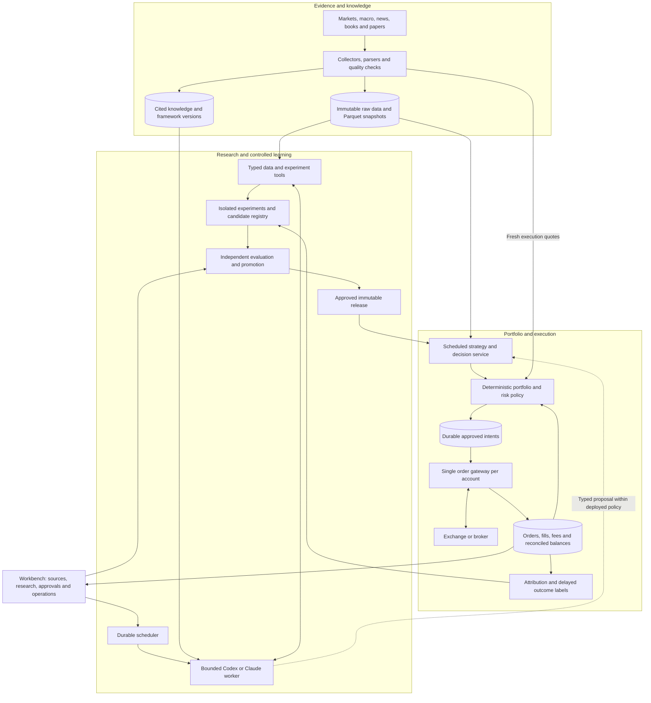
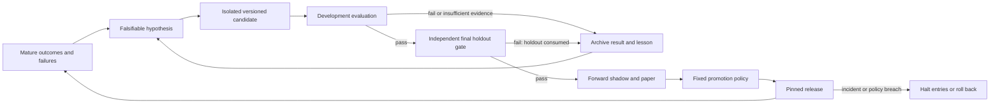

# Personal quant agent: research and proposed architecture

Research date: **2026-10-13**. Scope: a personal, continuously operated,
BTC-first system that can later cover other assets. This is a design proposal;
the new services and learning capabilities below are **not implemented**.
Current capabilities: [product guide](product-guide.md),
[folder map](project-structure.md), [architecture](technical-architecture.md).

## 1. Recommendation

Extend QT into a **research, knowledge and execution platform**. Run Codex or
Claude as bounded analyst/engineering workers. Keep market ingestion, accounting,
risk enforcement, order reconciliation and deployment policy in ordinary services.
The system stays available continuously; expensive model jobs run when triggered.

Recommended stack: **existing Python/FastAPI/React + Codex worker + PostgreSQL/
pgvector + Parquet/DuckDB + object storage + Docker Compose**. Retain QT's
research interfaces, recorded paper validation and unit-tested testnet adapter;
authenticated exchange acceptance remains pending. Use RD-Agent/Qlib as references
for automated experimentation. Introduce Temporal only when workflows
span several services and long waits; LangGraph is optional within research jobs.
This selection optimizes reuse, auditability and maintenance for this repository.

The reviewed sources do not establish an independently verified, persistently
profitable, self-evolving Codex/Claude trading framework. Engineering robustness
and investment performance need separate acceptance tests. FINSABER finds that
reported LLM advantages weaken under broader, longer evaluation; StockBench
likewise distinguishes financial knowledge from sequential trading performance.
[FINSABER](https://arxiv.org/abs/2505.07078),
[StockBench](https://arxiv.org/abs/2510.02209).

## 2. Framework selection

### Agent runtime and orchestration

| Option | Verified role | Choice for QT |
| --- | --- | --- |
| Codex `exec` / Codex SDK | Headless jobs, structured results and resumable sessions; SDKs for TypeScript and Python | Keep the existing bounded `exec` adapter initially; evaluate a pinned SDK for richer research tools. [Exec](https://learn.chatgpt.com/docs/non-interactive-mode), [SDK](https://learn.chatgpt.com/docs/codex-sdk) |
| Claude Agent SDK | Python/TypeScript harness with tools, MCP, hooks, permissions and sessions | Alternative worker behind the same typed input/output contract; choose by task-specific evaluations. Hosting still owns lifecycle and persistence. [SDK](https://code.claude.com/docs/en/agent-sdk/overview), [hosting](https://code.claude.com/docs/en/agent-sdk/hosting) |
| OpenAI Agents SDK | Application-owned tools, handoffs, tracing and guardrails | Consider for a focused analyst without a coding workspace; unnecessary alongside another SDK for the same job. [SDK](https://developers.openai.com/api/docs/guides/agents/sdk) |
| OpenAI Agents API | Managed Codex harness, durable sessions, recovery and sandbox integration | Managed alternative when reducing runtime operations matters more than local control; check account availability and API/tool/container charges. [Overview](https://developers.openai.com/api/docs/guides/agents-api/overview) |
| Claude Managed Agents | Beta managed sessions with persistent state, scheduled runs and optional self-hosted sandboxes | Comparable managed alternative; orchestration and tool traffic still involve Anthropic even with local execution. Billing includes tokens and active session runtime. [Overview](https://platform.claude.com/docs/en/managed-agents/overview), [self-hosting](https://platform.claude.com/docs/en/managed-agents/self-hosted-sandboxes), [pricing](https://platform.claude.com/docs/en/about-claude/pricing#claude-managed-agents-pricing) |
| LangGraph | Graph state, checkpoints, interrupts and persistent stores | Add when research branches or pauses for review. It does not own balances or order recovery. [Persistence](https://docs.langchain.com/oss/python/langgraph/persistence) |
| Temporal | Durable workflows, timers, retries and worker recovery | Later outer scheduler for multi-day experiments, approvals and retraining. Keep each LLM call bounded inside an activity. [Python SDK](https://docs.temporal.io/develop/python) |

**Current compatibility caveat:** `codex mcp-server` has been removed. Codex can
still consume external MCP tools. Raw `app-server` and its WebSocket transport
are documented as experimental and unsupported for production; current docs
separately describe a stable Python SDK with a pinned local app-server runtime.
Select a supported SDK surface and test its pinned version rather than making
raw protocol integration a critical trading dependency.
[Removal notice](https://learn.chatgpt.com/docs/mcp-server),
[app-server](https://learn.chatgpt.com/docs/app-server),
[SDK](https://learn.chatgpt.com/docs/codex-sdk).

Choose one owner for job lifecycle. Initially reuse QT's durable queue. If
Temporal is adopted, it owns scheduling/retries; a research graph stays inside
that boundary. Temporal activities can repeat external effects after a crash,
so checkpoints and workflow recovery do not create exactly-once exchange orders.
[Activity semantics](https://docs.temporal.io/activity-definition).

### Quant research and trading engines

| Framework | Strength / license | Recommendation |
| --- | --- | --- |
| NautilusTrader | Event-driven simulation/live design, Rust/Python; LGPL-3.0 | Retain the existing research integration. Validate version and broker parity before any execution migration. [Upstream](https://github.com/nautechsystems/nautilus_trader) |
| Freqtrade + FreqAI | Integrated crypto operations, supervised retraining, historical retraining simulation; GPLv3 | Best alternative to evaluate for a fresh crypto-only bot. Here, reuse its retraining and leakage-check patterns rather than replacing QT. [FreqAI](https://www.freqtrade.io/en/stable/freqai/), [operation](https://www.freqtrade.io/en/stable/freqai-running/), [license](https://github.com/freqtrade/freqtrade/blob/stable/LICENSE) |
| Qlib + RD-Agent | ML pipelines plus iterative hypothesis, factor, model and code experiments; MIT | Strong research-factory reference; adapt data/labels for BTC and run in an isolated worker. [Qlib](https://github.com/microsoft/qlib), [RD-Agent](https://github.com/microsoft/RD-Agent) |
| QuantConnect LEAN | Broad asset/broker ecosystem, Python/C#, local and hosted workflows; Apache-2.0 | Reconsider if equities/options/futures become the main requirement. Engine licensing does not include data entitlements. [LEAN](https://github.com/QuantConnect/Lean) |
| TradingAgents | Analyst/debate/portfolio workflow with LangGraph; Apache-2.0 | Useful decision-report pattern; its research scaffold and simulated execution do not establish deployable alpha. [Repository](https://github.com/TauricResearch/TradingAgents) |
| FinRL-X | Modular selection/allocation/timing/risk/execution interfaces; Apache-2.0 | Borrow the target-weight contract; evaluate later for allocation research. Original FinRL is explicitly educational/research. [FinRL-X](https://github.com/AI4Finance-Foundation/FinRL-Trading), [FinRL](https://github.com/AI4Finance-Foundation/FinRL) |

QT pins `nautilus_trader==2.0.0rc4` in its optional research environment.
Upstream currently warns that v2 release candidates are unsuitable for real
capital and that stable installation/latest documentation can refer to different
major versions. Keep this an explicitly research-only dependency until a
separately validated production version is selected.
[Version guidance](https://github.com/nautechsystems/nautilus_trader),
[local dependency](../pyproject.toml).

RD-Agent's published quant results use a specified CSI 300 historical split;
they support experimenting with its research process, not transferring its
reported returns to BTC. FinGPT can later be benchmarked for financial-text
features; it is not an execution platform. Start with interpretable rules and
supervised models before RL, whose simulated environment can omit real execution
behavior. [RD-Agent paper](https://arxiv.org/html/2505.15155v1),
[FinGPT](https://github.com/AI4Finance-Foundation/FinGPT),
[FreqAI RL limitations](https://www.freqtrade.io/en/stable/freqai-reinforcement-learning/).

## 3. Complete system shape

Protective exits and reconciliation must remain operational when the LLM or
research worker fails. An approved release fixes strategy, feature, model,
prompt, tool and risk-policy versions. The deployment controller, not the
research agent, can activate or roll it back.

| Loop | Initial cadence proposal | Durable output |
| --- | --- | --- |
| Market/risk monitoring | Quotes/reconciliation every few seconds to minutes as required; closed-bar decisions hourly/daily | Freshness, balances, exposure, intents and incidents |
| News/knowledge ingestion | News every 15–60 minutes; documents on upload | Deduplicated observations, citations and availability timestamps |
| Analyst | New validated candidate, material event or daily summary | Evidence-backed thesis, contradiction checks and bounded proposal/abstention |
| Research/learning | Daily outcome labeling; weekly or drift-triggered experiments | Failed and successful trials, challenger versions and evaluations |
| Promotion | On completed evidence gates | Reviewed release, rollout record and rollback target |

These cadences are design choices, not tested SLAs. Low trade frequency does not
remove the need for timely risk monitoring. Persist checkpoints between bounded
jobs; Anthropic's long-running-agent research finds compaction alone insufficient
and uses durable progress artifacts across sessions.
[Harness research](https://www.anthropic.com/engineering/effective-harnesses-for-long-running-agents).

## 4. Knowledge, tools and investment reasoning

Separate five kinds of memory: **source evidence**, **approved investment/risk
policy**, **unproven hypotheses**, **experiment history**, and **operational
truth**. Orders and balances always come from the transactional ledger.
Retrieval can explain them; it cannot reconstruct authoritative positions.

Document pipeline: authorized originals → content hash and rights metadata →
Docling extraction → page/section-aware chunks → full-text plus vector retrieval
→ cited evidence. Record edition, publication date, page, parser/embedding
version and source ID. Docling supports local document conversion, including
PDF layout/tables and EPUB; check model licenses separately from its MIT code.
[Docling](https://github.com/docling-project/docling).

Books and investment frameworks should become versioned research templates:
economic mechanism, applicable assets, holding horizon, required evidence,
counterarguments, invalidation conditions and testable predictions. A book's
authority or an eloquent model explanation is not a validated signal.

| Analysis stage | Numerical service responsibility | Agent contribution |
| --- | --- | --- |
| Mandate/regime | Eligible assets, liquidity, trend/volatility and macro features | Explain which approved framework applies and cite contradictory evidence |
| Opportunity | Price/volume extremes, on-chain valuation, positioning and event features | Form a falsifiable thesis; flag missing or unreliable evidence |
| Forecast | Fit/calibrate return or risk models on qualified data | Compare hypotheses and scenarios; avoid invented probabilities |
| Portfolio | Existing exposure, correlation, turnover, cost and sizing limits | Explain a target allocation or abstention within the mandate |
| Execution/exit | Quotes, precision, order limits, stops, expiry and reconciliation | Post-decision explanation and later attribution |

For BTC, research price/volume-only, trend/volatility, derivatives, on-chain,
macro and news variants separately before combining them. Use ablations to
measure each source's incremental benefit. Correlated indicators are not
independent votes; missing data must not silently lower an entry requirement.
Choose thresholds using training/validation data and freeze them before testing.

Expose a small typed tool catalog, through Python functions or an authenticated
MCP gateway: `search_knowledge(as_of)`, `read_market_snapshot`, `compute_features`,
`run_backtest`, `compare_runs`, `record_hypothesis`, `propose_target` and
`read_execution_status`. Each call has a schema, identity, deadline, quota and
audit record. SQL/data access is read-only and scoped; experiment code runs in a
separate sandbox with resource limits and no exchange credentials.

A proposed decision contract contains `decision_id`, `as_of`,
`data_snapshot_id`, `strategy_version`, `instrument_id`, `target_weight`,
`expires_at`, `evidence_ids`, uncertainty and reason codes. The gateway derives
quantity and executable prices from current account state. `NO_TRADE` is a
first-class outcome. The agent never directly invokes an unrestricted order API.

News and retrieved documents are untrusted evidence and cannot redefine tools,
risk limits or instructions. Enforce permissions outside the model. In Claude's
SDK, `allowed_tools` preapproves tools rather than forming a restrictive
whitelist; use explicit exposure/denials and hooks plus gateway authorization.
[Permission semantics](https://code.claude.com/docs/en/agent-sdk/permissions).

## 5. Data sources and historical correctness

Start with Binance, Coin Metrics Community, FRED/ALFRED and curated news/RSS.
Add paid datasets only after proving useful coverage or incremental signal value.

| Source | Role | Access/quality decision |
| --- | --- | --- |
| Binance official data | Spot candles/trades; derivatives funding, open interest and liquidation context | Bulk archives include checksums; spot archive timestamps from 2025 use microseconds. OI statistics retain only the latest month; liquidation streams sample the latest event per symbol/second, not complete liquidation totals. [Archive](https://github.com/binance/binance-public-data), [market REST](https://developers.binance.com/en/docs/catalog/core-trading-derivatives-trading-usd-s-m-futures/api/rest-api/market-data), [streams](https://developers.binance.com/en/docs/catalog/core-trading-derivatives-trading-usd-s-m-futures/api/ws-streams/market) |
| Coin Metrics Community → Pro | BTC network fundamentals and reference metrics | Community has limited products/history and rate limits. Discover available metrics first; do not assume paid coverage is free. [Community](https://gitbook-docs.coinmetrics.io/packages/coin-metrics-community-data), [API](https://docs.coinmetrics.io/api/v4/) |
| Glassnode | Richer on-chain valuation/cohort analysis | Optional paid upgrade; API needs Professional plus API add-on. Verify individual metrics/history and rights. [Access](https://docs.glassnode.com/basic-api/api) |
| FRED / ALFRED | Rates, inflation, liquidity and macro regimes | API key; use vintage/realtime periods to reproduce what was known then. Latest revised values can leak future information. [Vintages](https://fred.stlouisfed.org/docs/api/fred/realtime_period.html) |
| GDELT + selected publisher RSS | Discover news, cluster events and source disagreement | GDELT 2.0 updates every 15 minutes; deduplicate syndication. Discovery does not grant full-article retention rights. [GDELT](https://gdeltproject.org/data.html) |
| SEC EDGAR | US equity filings and XBRL fundamentals | Store accession/amendments and acceptance time; obey access policy, including aggregate 10 requests/second. [APIs](https://www.sec.gov/search-filings/edgar-application-programming-interfaces), [policy](https://www.sec.gov/about/developer-resources) |
| Alpaca | US equity data and later paper broker integration | Free realtime IEX is one venue; realtime consolidated SIP needs entitlement. Keep feed semantics consistent across research and operation. [FAQ](https://docs.alpaca.markets/us/docs/market-data-faq) |
| Databento | Paid equity/futures history, corporate actions and instrument master | Point-in-time reference products help multiasset expansion. Obtain venue-specific coverage, licensing and cost quotes. [Security master](https://databento.com/security-master), [corporate actions](https://databento.com/corporate-actions) |

Every observation needs `source_id`, `instrument_id`, `event_time` or period,
`published_at`, `available_at`, `ingested_at`, revision ID, content hash, schema
version and quality flags. Preserve corrections instead of overwriting history.
On-chain entity labels, macro series and news can all change after first release.
`event_time` describes the event/measurement; `published_at` is source release;
`available_at` is verified strategy availability; `ingested_at` is local receipt.
Record timestamp precision and whether availability is verified or estimated.

Enforce `available_at <= decision_as_of`; exact production replay also requires
`ingested_at <= decision_as_of`. Historical data downloaded today may use
provider-proven publication history, but must not receive fabricated old
ingestion timestamps. Date-only availability needs a conservative lag; exclude
unverifiable availability from strict point-in-time evaluation. A lag alone
cannot prove that a backfilled or revised observation existed at the time.
For equities, include delistings, historical universe membership, ticker changes,
raw versus adjusted prices, corporate actions and exchange calendars. For futures,
preserve individual contracts and explicit roll rules. A continuous price series
is not itself an executable instrument.

## 6. Storage and service choices

| Layer | Recommended technology | Stored information |
| --- | --- | --- |
| Operational database | PostgreSQL | Jobs/leases, instrument catalog, decisions, approved intents, orders/fills/fees, positions, audit and release manifests |
| Knowledge retrieval | PostgreSQL full-text search + pgvector | Source metadata, chunks, embeddings, as-of filters and evidence links; embeddings are rebuildable derivatives. [Hybrid search](https://github.com/pgvector/pgvector) |
| Research data | Immutable Parquet + DuckDB | Raw/normalized series, features, labels and frozen dataset manifests; analytics run outside the order ledger. [S3/Parquet access](https://duckdb.org/docs/current/core_extensions/httpfs/s3api) |
| Artifact store | Local volume initially; S3-compatible remote storage | Original documents, raw responses, models, reports and off-host backups; content hashes and versioned paths |
| Experiments/models | Existing QT registry first; MLflow when model training grows | Trial parameters, metrics, dataset/code/model versions and approved aliases resolved to immutable versions. [Architecture](https://mlflow.org/docs/latest/self-hosting/architecture/overview/), [registry](https://www.mlflow.org/docs/latest/ml/model-registry/workflow/) |
| User/API layer | Existing FastAPI + React/TypeScript | Knowledge browser, source status, strategy comparisons, approvals, risk status and incident timeline |
| Operations | Structured logs/metrics; optional OpenTelemetry, Prometheus/Grafana | Data freshness, queue age, tool/model spend, risk exposure, reconciliation lag, backup status and alerts |

Enforce immutability with content-addressed snapshots and append-only manifests.
Deny research workers overwrite/delete access to committed datasets and release
artifacts; verify hashes when loading them.

Do not embed historical price tables as the main market query system. Retrieve
numbers through time-series queries; use embeddings for semantic text. Qdrant
is a later option if measured retrieval scale or isolation requirements outgrow
PostgreSQL. Kafka, Kubernetes, Redis and a separate feature-store service are
not initial dependencies for this personal low-frequency workload.

**Migration boundary:** today's v3 research queue and BTC agent use separate
SQLite databases. Keep them working during the first knowledge pilot. Before
unifying jobs or portfolios in PostgreSQL, migrate with record/count/balance
checks, a quiesced cutover and restore rehearsal. Exactly one store owns each
account ledger; do not maintain two writable authorities. The retained older
`platform/` PostgreSQL code is not already this proposed unified service.

Deploy logical roles as separate Compose processes, sharing application images
where practical: **API/UI, scheduler/collectors, knowledge ingestion,
research/analyst worker, deterministic execution/reconciliation, PostgreSQL**.
Document parsing and backtests get separate CPU/memory limits. Only the execution
service receives broker credentials; only an authenticated gateway exposes UI/API
ports. Research sandboxes receive frozen inputs and narrowly scoped network access.
Do not expose the Docker socket to generated strategy code.

Initial sizing estimate: an always-on Linux host with **4 vCPU and 8–16 GB RAM**
for a small daily/hourly universe and hosted LLM calls; use a separate/burst worker
for large backtests or model training. Measure actual usage before purchasing.
A GPU is not required for hosted Codex/Claude. Storage follows retained data:
bars are small; ticks, document originals and experiment artifacts can dominate.
One host with restart policies is recoverable, not highly available.

## 7. Controlled self-learning

| Level | What changes | Promotion boundary |
| --- | --- | --- |
| Knowledge | New books, events, facts, citations and retrieval indexes | Validate provenance, rights, timestamps and retrieval quality |
| Experience | Decisions, abstentions, outcomes and verified lessons | Label after the prediction horizon; distinguish facts from model reflections |
| Statistical models | Calibrators, forecasts and ranking models | Version training data, evaluate chronological holdouts and run challengers |
| Strategy/agent engineering | Factors, rules, prompts, tools and code | Isolated change, regression tests, economic evaluation, shadow run and controlled release |

This does not automatically update Codex/Claude's underlying model weights.
Persistent memory, retrieval, prompt changes and training a separate forecast
model are different mechanisms. Begin with the first two levels, then add models
only where they improve a measured baseline.

Required evaluation: chronological walk-forward with overlapping-label purging
where needed; an untouched final holdout; multiple regimes; realistic spreads,
fees, funding/borrow where applicable, latency, liquidity and partial fills;
parameter/cost stress; data outages and order faults. Compare against cash,
buy-and-hold, DCA and simple trend/volatility controls using comparable exposure
and cash-flow assumptions. Log every trial and bound the search budget.
Keep final-holdout data/results outside candidate tools and research memory during
iteration. Once its results influence a revision, that holdout is consumed;
subsequent claims need fresh held-out or forward evidence.
Multiple-testing diagnostics such as DSR/PBO require enough data and appropriate
assumptions; they are not release certificates.
[DSR](https://www.davidhbailey.com/dhbpapers/deflated-sharpe.pdf),
[PBO](https://escholarship.org/uc/item/4w1110bb).

Historical LLM leakage also comes from pretrained knowledge of past events,
even with correctly filtered input data. Use masked-history diagnostics and,
most importantly, forward shadow evaluation. Attribute results to market beta,
style, selection, sizing, execution and costs. Ultra-low-frequency strategies
need enough independent events; a 30-day paper run or two trades proves little
about an edge. [KTD-Fin](https://arxiv.org/abs/2605.28359).

Evaluate the agent separately: source accuracy, retrieval completeness, valid
tool use, abstention, failure recovery, cost and latency. OpenAI's improvement
example uses traces → feedback → regression evaluations → diagnosis → Codex
changes; its fictional financial-diligence example demonstrates the engineering
loop, not trading profitability. Adopt that loop while keeping release criteria
and risk limits outside the candidate agent's write permissions.
[Official improvement loop](https://developers.openai.com/cookbook/examples/agents_sdk/agent_improvement_loop).

Initially the owner approves strategy promotion. Later, automate promotion only
inside a previously approved instrument/risk/strategy envelope, with independent
evaluation and immutable rollback artifacts. Individual orders may execute
automatically under that deployed policy; promotion approval is not per-order
approval. Generated changes cannot widen their own risk or tool permissions.
Rollback pauses entries, reconciles outstanding intents, and activates a
state-compatible previous strategy while retaining the current ledger. It never
rewinds balances/fills or blindly replays old intents.

## 8. Trading API and operational reliability

Retain the current testnet gateway while building an explicit account-level
order authority. Keep CCXT behind the crypto adapter and venue-specific allowlists;
use the selected broker's supported API for later equity/futures adapters. A
shared library does not normalize every venue's order, fee or recovery semantics.
A multiasset extension needs instrument precision, market hours,
currency conversion, settlement, borrowing and corporate-action handling before
it can share one portfolio allocation interface.

Persist an intent before submission, use a stable client order ID, reconcile
unknown outcomes before retrying, and account for fills/fees idempotently.
On restart, recover balances, open orders and subscriptions before accepting new
entries. A successful network reconnect alone is not reconciliation.
[Nautilus live semantics](https://nautilustrader.io/docs/latest/concepts/live/).

Provide separate states for **entry pause**, **cancel open orders**, **controlled
liquidation** and **full order halt**. The existing BTC agent's `halt` currently
blocks all new orders, including exits; it does not liquidate. A future entry-only
pause must preserve protective exits and clearly report this distinction.

Acceptance must cover process crashes around submit/acknowledgment, partial
fills, duplicate events, stale feeds, model timeout, exhausted budgets, exchange
rate limits, clock drift and disk/database failure. Track readiness separately
from process liveness. Alert on actionable incidents and reconcile after recovery.
Back up off-host and test restoration; restoring an old ledger must trigger
exchange reconciliation before orders resume. Protective stops cannot guarantee
a fill during gaps or venue outages, so incident handling must expose residual risk.

## 9. Repository mapping and delivery roadmap

| Existing area | Reuse | Missing extension |
| --- | --- | --- |
| `data/`, `indicators/`, `signal/` | Provider adapters and numeric factors | Consistent as-of/revision contract and source quality catalog |
| `research/`, `lab/`, `workbench/` | Durable jobs, versions, experiments, comparisons and validation | Agent jobs, complete trial registry, outcome labels and promotion policy |
| `lab/learning.py` | Curated signal explanations | This is a learning UI contract, not autonomous model training |
| `nautilus/`, `strategy_ports/`, `btc-backtest` | Existing simulation and strategy adapters | Pinned-version parity and production readiness evaluation |
| `btc_agent/` | Codex review, paper/testnet limits, durable order recovery | Rich evidence snapshots, health alerts and consolidated status |
| `web/`, `monitoring/` | Workbench and operational patterns | Knowledge browser, approvals, cost/data dashboards and incident controls |
| New proposed modules | — | `knowledge/`, `agents/`, `evaluation/`, `promotion/`; extract execution interfaces only when reuse is proven |

The [recorded BTC acceptance](verification/codex-btc-agent-acceptance.md) covers
201 relevant tests and local Docker paper operation. Authenticated Codex calls,
sandbox buy/sell fills, a 24-hour soak and remote deployment remained pending in
that record. This research does not revalidate a running service or implement
the proposed architecture. Binance Spot Testnet covers exchange orders; Bitcoin
L1 testnet wallet transfers are a separate capability.

| Phase | Deliverable | Exit criterion |
| --- | --- | --- |
| 0: Finish the baseline | Authenticated model and sandbox round trip, restart/outage test, backups and 24-hour soak | Recorded real sandbox IDs/fills, reconciled balances and recovery evidence |
| 1: Evidence and knowledge | Timestamped BTC/macro/news data, a small authorized book collection, cited retrieval and analyst reports | Reproducible as-of queries, manually checked retrieval set, no future-data access or execution authority |
| 2: Research loop | Hypotheses → isolated code → existing backtest queue → complete experiment history | Frozen evaluation protocol, baselines, failure cases, budgets and reproducible artifacts |
| 3: Controlled adaptation | Delayed labels, optional supervised retraining, challenger/shadow comparison and promotion UI | Independent quality/economic gates, adequate forward evidence and tested rollback |
| 4: Broader operation | Unified portfolio gateway and, if justified, Temporal/multiasset adapters | Reconciled migrations, instrument-specific tests and incident/restore exercises; real capital requires separate acceptance |

### What the owner needs to provide

- **Mandate:** asset universe, venues, holding horizon, cash allocation, exposure/
  loss limits, allowed instruments, promotion authority and monthly research budget.
- **Access:** provider API/service credentials and entitlements; Codex or Claude
  API billing; dedicated exchange testnet credentials initially. Supply secrets
  through local secret storage, not chat or Git. Do not assume a desktop model
  subscription includes unattended server capacity.
  [Codex automation auth](https://learn.chatgpt.com/docs/non-interactive-mode),
  [Claude authentication](https://code.claude.com/docs/en/agent-sdk/overview).
- **Knowledge:** investment books/papers you may process, preferred frameworks,
  and any personal decisions/history you want retained with an explicit scope.
- **Operations:** an always-on host, backup destination, notification channel and
  an owner who can respond to account, provider or reconciliation incidents.

Budget model: hosting + data entitlements + storage/egress + model/tool calls +
experiment compute. Enforce daily/monthly spend caps externally; cache cited
extractions and invoke agents on material changes. Start with a small universe
and one model provider, then pay for added complexity only when evaluations
show a benefit. Vendor prices and access terms require a fresh quote at purchase.
