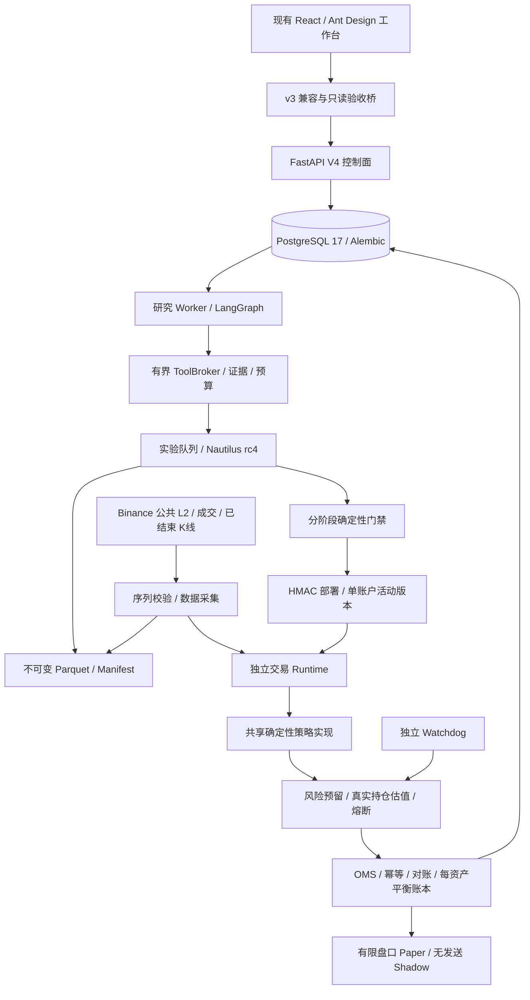

# QT V4 实现、验收与运行说明

日期：2026-10-24；原代码基线：`492bbcc`。本文记录本次架构方案对应的**实际代码**。旧实验和 v3 工作台保留；V4 是同一仓库的新合同与进程边界，不覆盖旧实验报告。

当前可运行的闭环是：**不可变数据 → 注册策略 → 真实 Nautilus 回测 → 可复现性／因果检查 → 签名 Paper 部署 → 实时公共行情 → 确定性信号、风控、模拟撮合、成交账本及恢复**。Shadow 保留完整风险检查而不发送订单。资金交易默认拒绝，未把测试通过当作策略盈利或实盘资格。

## 1. 架构和技术选择



| 领域 | 本次实现 | 选择依据与边界 |
|---|---|---|
| 合同 | Pydantic 2 严格、冻结、十进制字符串、规范 SHA-256 | 未知字段、非有限数字、浮点金额、越界精度直接拒绝；未知指标用 `null + reason` |
| 事务数据库 | SQLAlchemy 2、psycopg 3、PostgreSQL 17 | 账户行锁、`SKIP LOCKED`、唯一键、租约与 fencing；SQLite 只供显式离线测试 |
| 迁移 | Alembic，冻结初始 DDL，追加修订 | 迁移进程持 advisory lock；API 不隐式建表；交易历史禁止破坏性 downgrade |
| 数据 | PyArrow Parquet、内容寻址 manifest | 校验实际文件、行数、时间边界、缺口和权限来源；拒绝路径穿越／符号链接 |
| 研究编排 | `langgraph==1.2.16`、`langgraph-checkpoint-postgres==3.2.0` | 真正的持久图；研究与反证分工；checkpoint 不承担订单权威状态 |
| 模型 | 可替换 ModelProvider；默认本地 llama.cpp 服务 | tokenizer 预检查、输出 token 限额、显式模型别名、原始回执与成本账本 |
| 回测 | Nautilus `2.0.0rc4`，Python 3.12 | 复用已有真实引擎；单标的现货 bar 模式；不伪装实现 L2 排队／市场冲击 |
| 升级候选 | 单独 Python 3.13／Nautilus rc7 镜像 | 固定夹具比较订单、成交、费用、NAV；生成差异报告，不自动接受升级 |
| 前端 | 保留 React 19／Ant Design 5／TanStack Query | 新增生产验收页，服务端读取四维证据；无实盘开关、无前端密钥 |
| 部署 | 六类业务进程、Compose、明确 OrbStack context | 交易／研究隔离；资源限额、只读根文件系统、最小端口；没有引入重复的工作流平台 |

Deep Agents、HftBacktest、Freqtrade、LEAN、NATS、Temporal、ClickHouse 没有为了框架覆盖率被加为运行依赖。扩展接口保留；盘口策略须先补对应成交模型验证，不能在 bar 模型上获得虚假的准入。

依赖权威是 `requirements-production.in/.lock`、`requirements-native-baseline.in/.lock` 和 `requirements-native-candidate.in/.lock`。锁文件包含哈希，镜像离线安装下载好的 wheel；rc4 镜像与 rc7 候选分别保留。

## 2. 代码导航与状态所有权

| 路径 | 职责 |
|---|---|
| `src/qt/contracts/` | MarketEvent、InstrumentSpec、FeeSchedule、DatasetManifest、StrategyArtifact、ExperimentSpecV2、ForecastRecord、DeploymentManifest、SignalIntent、OrderIntent 与 Protocol |
| `src/qt/persistence/` | 权威业务表、事务仓储、幂等队列、迁移和旧结果归档 |
| `src/qt/datasets/` | 不可变 Parquet 注册、真实文件校验、因果时间重放 |
| `src/qt/marketdata/` | snapshot/delta 订单簿、缺口重建、已结束 K 线、公共 Binance 采集 |
| `src/qt/research/{graph,providers,evidence}.py` | 有界研究图、隔离反证、本地模型、证据版本和可得时间 |
| `src/qt/experiments/` | 原生引擎桥、净值指标、真实 WF/CPCV、DSR/PBO/Holm、campaign 与留出集 |
| `src/qt/strategies/native_bridge.py` | 实验和实时共用已注册策略及 sizing overlay；拒绝用另一套规则冒充已验证策略 |
| `src/qt/execution/{oms,simulated,runtime}.py` | 风险预留、提交／未知状态、部分成交、对账、精确账本、事件恢复 |
| `src/qt/operations/` | 验收政策、调用费用预算、估值风控、独立 watchdog、部署活动版本与回滚 |
| `src/qt/forecasting/` | PostgreSQL 预测与追加式结算、事件聚类、配对概率评分 |
| `src/qt/control/` | V4 API、研究／实验 Worker、六进程 CLI |

LangGraph 只拥有研究进度；队列拥有任务状态；DatasetRegistry 拥有数据快照；ExperimentRegistry 拥有搜索与留出集；OMS／账本拥有交易事实。搜索、页面缓存、指标均不是资金状态来源。

## 3. 主要不变量

### 数据和实验

1. 金融事件带场所时间、实际接收时间、序列和质量标记。盘口缺口、乱序冲突、过期或非法时间会阻止新增风险，不能用插值修补 L2。
2. 实验显式绑定数据、标的规则、费用、策略、切分、seed 和镜像。不能再由 `BTCUSDT/1d/2000 bars` 的旧接口隐式决定输入。
3. campaign 与数据集绑定；所有候选计入账本，包括失败与淘汰。受保护时间区间不能用另一个 trial 或 campaign 绕过。
4. native 测试窗右端点为闭区间，访问控制转换为 `end_ns + 1` 的半开区间，防止恰好读取留出集第一根 bar。
5. 最终留出集解封必须有独立权限和原因，且 campaign 冻结。解封不允许研究工具随后自由读取原始留出数据。
6. 相同 spec 真实执行两次，再做截断前缀回放。原始随机 UUID 保留；一致性 hash 仅对已识别的 UUID 做保留关联的规范化。成交金额、时间、费用、订单关系与净值仍精确比较。
7. 重置资金的各个 WF 折分别报告，不把它们拼接成一条复利账户。CPCV 分割数与路径数分别报告；输入不全时 DSR/PBO 返回不适用，trial 数量不能制造校正结果。
8. 固定 bps 滑点、融资、借贷、未支持的成交／退出模型会明确失败，不会悄悄忽略成本。

### 交易与恢复

1. 实时行情 → 共享策略 → 风控 → OMS 不调用 LLM。模型只提出研究假设和候选；工具列表没有 `place_order`、提款、修改风险限额等能力。
2. 每个逻辑信号有稳定意图 ID，数量和限价在副作用前持久化。恢复时使用原始意图，不按新价格重新 sizing 同一笔交易。
3. `accepted/rejected/unknown` 不混同。超时、撤单未知、迟到成交保留预算；未知状态先查询和对账，不盲目重发。
4. 账户单活动执行租约；旧租约不能写入或发送。策略状态、事件 checkpoint 和原始订单共同恢复。
5. 现货首版无借贷／杠杆。买单占用报价资产，卖单预留真实基础资产；未成交和 UNKNOWN 继续计入风险。
6. 成交按场所成交 ID 去重；每项资产的 journal 分别平衡；费用保留原币种。持仓来自实际成交，不来自请求数量或模型判断。
7. NUMERIC(38,18) 容量显式验证；买方现金成本向上、卖方收入向下取到 18 位，估值向下取整，避免 SQLite／PostgreSQL 隐式舍入差异。
8. Paper 只消耗提供的有限深度；IOC、FOK、部分成交及恢复有测试；没有队列模型时不捏造 maker 成交。Shadow 从不发送。
9. 风控按真实钱包、保守 bid、隔离资本计算日损失和高水位回撤。超预算锁定减仓状态；保护性卖出不因入场预算耗尽而被拒绝。止损／熔断动作不保证极端情形下的实际损失上限。
10. 每个账户只有一个活动部署头。历史签名不能继续授权下单，也不能让 watchdog 停用后续版本。替换／停用／回滚要求账户平仓、无待执行或未结算副作用，且不得悄悄提高风险。

## 4. 研究、证据与模型边界

研究图默认最多 4 轮、20 次工具调用、15 分钟；服务端限制单次 $1、每日 $5、每月 $150。读工具结果有大小限制，身份在服务端注入；取消、截止时间和租约 fencing 同时约束结果、研究提案和实验排队。

研究员先取证，反证角色只获得提案与证据，不继承中间 scratchpad。引用存在性与事实支持性分开：能定位引用不表示声明已被证实；后者未经确定性核验始终标记未验证。反证拒绝或伪造引用使结果保持 HOLD。

证据在 PostgreSQL 保存版本、source hash、发布时间、可得时间、接收时间和使用权；研究工具按运行创建时间限制可见性。当前本地检索是有界词法检索，返回扫描窗口信息；没有宣称完成中文语义召回或全面互联网检索验收。现有 v3 知识库／来源工具继续保留。

默认 V4 provider 使用本地 llama.cpp 的 `/apply-template`、`/tokenize` 和带输出上限的 `/v1/chat/completions`，保存实际 usage 与回执。模型别名应由操作者绑定到固定权重文件。API 费用为零不意味着硬件、电力、耗时或研究质量成本为零。[llama.cpp 官方服务器协议](https://github.com/ggml-org/llama.cpp/blob/master/tools/server/README.md)

现有 Codex CLI provider 被保留，但其当前调用入口不能执行严格的输出 token 上限，因此 V4 有硬预算的研究图拒绝把它当作可强制限额的付费 provider。旧 Hub 工作流不受此接口迁移影响。后续付费 HTTP provider 必须实现输入计数、输出限额、明确费率和相同评测。

## 5. 评测与晋升

`GET /api/v4/policy` 返回当前政策、每条指标的方法、样本档案、阈值、失败动作及政策 hash；`POST /validations` 只从已保存的真实实验与受信前向观测生成报告，不接受浏览器直接提交“已通过”的指标。

| 阶段 | 已实现的准入语义 | 尚需真实观察的证据 |
|---|---|---|
| 研究 | 因果、数据、费用、会计及可复现性检查 | 策略允许负结果，明确报告未证明优势 |
| Paper | 冻结 spec／成本、签名版本、模拟资金和真实公共行情 | 30 天／200 意图；低频应更长，不能用合成记录替代 |
| Shadow | 完整确定性检查、意图和状态；不发送 | 至少 14 天／100 有效意图及策略统计证据 |
| 小资金 | 完整统计、前向、账户资格、恢复、实际 adapter 验收和配置绑定 | 当前新 Runtime 不提供资金发送路径，保持拒绝 |
| 扩大资金 | 至少 90 天／100 实际生命周期和总成本后经济证据 | 未完成实际交易与容量校准前不得放行 |

收益序列使用现金流调整净值、UTC 日收益、Crypto 365 日年化，包含未平仓估值。VaR/CVaR 在有效尾部样本不足时不伪造可靠估计。块 Bootstrap 保留相关性；DSR/PBO/Holm 实现与完整搜索账本分离验收。

默认小资金政策：单订单 ≤2% C、现货持仓 ≤30% C、日损失停止线 0.5% C、回撤停止线 3% C、无杠杆。它们是动作阈值而非收益或损失保证。风险预算不能由 Agent 提高。

预测评分保留 `p=0`；缺失市场概率不补成 0.5；同一事件、结算期限与预测模式按预注册规则选首条，事件簇单独计数。结算只追加、有来源及权限验证；0.5 特殊兑付与二元结果分开。Brier／Log Loss 使用配对基准子集，事件簇 bootstrap 不把 100 次重复预测当 100 个独立事件。概率质量不等于可执行净利润。

四个结论分开发布：工程状态只在已验证范围内成立；研究有效性需要冻结任务消融；策略有效性需要统计与前向数据；经济性需要真实成本与利润。系统正常输出 `unverified`／`insufficient`，这是验收结果而非系统故障。

## 6. API 与进程运行

V4 API 使用服务端 Bearer token；幂等创建接受 `Idempotency-Key`，同键不同内容返回 409。部署签名密钥与 API token 分离。订单查询保留十进制字符串。资金／风险和订单接口没有注册成 Agent 工具。

主要 API：研究创建、取消和游标 SSE；策略／标的／费用／数据注册；campaign／实验排队；验证报告；部署创建、停用和新版本回滚；订单查询；预测入账和聚类评分。结算写入要求独立受信操作权限。旧 SQLite 结果通过只读 v3 或显式 archive 导入读取，不冒充新 V2 验证。

进程入口统一为 `python -m qt.control`，支持 `migrate`、`api`、`research-worker`、`experiment-worker`、`data-worker`、`trading-runtime`、`watchdog`、`check`、`import-legacy`、`ingest-evidence`。`--once` 供自动化验证。模型或部署未配置时，相关 Worker 保持阻断而不是猜测配置。

在本机使用仓库 wrapper，所有 Docker 操作显式使用 `orbstack`：

```sh
./deploy/orbstack.sh v4-init
./deploy/orbstack.sh v4-config
./deploy/orbstack.sh v4-up
./deploy/orbstack.sh v4-status
./deploy/orbstack.sh v4-check
./deploy/orbstack.sh v4-test
./deploy/orbstack.sh v4-test-postgres
./deploy/orbstack.sh v4-backup
./deploy/orbstack.sh v4-restore-check /path/to/verified-backup.dump
./deploy/orbstack.sh v4-native-compare
```

`v4-init` 只生成本机私有 `.env.production-v4`（0600，不入 Git），不配置模型或资金账户。API 默认仅绑定 `127.0.0.1:8890`。当前已有项目不会被重置。

`QT_V4_MODEL_ORIGIN` 应是 llama.cpp 的 origin，不包含 `/v1`；`QT_V4_MODEL_ID` 是固定模型别名。`QT_V4_DEPLOYMENT_ID` 是已经通过服务端门禁的 Paper／Shadow 部署 ID。设置字符串本身不能通过门禁。

现有 React 工作台的 `/production` 通过只读 `/api/v3/production/readiness` 桥接。需在现有工作台服务端配置 `QT_V4_CONTROL_ORIGIN` 和 `QT_V4_SERVICE_TOKEN`；浏览器不保存服务密钥。未连接时明确报告不可用。

## 7. 备份、恢复与回滚

PostgreSQL 备份使用一致性导出快照、custom-format pg_dump、逐表行数及内容摘要；文件权限 0600。恢复检查只能进入隔离测试集群里的随机新数据库，不自动覆盖生产数据。数据库 dump 不包含 Parquet、外部密钥或模型权重，必须独立异地复制并验证 manifest 引用文件。

旧 SQLite 导入使用 backup API 包含已提交 WAL、检查完整性，记录源 hash／表行数／行内容 hash；跳过凭据等表。归档明确标记 `trading_state_migrated=false` 和 `validation_evidence_migrated=false`。旧结果不重算、不升级资格。

策略回滚产生新签名版本、重新验证门禁，并切换账户活动头；不得删除成交、费用、风险高水位或审计。首版保守地要求平仓且无未知／未结算订单，未实现复杂持仓迁移时不能强制接管。

## 8. 测试、review 和真实限制

自动化覆盖：合同精度／冻结／未知字段；实际 Parquet 损坏；时间可得性／已结束 bar；盘口 gap／乱序／重复；有界公共流与重连；Nautilus 15m／1h／超过 2000 根 bar；未来价格修改与前缀不变性；真正 CPCV(6,2)=15 分割／5 路径；无输入不能显示 PBO/DSR 通过；预算与留出集绕过；未知订单／重复成交／部分成交／撤单超时／迟到成交／恢复；共享策略全 Paper 链路；Shadow 零发送；日损失、回撤、活动部署与独立 watchdog；预测聚类；真实 PostgreSQL 并发与 graph checkpoint；前端组件、类型检查和构建。

独立 review 已针对跨数据集试验绑定、最终时间端点、账户／模型复用前向证据、无效指标域、过期任务成功写入、付费 provider 限额、历史部署影响新版本、固定精度和恢复幂等新增回归用例。最终运行数量见本次实现验收记录。

以下不被自动化夹具冒充已经完成：30 天 Paper、14 天 Shadow、数年真实历史与独立事件样本、真实账户资格、生产 RTO/RPO/SLO、真实成交／冲击／资金费用、资金规模收益、完整 HftBacktest 盘口交叉验证、衍生品与 Polymarket 资金执行。浏览器手工打开验收按用户要求暂缓；组件测试和构建在 Codex 内执行。

实施顺序继续为：先补合规可用的真实数据与长期观察，再校准成本和统计证据，最后在独立完成 adapter／资格／恢复验收后建设资金执行并申请极小额度。任何未支持模型或证据不足都应保持阻断，不能靠翻转 `live_ready` 上线。

## 9. 本次实际验收记录

| 检查 | 实际结果 |
|---|---|
| 完整 Python 测试（含真实 V4 PostgreSQL） | 1967 通过、8 条件跳过，103.82 秒；跳过项为旧平台 PostgreSQL 环境 7 项与可选 Docker plugin 镜像 1 项 |
| V4 PostgreSQL 专项 | 5 通过；包括 100 个并发风险预留恰好放行 30 个、30 次重复成交只入账一次 |
| 旧平台集成补测 | 显式配置同一隔离测试 PostgreSQL 后，`tests/integration` 85 通过；覆盖上面原先跳过的 7 个旧平台数据库用例 |
| 前端自动化 | 9 个文件、74 测试通过；`tsc` 与 Vite 构建通过，仍有现有大 bundle 提示 |
| 静态检查 | `ruff check src tests deploy/v4_*.py`、12 个核心合同／数据／策略源码严格 Mypy、`pip check`、shell 语法检查通过 |
| 隔离容器测试 | 最终源码、rc4、无网络、只读源码：220 通过、5 个显式 PostgreSQL 条件跳过；5 个 PostgreSQL 用例已在宿主专门测试中验证 |
| 镜像与进程 | Python 3.12 控制镜像、rc4 原生镜像及独立 Python 3.13／rc7 候选镜像均构建成功；六进程启动与迁移、checkpoint、健康和 readiness 检查通过 |
| 一致性备份恢复 | 实际初始化后的 V4 数据库 27 张表、16 行，在随机新数据库中恢复，逐表内容 hash 一致；源生产库未修改 |
| rc7 升级 | 未通过：`CurrencyPair` 构造器不再接受现有 `maker_fee` 参数；保留 rc4，不篡改回放或自动切换 |
| 浏览器手工验收 | 按用户要求暂缓，未声称完成 |
| 资金／策略经济验收 | 未完成，资金执行仍拒绝；未声称盈利或完成长期 Paper／Shadow |

验收过程中启用的 V4 业务容器已停止，保留私有配置、卷和备份。日志、原始数据、密钥、运行状态和生成备份未纳入 Git。
