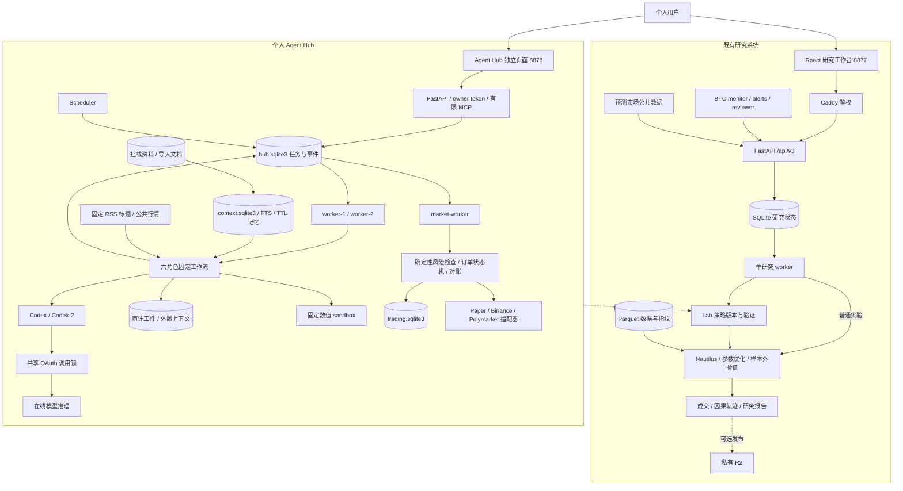
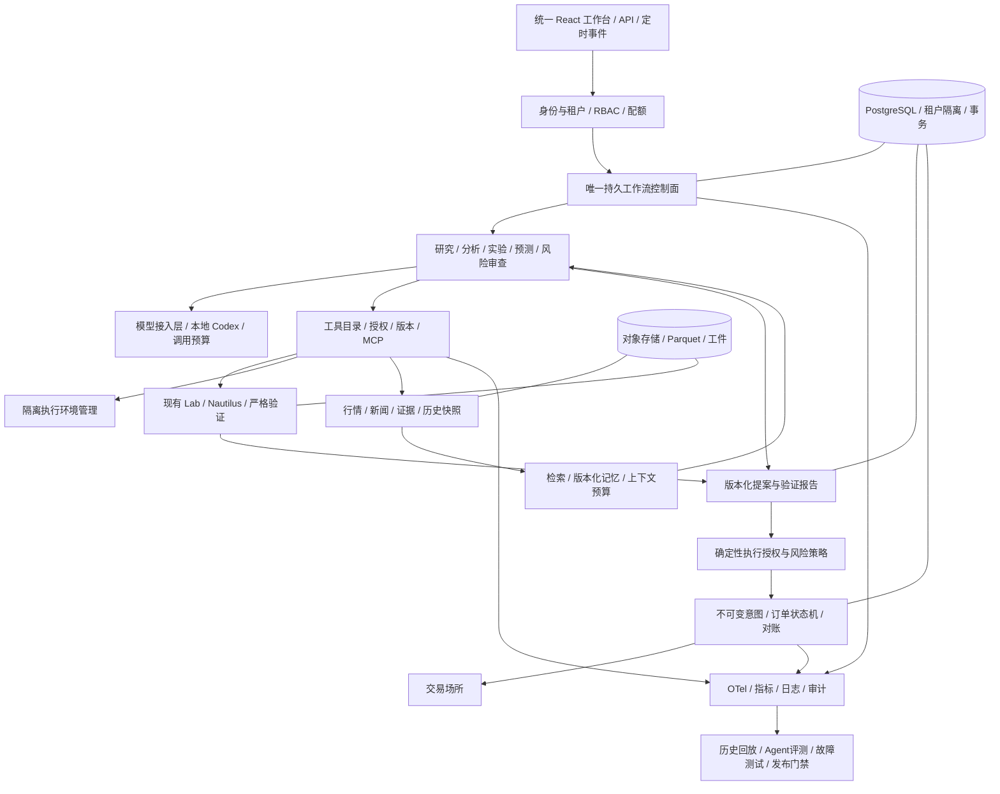

# QT 项目审查、最新 Agent 架构与升级路线

审查日期：**2026-10-21**。代码基线：`3b3877e`。范围：整个 QT 仓库、当前本地 Docker 服务、Agent Hub 执行与交易路径，以及截至当日可核验的一手技术资料。本次进行审查、离线故障复现和文档整理，未修改业务代码、未发送真实资金订单。

**结论：项目已经是可运行的个人量化研究工作台与 Agent 模拟交易系统；最值得继续建设的方向，是把已有研究引擎、Agent 决策和交易账本接成一条可验证、可恢复的业务链。** 当前不能据此宣称达到金融实盘生产或企业多租户水平。六个角色、八个容器和测试通过，分别说明功能组织、部署形态和已覆盖案例的正确性，不代表完整业务可靠性。

## 1. 优先审查发现

P1 表示按未来实盘目标应优先修复、启用 live 前必须关闭的问题；在当前默认 paper 环境中，影响是模拟业务的正确性。以下复现均使用临时目录和离线数据。本文没有发现或声称存在已经发生的真实资金损失。

| 编号 / 优先级 | 发现、触发条件与实际影响 | 源码证据 | 建议及验收条件 |
| --- | --- | --- | --- |
| R1 / P1 | **订单已记录，但 execute job 尚未完成时，重试不能可靠恢复。** 同一个 pipeline 重试会重新取报价、生成数量与 `quote_timestamp`，交易层却对完整 intent 计算 fingerprint。即使价格不变，仅时间变化也会触发 `idempotency_key_conflict`。若预测已过期或行情偏离，重试又可能先返回 HOLD，掩盖此前已经成交的事实。防重单生效，但工作流无法正确收尾。 | [runtime.py](../src/qt/agent_hub/runtime.py#L499) 的新报价及 L520–542 的新 intent；[trading.py](../src/qt/agent_hub/trading.py#L1032) 与 L1045–1072；[runtime.py](../src/qt/agent_hub/runtime.py#L577) 在交易动作之后完成 job | 在首次执行前持久化不可变 execution intent；恢复时先按 tenant/mode/decision ID 读取原意图与订单，再查询或对账，不重新做一次交易决定。分别在预留后、发送后、账本提交后、job 完成前注入崩溃，要求单笔副作用、单次记账、正确最终状态。不要通过忽略冲突参数来“修复”幂等。 |
| R2 / P1 | **开仓日额度也会阻断保护性减仓。** `_risk` 在区分 BUY/SELL 前累计当天所有订单的 reserved；买入接近日限额后，止损 SELL 仍消耗同一额度。离线案例：日限额 30，买入约 24.77，价格跌至 89，monitor 返回 protective exit blocked，持仓仍为 0.2475。 | [trading.py](../src/qt/agent_hub/trading.py#L1259)；[runtime.py](../src/qt/agent_hub/runtime.py#L298) | 拆分新增风险预算与 reduce-only 退出预算；退出必须核实实际持仓、成交容量和未知订单，不能笼统绕过风控。补“买满额度后下跌仍可有界减仓”测试，并区分暂停开仓、只允许减仓、完全冻结三个操作状态。 |
| R3 / P1 | **自动执行没有程序化核验证据。** 只要求 forecast/risk_review 都 propose、confidence 达标、evidence 非空。完整离线六角色链在没有知识文档、所有 evidence 都是不存在的 ID 时，仍产生 FILLED paper order。自报置信度不能证明引用正确，也不能证明预测已校准。 | [runtime.py](../src/qt/agent_hub/runtime.py#L473) 至 L486；[codex.py](../src/qt/agent_hub/codex.py#L333) 仅用指令要求引用真实 | 建立不可变 proposal：instrument/outcome、side、期限、证据 ID/hash、策略版本、实验版本、policy version。风险审查引用 proposal hash；服务端检查引用属于本次上下文、内容版本一致、时效和工具结果有效。再增加蕴含核验与人工标注评测。缺失、伪造、越租户、过期证据必须阻断。 |
| R4 / P1 | **Hub 回测与策略提案没有绑定。** 默认始终跑 BTC 日线 MA20；用户提出其他策略或 Polymarket 预测时，完成这个实验不能验证对应提案。现有更完整的 Lab/Nautilus 验证链未接入 Hub。 | [runtime.py](../src/qt/agent_hub/runtime.py#L386) 至 L423；对比 [lab/service.py](../src/qt/lab/service.py#L697)、[research/executor.py](../src/qt/research/executor.py#L329) | 先接现有研究平台，统一 `strategy_version_id + dataset_snapshot + experiment_spec + validation_report`。定义“研究完成”和“允许执行”两个状态，只有对应版本通过验证才能进入 paper/shadow。预测市场另做事件级概率验证，不能借用 BTC 均线回测作为证据。 |
| R5 / P2 | **上下文外置目前只能支持审计，不能保证模型恢复全文。** 超限时写 artifact 并截断，但 Codex 禁用文件/工具能力，且没有挂载这些 artifacts。 | [runtime.py](../src/qt/agent_hub/runtime.py#L231)；[codex.py](../src/qt/agent_hub/codex.py#L333)；[Compose](../docker-compose.agent-hub.yml#L168) | 先增加确定性的分段提取和有引用摘要；确有需要时再提供按 tenant/run 授权的只读取片段工具。测试答案所需证据处于截断区时是否能恢复，并采用模型 token 预算。 |
| R6 / P2 | **Hub 的完整镜像与可选 SDK 验证尚未进入专门 CI 门禁。** 主 CI 会跑 Hub Python 测试，但常规依赖不安装 agent-hub extra，SDK 测试可能跳过；本次完整依赖验证来自本地 Docker。 | [ci.yml](../.github/workflows/ci.yml#L22)、[test_agent_hub_trading.py](../tests/test_agent_hub_trading.py#L960)、[Compose test](../docker-compose.agent-hub.yml#L54) | 增加无凭据、无网络的 Hub 镜像测试任务，确保官方 SDK 契约测试零跳过；接入 R1–R4 的端到端故障测试。OAuth 在线 smoke 留在受信任的私有执行环境，不能把登录凭据送入公共 CI。 |
| R7 / P2 | **RAG 的 as_of 只表示有效时间，不证明历史时点已知。** 今天导入的内容只要回填早期 valid_from，就能进入早期 as_of 查询。它不自动具备金融历史回放所需的 point-in-time 数据语义。 | [context.py](../src/qt/agent_hub/context.py#L137)、[查询过滤](../src/qt/agent_hub/context.py#L218) | 区分 published_at、available_at、observed_at、修订版本与有效期，明确历史回填策略。不能简单排除一切后来导入的真实历史数据；需要能区别当时公开的数据和后来才发布的修订。补跨时间查询测试。 |

R3 的复现使用故意返回错误引用的测试 provider，证明服务器没有强制门禁；它没有测量真实 Codex 产生错误引用的频率。风险角色按当前协议应输出 `side=HOLD`，不能把它与 forecast 的 side 不一致单独当作缺陷。

保留现有优点：持久队列、租约与 fencing、步骤完成/后续入队原子提交、尝试级工件、交易 Decimal 账本、发送结果 UNKNOWN 时查询原单而不重发、交易密钥与模型隔离。这些是有价值的工程基础。R1 正说明“各模块都防重”仍需端到端恢复测试。

## 2. 项目实际技术栈

| 层 | 当前采用 | 边界 |
| --- | --- | --- |
| Python 服务 | Python 3.12 Docker、FastAPI、Pydantic、Uvicorn、HTTPX | 核心包声明 Python ≥3.10；原生研究依赖需要 3.12，不能把两者混为一套最低运行环境 |
| 研究 Web | React 19.1.1、TypeScript 5.9.2、Vite 7.3.6、Ant Design、TanStack Query、React Router | `web/`，8877 入口 |
| 图表/编辑器 | ECharts、Lightweight Charts、CodeMirror | 展示研究结果与编辑策略 |
| Agent Web | 原生 HTML/CSS/JavaScript + FastAPI 静态页面 | 独立 8878；尚未并入 React 工作台 |
| 量化计算 | Nautilus Trader 2.0.0rc4、Optuna 4.5.0、TA-Lib 0.7.1、独立 `btc-backtest` | Nautilus 是固定的预发布版本；Hub 默认不走此完整研究链 |
| 数据分析 | NumPy、Pandas、SciPy、PyArrow、DuckDB、Parquet；多数据源适配 | 数据/策略能力与每条部署链实际启用项需要分别检查 |
| Agent 编排 | 自研 Python 固定流程 + SQLite 持久任务队列 | 没有采用 LangGraph、Temporal、AutoGen 或 CrewAI |
| AI 接入 | 容器内 Codex CLI 0.162.1，Node 22；`codex exec` 与结构化输出 | 本地集成、在线推理；不是本地模型权重推理。仅一个 provider，角色可分别指定可用模型 |
| 状态/检索 | SQLite；研究工作台与 Hub 任务库启用 WAL；FTS5/BM25 + 中文子串补偿 | Hub 上下文、交易库未显式启用 WAL；没有向量模型、reranker、分布式数据库或 DB 行级租户策略 |
| 执行环境 | 固定函数数值 sandbox，Docker 内网、只读根、非 root、资源限制 | 不是可让模型生成并运行任意 Python 的环境管理平台 |
| 交易适配 | 自有 Binance Spot/Testnet REST；Polymarket `polymarket-client==0.13.0`；paper ledger | 有协议代码与 fixture；没有真实账户成交验收 |
| 本地部署 | OrbStack + Docker Compose，持久卷、只读文件挂载、分离 token/secret | Hub 8 个常驻服务 + 一次性 initialize；工作台 6 个常驻服务 |
| 其他部署路径 | Caddy、Cloudflare Worker/Access、可选私有 R2、Linux systemd | 属于已有工作台云路径，不能自动算作 Hub 已上云 |
| 保留旧平台 | PostgreSQL 17、SQLAlchemy、Alembic | `qt.platform` 的独立部署，不是当前 v3/Hub 的数据库底座 |
| 测试/运维 | pytest、Ruff、部分 mypy、Vitest、GitHub Actions、心跳与任务事件 | Hub `/metrics` 目前只有任务状态 gauge；没有统一 OTel、告警或 Agent 质量评测平台 |

版本依据：[pyproject.toml](../pyproject.toml)、[web/package.json](../web/package.json)、[Hub Dockerfile](../Dockerfile.agent-hub)、[Hub 依赖锁](../requirements-agent-hub.lock)、[部署文件](../docker-compose.orbstack.yml)。这里记录仓库实际版本，不代表这些依赖都是上游最新版本。

## 3. 当前架构图：两套系统并行，部分复用代码



图中虚线 Hub→Lab 是**待建接口**。研究工作台与 Hub 的用户认证、队列、状态库、UI 和交易账本尚未统一；旧 Postgres platform、独立 Codex BTC agent 也不是 Hub 的后台服务。不要将多个实现的能力直接相加，称为同一条已验收链路。

Hub 的实际顺序是：`pipeline → research → analysis → backtest → forecast → risk_review → execute（按开关）→ log_review`。其中 execute 是确定性代码；另外六个步骤调用模型。它属于有角色分工的工作流，不是会自主选择任意工具、反复试验和动态委派的开放 Agent 集群。固定流程适合当前审计要求，本身不是缺点。

两个 Codex 容器共享一次完整调用范围的 OAuth 锁，因此当前实际模型吞吐仍串行。增加 worker 可以分离任务和提升恢复性，却不能直接使模型推理吞吐翻倍。官方也要求同一份账户认证缓存只供一台机器或串行任务流使用；个人版继续保留这个约束。[Codex 自动化认证说明，2026-10-21 核验](https://learn.chatgpt.com/docs/auth/ci-cd-auth)。

## 4. 已经具备的能力、怎样使用

### 研究工作台：先用已有强项

入口：<http://127.0.0.1:8877>，使用已配置的本地账号密码。

```bash
./deploy/orbstack.sh status
./deploy/orbstack.sh check
# 需要构建/启动时
./deploy/orbstack.sh up
```

推荐操作流程：数据页选择/同步数据集 → 策略页克隆并保存不可变版本 → 实验页设置数据与成本 → 查看订单、费用、回撤和决策轨迹 → 验证页执行严格验证 → 比较页同条件比较策略版本。主要页面包括 `/data`、`/strategies`、`/experiments`、`/validation`、`/compare`、`/traces`、`/btc-monitor`、`/runtime`。

已有研究代码包含 walk-forward、训练/验证/测试分段、purge/embargo、成本压力、参数敏感性、DSR、Monte Carlo、未来数据一致性和递归稳定性检查。不是所有检查都由同一个页面或同一种实验自动执行；需查看具体 profile 和结果字段。优先统一它们的报告契约，再供 Hub 调用。详见 [工作台指南](workbench-architecture-and-deployment.md)、[OrbStack 指南](orbstack.md)、[独立回测包](btc-backtest.md)。

### Agent Hub：研究、预测、模拟执行与复盘

入口：<http://127.0.0.1:8878>。用本机私有 `.env.agent-hub` 中的 `QT_AGENT_HUB_SERVICE_TOKEN` 登录；令牌只保留在当前页面内存，不应复制到研究资料或提交到仓库。

```bash
# 首次配置与启动；现有机器已配置并运行
./deploy/orbstack.sh hub-init
./deploy/orbstack.sh hub-up

# 状态、测试、完整在线 smoke
./deploy/orbstack.sh hub-status
./deploy/orbstack.sh hub-test
./deploy/orbstack.sh hub-check

# 故障排查及停止；down 保留持久卷
./deploy/orbstack.sh hub-logs worker-1
./deploy/orbstack.sh hub-down
```

`hub-check` 会调用在线 Codex，并以独立 paper 验证账本检查公开行情和模拟成交；它不是实盘验收。检查每个 `checks` 的结果，不能只看容器是否 healthy。

1. 将 UTF-8 `.md/.txt/.csv` 放到配置的 imports 目录，默认 `data/agent-hub-imports/`。每 5 分钟定时导入，或在页面提交“导入挂载资料”。当前只扫描首层、最多 100 个文件，单文件限制 200 KB。
2. 在“导入文本证据”保存带来源的材料；在“长期记忆”保存已确认偏好与适用范围。两者都可能进入模型上下文，交易密钥不应放在这里。
3. 提交“完整多 Agent 流程”，市场选择 BTC、instrument 为 `BTCUSDT`，问题中写明研究假设和验收目标。先观察每个步骤的证据、实验结果和拒绝原因。
4. 需要测试 paper 自动执行时，使用页面勾选项。当前 YAML 已有 `mode: paper`、`auto_execute: true`，每日定时 pipeline 也允许 paper 执行；页面不勾选仅影响该次手工任务，不会关闭每日调度。
5. Polymarket 先用“发现 BTC 预测市场”，核对市场的结算规则与具体 outcome token，再提交对应任务。“BTC 看涨”不能替代二元合约的结果定义。
6. 在任务详情查看各子任务、事件和工件；在持仓与订单查看账本。“对账未知订单”用于查询原订单。“停止新交易”是冻结提交，不是自动平仓，当前也会阻断保护性卖出。

默认定时能力：行情监控 30 秒、完整研究每日、独立预测每小时、日志复盘每日、挂载导入 5 分钟。独立 forecast 任务不等同于完整研究和执行链。默认周期监控只覆盖 BTCUSDT，不会自动监控全部 Polymarket 持仓。

| 能力 | 当前实际支持 | 尚未具备 |
| --- | --- | --- |
| 调度与执行 | 多 worker、持久队列、心跳、租约、fencing、有限重试、死信恢复、定时去重 | 用户级取消/暂停、复杂动态 DAG、租户公平性、跨节点恢复演练 |
| 研究 | 导入资料、固定 Fed/CoinDesk RSS 标题与链接、公共行情 | 广泛网页正文研究、来源交叉验证、授权金融数据完整接入 |
| RAG | FTS/BM25 词法检索、中文补偿、有效时间、原文引用/hash | 语义向量、reranker、检索基准、逐引用验证 |
| 记忆 | short/long、tenant/key、TTL、删除、成功步骤短记忆 | 历史版本、冲突解决、事实提炼验证、删除与备份保留联动 |
| 技能/MCP | 六角色 YAML 指令、三个有限 MCP 工具：搜索证据/读状态/提交研究 | 通用技能包执行器、工具注册/授权/版本管理、现代协议完整兼容 |
| 回测 | Hub 固定数值实验；全仓另有较强研究与验证模块 | Hub 提案与完整实验/验证报告绑定 |
| 交易 | paper 账本、预算/行情门禁、幂等、UNKNOWN 对账、现货和预测市场适配器 | 实盘认证成交验收、完整净值/风险敞口、账户事件流、成熟预测市场结算生命周期 |
| 运维 | 容器健康、任务事件、CLI token 计数、基础 metrics | SLO、跨服务 trace、外部告警、成本核对、灾备与恢复演练 |

已有文档记录 **2026-09-10 Tencent Cloud 工作台部署及 HTTPS 验收**，本次未重新验证远端状态。Hub 没有对应云部署验收；阿里云/腾讯云的 Hub 部署、全部服务 Docker 化上云，都仍需独立实施。见 [TC 自动部署](tc-auto-deployment.md)。

## 5. 最新企业 Agent 架构：截至 2026-10-21

下述是多份一手资料共同体现的工程方向及对本项目的综合判断，不是统一的“行业认证标准”。2026 年 9—10 月的新文章与长期滚动规范分别标注；厂商案例不能当作独立性能或投资收益证明。

| 最新资料 | 可核验内容 | 对 QT 的意义 |
| --- | --- | --- |
| [Heurist Finance / AWS，2026-09-09](https://aws.amazon.com/blogs/machine-learning/how-heurist-finance-built-an-ai-native-investment-workbench-on-amazon-bedrock-agentcore/) | 金融研究工作台结合 Strands、AgentCore 身份/记忆/隔离计算/Tracing、组合数据与分析产物 | 最接近本项目。借鉴身份、实验、报告、记忆的贯穿关系；不从工程提效推导投资收益 |
| [Abnormal AI / AWS，2026-09-14](https://aws.amazon.com/blogs/machine-learning/abnormal-ai-amazon-bedrock-agentcore-for-agentic-email-security-at-scale/) | 规则→ML→Agent 分层，困难样本才使用 Agent；隔离计算与反馈验证 | 高频行情、风控、下单留给确定性代码；Agent 负责研究和复杂异常分析。文章中的十亿级日消息不等于十亿次 Agent 调用 |
| [MRH Trowe / AWS，2026-09-17](https://aws.amazon.com/blogs/machine-learning/how-mrh-trowe-enabled-secure-self-service-ai-agents-in-financial-services/) | 服务端传递员工身份，只能读取有权访问的数据 | tenant/user 不能由模型或请求自由指定，权限必须贯穿每个工具、记忆与文件 |
| [Deep Agents Skills，2026-10-07](https://www.langchain.com/blog/revamping-skills-in-deep-agents) | 技能可绑定工具、按需激活、长会话刷新 | 技能应包含版本、授权工具和测试；角色 prompt 不能替代完整技能管理 |
| [Temporal × AWS，2026-10-13](https://temporal.io/blog/temporal-and-aws-a-partnership-built-for-production-grade-ai) | 将模型/工具调用作为 Activities，工作流负责恢复；新 Serverless Workers 部署形态仍有 preview/pre-release | 借鉴持久执行；外部交易副作用仍需要自身幂等和对账。不要把所有新集成都称为 GA |
| [Deep Agents Context Engineering，2026-10-14](https://www.langchain.com/blog/context-engineering-deep-agents-remember) | 大结果外置、摘要、按需技能、子 Agent 独立上下文、跨会话记忆 | 构建可恢复的上下文，而不只是截断和存文件；用评测判断是否有效 |
| [Microsoft Foundry 9 月更新，发布于 2026-10-15](https://devblogs.microsoft.com/foundry/whats-new-in-microsoft-foundry-september-2026/) | Tool Search、A2A、Routines GA；Insights、长任务恢复 public preview | 工具发现、调度、身份、运行状态成为平台职责；恢复连接不自动保证外部动作幂等 |
| [Numan，2026-10-19](https://www.langchain.com/blog/how-numan-built-an-eval-first-ai-health-coach-with-langgraph-and-langsmith) | 评估使用生产同一 graph，多轮模拟、分类评分、运行时 guard 与发布门禁 | Agent 评测必须覆盖真正的业务链。案例来自健康辅导，方法可借鉴，不能直接证明金融有效性 |

OpenAI 当前官方架构也区分 **harness、environment、application server**；自托管环境由应用管理生命周期，session 可以长于某次计算环境。这支持将“Agent 状态”和“执行容器寿命”分开设计。本文借鉴职责划分，个人版仍使用本地 Codex 接入，不要求改为托管 API。[Agents API 架构](https://developers.openai.com/api/docs/guides/agents-api/architecture)、[环境生命周期](https://developers.openai.com/api/docs/guides/agents-api/environments/lifecycle)，均核验于 2026-10-21。

### 协议与框架的关键更正

**当前 MCP `latest` 指向 2026-07-28，而项目硬编码 2025-11-25。** 新版采用请求级 `_meta` 协商和 `server/discover`，取消旧 initialize 握手，Tasks 为扩展，并有 OTel trace 上下文约定。保持旧版兼容可以是明确选择，但不能称为“最新 MCP 完整支持”；升级必须包含契约测试和兼容策略，不能只替换版本字符串。[MCP 变更说明](https://modelcontextprotocol.io/specification/2026-07-28/changelog)。这个协议日期早于 9 月，列在这里是因为它仍是截至审查日的当前规范。

MCP 连接工具/资源；A2A 连接独立 Agent 的任务协作。一个应用内部的六个角色不必通过 A2A 互调，只有跨团队、跨运行时委派才优先考虑它。[A2A 官方说明](https://a2a-protocol.org/latest/topics/a2a-and-mcp/)。

LangGraph 提供 thread checkpoint 与跨 thread store；Temporal 擅长长期工作流、恢复、等待和 worker 调度。两者不是互斥，也不应无条件叠加。在 QT 中先明确谁拥有业务状态真相，只有需要复杂 Agent 内部状态图时才增加第二层框架。[LangGraph persistence](https://docs.langchain.com/oss/python/langgraph/persistence)、[Temporal Durable AI](https://docs.temporal.io/ai)，均为 2026-10-21 核验的滚动文档。

## 6. 建议的目标架构与技术选型



图为目标设计，不能当作已实现能力。建议把它分为三个可交付阶段。

### 阶段 A：可靠的个人研究与 paper 产品

- 修复 R1–R3，增加真实业务链的故障注入测试；保留 Decimal、UNKNOWN 冻结和租约保护。
- 把 Hub 接入现有 Lab/Nautilus，研究、提案、预测、实验、订单共享 `run_id/decision_id`，保留各模块明确职责；先统一接口，再整合 UI。
- 建立 `EvidenceSnapshot`、`ExperimentSpec`、`ValidationReport`、`TradeProposal`、`ExecutionIntent` 五类强类型契约；模型输出只产生 proposal，服务端决定是否允许执行。
- 继续使用 SQLite/Compose 和单份 Codex 凭据串行队列。增加模型调用优先级、排队超时、预算、取消；不靠复制共享 OAuth 容器增加吞吐。
- 先通过现有锁定依赖的镜像 CI、错误引用/过期预测/恢复/保护退出测试，再做持续 paper 观察。此阶段无需引入 Kubernetes、Kafka 或多个工作流框架。

### 阶段 B：具备专家岗展示深度的 Agent 工程平台

| 能力 | 建议实现 | 可验证的交付标准 |
| --- | --- | --- |
| 长任务与编排 | 跨服务长期任务采用 Temporal 作为外层业务状态机；Agent 内部先保持轻量 typed Python | 进程被杀/服务重启后恢复已记录结果；等待、取消、超时、版本升级有明确语义；非幂等发送不盲目重试 |
| 模型接入 | 保留本地 Codex provider；按角色配置模型、schema、deadline、token/时长预算与熔断 | 每次运行记录实际模型信息（能获得时）、CLI/配置版本、usage、失败类型；切换模型必须跑评测 |
| 技能与工具 | 技能 manifest：版本/hash、输入输出、允许工具、权限、成本上限和评测样本；工具按需加载 | 技能不能自行提升权限；依赖锁定；新版本可回退；工具协议有契约测试 |
| 知识/RAG | 先 chunk、时间与来源过滤、检索评测；需要语义召回时用 PostgreSQL + pgvector，再考虑 reranker | 引用准确率、Recall@k/排序、过期证据排除可测；不能以“换了向量库”代替质量证明 |
| 记忆 | append-only 版本，区分 observed_at、available_at、valid interval；scope/来源/信任/TTL/冲突处理 | 能复原当时已知信息，撤销错误记忆，验证删除及备份策略；模型总结不直接升级为事实 |
| 执行环境 | 固定数值任务继续当前 sandbox；任意代码另建每任务 runner，限制镜像/依赖/网络/CPU/内存/文件 | run 与 environment 可独立恢复；超时清理；网络默认拒绝；无交易密钥；产物 hash 和镜像 digest 可追踪 |
| Agent 评测 | 生产同一路径执行冻结数据集；分来源、推理、工具、记忆、权限、执行故障评分 | 错误引用/过期预测/跨租户数据等必阻断；离线评分、shadow、发布回归和回滚闭环；judge 结果需人工校准 |
| 预测评价 | 为 BTC 指定目标和期限；为 Polymarket 绑定事件与结算规则，跟踪最终标签 | Brier score、log loss、校准曲线、分期限/分市场结果；与简单基线比较，不用模型 confidence 替代 |
| 可观测性 | OTel 贯穿 API→job→model/tool→OMS；Prometheus/Grafana 承载指标，按需要选择日志/trace 后端 | 能定位队列年龄、模型 p95、证据失败、对账延迟、UNKNOWN 数量、预算、风险阻断；告警有接收端与演练 |

Agent 质量改进应从真实 trace 定位失效，再建立可重复数据集和评测；输出 JSON 合法只覆盖格式正确。[OpenAI Agent workflow evaluation](https://developers.openai.com/api/docs/guides/agent-evals)。本项目应优先评测引用、时间正确性、策略绑定与交易恢复，再追求更多角色或更长自主循环。

### 阶段 C：多租户与云端生产能力

- **身份**：OIDC 登录，服务端从身份与 membership 推导 tenant；RBAC/ABAC、租户配额、执行授权及独立交易账户。模型不能传任意 tenant/account 字段取得权限。
- **数据库**：迁移到 PostgreSQL，设计复合唯一键/事务/迁移，增加 RLS 作为纵深保护。既有旧 platform 的 PostgreSQL 代码需要重新评估后复用，不能直接换连接字符串。
- **文件与检索**：对象前缀、签名下载、检索过滤、缓存 key、记忆 namespace 都携带租户身份；删除、备份、恢复同样必须隔离。
- **副作用一致性**：业务账本保留不可变意图与状态转换；跨服务事件采用 transactional outbox/inbox 或等价机制，定义唯一写入者，避免工作流库和交易库双重事实来源。
- **模型及执行资源**：每租户预算、公平调度、工具凭据、沙箱隔离；个人 Codex 登录缓存不是多租户共享认证方案。保持 provider 接口，商业化阶段再评估正式授权及独立凭据方案。
- **交易运维**：账户事件流、持仓/余额/费用核对、完整净值、实时风险敞口、reduce-only、账户漂移检测、预测合约到期/争议/结算/赎回处理。测试网、paper、真实账户是分别验收的环境。
- **云部署**：先单云 Linux + Compose + TLS + 托管数据库/对象存储 + 密钥托管 + 备份与恢复演练，再按容量决定是否采用 ACK/TKE。模型接入和有交易凭据的执行节点分离；不能通过切换云地域改变平台对用户的交易资格。
- **供应链**：固定镜像 digest、SBOM、漏洞扫描、签名、迁移/回滚演练。保护真实账户的生产版本不随未评测的 prompt/skill/model 更新自动升级。

阿里云/腾讯云应通过存储、密钥和部署适配层迁移，先选择一个主云完成验收。不要先做双云双活；跨云身份、状态同步和订单单写会额外增加难度。托管产品的具体地域、版本、配额、价格应在实施时再查官方资料，本报告未把它们写成已经开通的资源。

## 7. 达到“一线能力”的验收依据

下面是建议给本项目制定的验收门槛，不是厂商提供的行业排名：

1. **业务正确性**：R1–R4 的故障和对抗案例通过；每个执行意图绑定真实证据、策略和验证版本。发生重启、超时、重复消息时，不双下单、不双记账、不隐藏已发生动作。
2. **量化有效性**：有冻结数据快照、明确 available_at、独立样本外测试、成本压力、概率校准和基线比较。所有收益结论有样本范围与失败条件。
3. **可解释与可复现**：从一个订单能追到 decision、proposal、run、模型配置、证据、实验、policy 和最终对账；从一个失败能定位是数据、模型、工具还是执行错误。
4. **可靠性**：建立可测 SLO，并演练 worker 崩溃、模型 429/timeout、市场断流、未知订单、存储不足、备份恢复。短时 healthy 与历史测试通过不能替代长期运行结果。
5. **隔离与治理**：跨用户/租户的 API、RAG、缓存、工件、记忆、沙箱、账户均有拒绝访问测试；权限不能由模型扩张。
6. **发布能力**：代码、模型、prompt、skill、schema、数据版本都可追踪；实际业务路径的评测是发布门禁，可 shadow、回滚和解释回归原因。

面试展示优先准备三条演示：**研究→严格验证→有证据的 HOLD/提案**；**发送结果未知→恢复→对账且仅记一次账**；**伪造证据或越权资料→程序拒绝→审计定位**。这些能够展示架构取舍与验证能力，比演示多个角色依次输出长报告更能说明工程水平。

## 8. 本次核验记录与限制

- `deploy/orbstack.sh hub-status`：8 个 Hub 常驻服务 healthy；`status`：6 个工作台服务 healthy。观察时已连续运行约 8 小时，这不是长期稳定性证明。
- 只读查询 Hub 任务库时，累计 **1,081** 个任务均为 succeeded，其中 monitor 958、import_context 96；这是运行时快照，会随调度变化。任务成功状态不证明模型结论正确，也不反驳 R1–R3 的故障复现。
- 本次重新执行 `deploy/orbstack.sh hub-test`：**169 passed，0 skipped，1 条 Starlette/httpx 弃用 warning**。
- 补充离线临时账本复现 R1、R2、R7，以及完整六角色链复现 R3；未调用交易网络、未使用实际账户。这些新场景尚未作为修复后的测试加入代码，因本次任务是 review。
- R1 是对同一 execute 的重复调用复现；对应崩溃窗口依据源码调用顺序推导，本次没有执行进程强杀 chaos 测试。R7 是历史检索时间语义缺口，不是现有均线数值回测直接读取未来价格的证明。
- 之前的真实 Codex、公开行情、完整主链、paper 成交记录见 [Agent Hub 验收记录](agent-hub-acceptance.md)；本次没有重跑在线 smoke，也没有把历史验收写成本次新结果。
- 本次未重跑全仓全部测试、未验证当前腾讯云远端状态、未执行实盘测试或安全渗透审计。结论基于已列范围，不能作为投资有效性或生产安全认证。

建议后续实现顺序：**交易恢复和退出门禁 → 证据验证 → 接通现有研究验证 → 统一 trace 与 eval → 版本化记忆/技能 → 多租户及云端运维**。
