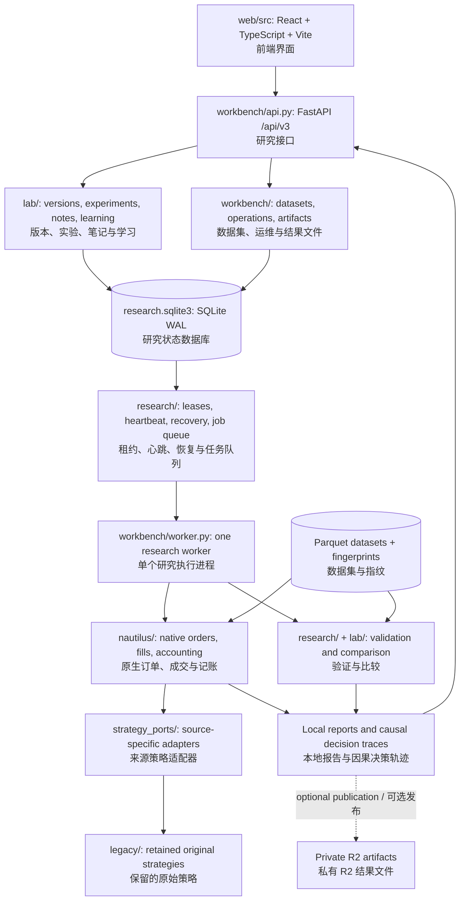
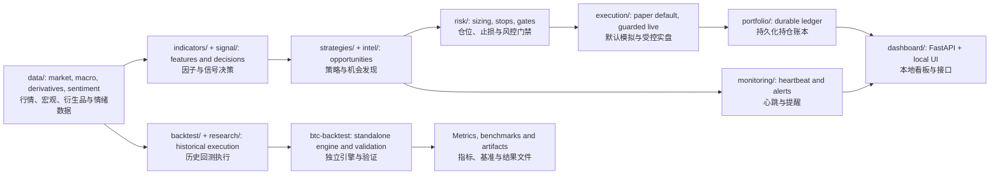
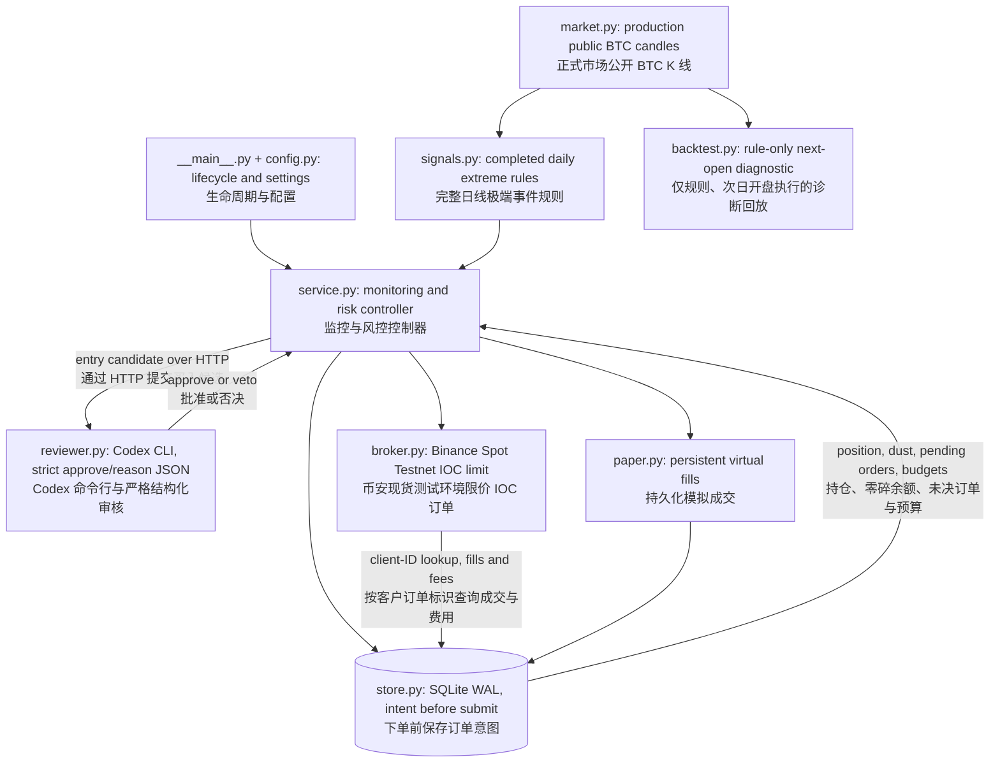
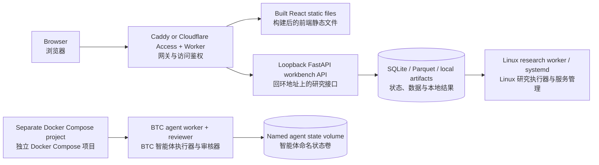

# QT technical architecture / 技术架构

The repo contains distinct runtimes. The research workbench, strategy monitor
and Codex agent have separate execution paths and state; they share selected
libraries rather than a single trading controller.
[Product guide](product-guide.md) · [Folder map](project-structure.md).

仓库包含不同的运行系统：研究工作台、策略监控和 Codex 智能体各有执行路径与状态，
共享部分库。[产品说明](product-guide.md) · [项目结构](project-structure.md)。

## Research workbench v3 / 研究工作台 v3

The API persists submissions; the worker owns execution and recovery. The UI
renders results, it does not run Python simulations. Native work needs Python
3.12+ and the declared research extras. SQLite is the v3 queue/metadata store;
PostgreSQL belongs to the older `platform/` runtime. Built-in and compatible
ported strategies run through the native bridge; custom plugins require the
separate isolated runtime and admission checks.

API 持久化提交的任务，执行器负责运行与恢复；前端仅展示结果，不在浏览器中执行 Python 回测。
原生研究需要 Python 3.12+ 和研究依赖。v3 用 SQLite 保存队列与元数据，PostgreSQL 属于旧版平台。
内置及兼容的来源策略通过原生桥接运行；自定义插件需要独立隔离环境和准入检查。

## Shared quant libraries and older strategy monitor / 公共量化库与旧版策略监控

`core/` supplies shared types/settings/logging; `reporting/` compares outcomes.
`scripts/run_all.py` runs enabled strategy/scanner threads; `run_service.py`
supervises the older paper service. The independent package owns its own data,
strategies, accounting, signals and reports. `strategy_ports/` preserves source
semantics rather than treating similarly named strategies as identical.

`core/` 提供类型、配置与日志，`reporting/` 比较结果。`scripts/run_all.py` 运行已启用的策略/扫描线程，
`run_service.py` 监护旧版模拟服务。独立回测包自带数据、策略、记账、信号和报告模块。
`strategy_ports/` 保留来源策略的行为语义，不把同名策略视为相同算法。

## Isolated Codex BTC agent / 独立 Codex BTC 智能体

- Worker container: exchange keys and persistent state; one writer per mode.
   执行容器持有交易所密钥和持久状态；每种模式仅允许一个写入进程。
- Reviewer container: only Codex authentication, no broker keys or state volume;
  fresh temporary home, disabled tools, schema validation and timeout.
   审核容器仅持有 Codex 鉴权，不接触交易所密钥或状态卷；使用临时目录、禁用工具、结构校验和超时限制。
- AI reviews new entries. Stops/trailing/time exits use fresh execution quotes
  without waiting for AI; a kill file blocks all new orders.
   AI 仅审核新买入；止损、跟踪止损及超时退出使用最新报价，无需等待 AI；停止文件会阻止所有新订单。
- Uncertain submission blocks further orders until reconciled. Terminal partial
  fills update inventory once; confirmed unsellable residuals remain tracked as dust.
   提交结果不明时阻止后续下单，直至完成对账；终态部分成交只记账一次，确认无法卖出的零碎余额仍保留记账。
- Signals use production public history; testnet liquidity supplies execution
  quotes. Modes are limited to paper/testnet, with separate SQLite ledgers.
   信号使用正式市场公开历史数据，测试环境流动性提供执行报价；仅支持模拟/测试模式，SQLite 账本分别保存。

## Deployment boundaries / 部署边界

Cloud configuration does not prove a deployed/authenticated service. Native
backtests run on the compute node, not the edge Worker. The older platform
Compose path uses SQLAlchemy/PostgreSQL and migrations; it is optional and
independent of v3 and the agent. Agent containers publish no host ports and
restart unless stopped; an awake host and external operational checks are still
needed. [Agent acceptance](verification/codex-btc-agent-acceptance.md) records
which integrations were tested and which remain pending.

云配置不代表已完成部署或鉴权验收。原生回测在计算节点执行，不在边缘 Worker 中执行。
旧版平台 Compose 使用 SQLAlchemy/PostgreSQL 和数据库迁移，与 v3 及智能体独立。
智能体容器不对主机公开端口；除非主动停止，否则故障后会自动重启。仍需保持主机运行并进行外部运维检查。
[智能体验收记录](verification/codex-btc-agent-acceptance.md)列出了已测试与待完成的集成。
