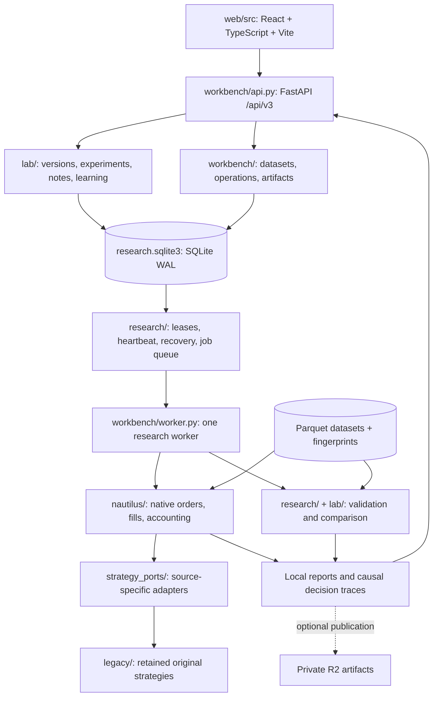
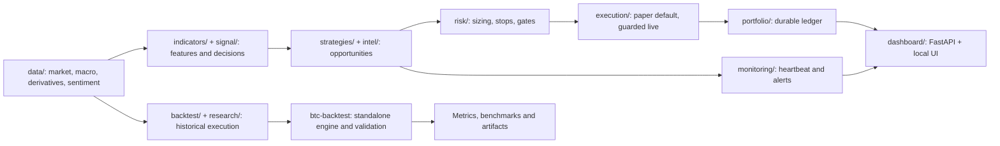
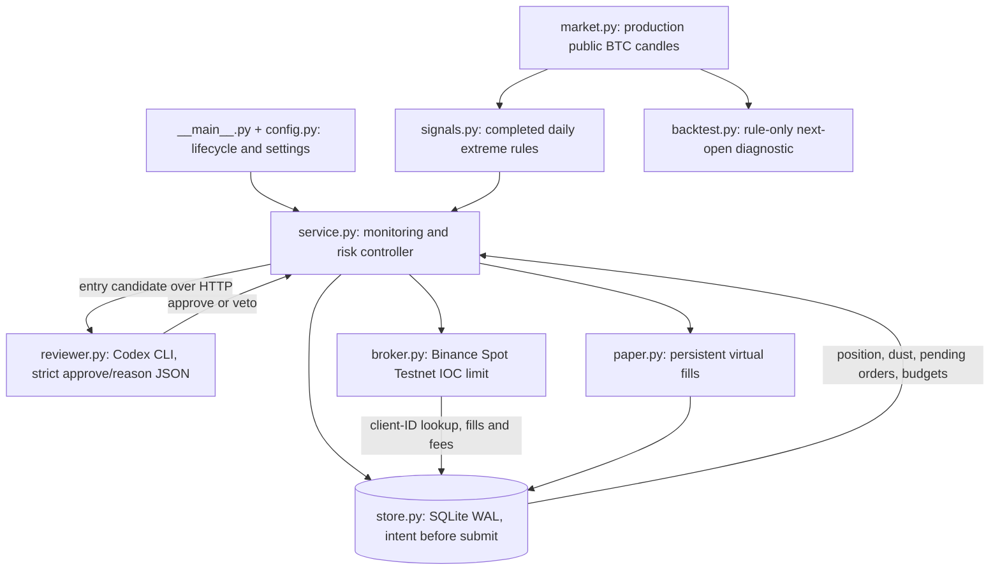
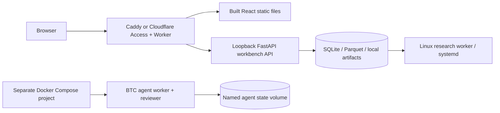

# QT technical architecture

The repo contains distinct runtimes. The research workbench, strategy monitor
and Codex agent have separate execution paths and state; they share selected
libraries rather than a single trading controller.
[Product guide](product-guide.md) · [Folder map](project-structure.md).

## Research workbench v3

The API persists submissions; the worker owns execution and recovery. The UI
renders results, it does not run Python simulations. Native work needs Python
3.12+ and the declared research extras. SQLite is the v3 queue/metadata store;
PostgreSQL belongs to the older `platform/` runtime. Built-in and compatible
ported strategies run through the native bridge; custom plugins require the
separate isolated runtime and admission checks.

## Shared quant libraries and older strategy monitor

`core/` supplies shared types/settings/logging; `reporting/` compares outcomes.
`scripts/run_all.py` runs enabled strategy/scanner threads; `run_service.py`
supervises the older paper service. The independent package owns its own data,
strategies, accounting, signals and reports. `strategy_ports/` preserves source
semantics rather than treating similarly named strategies as identical.

## Isolated Codex BTC agent

- Worker container: exchange keys and persistent state; one writer per mode.
- Reviewer container: only Codex authentication, no broker keys or state volume;
  fresh temporary home, disabled tools, schema validation and timeout.
- AI reviews new entries. Stops/trailing/time exits use fresh execution quotes
  without waiting for AI; a kill file blocks all new orders.
- Uncertain submission blocks further orders until reconciled. Terminal partial
  fills update inventory once; confirmed unsellable residuals remain tracked as dust.
- Signals use production public history; testnet liquidity supplies execution
  quotes. Modes are limited to paper/testnet, with separate SQLite ledgers.

## Deployment boundaries

Cloud configuration does not prove a deployed/authenticated service. Native
backtests run on the compute node, not the edge Worker. The older platform
Compose path uses SQLAlchemy/PostgreSQL and migrations; it is optional and
independent of v3 and the agent. Agent containers publish no host ports and
restart unless stopped; an awake host and external operational checks are still
needed. [Agent acceptance](verification/codex-btc-agent-acceptance.md) records
which integrations were tested and which remain pending.
